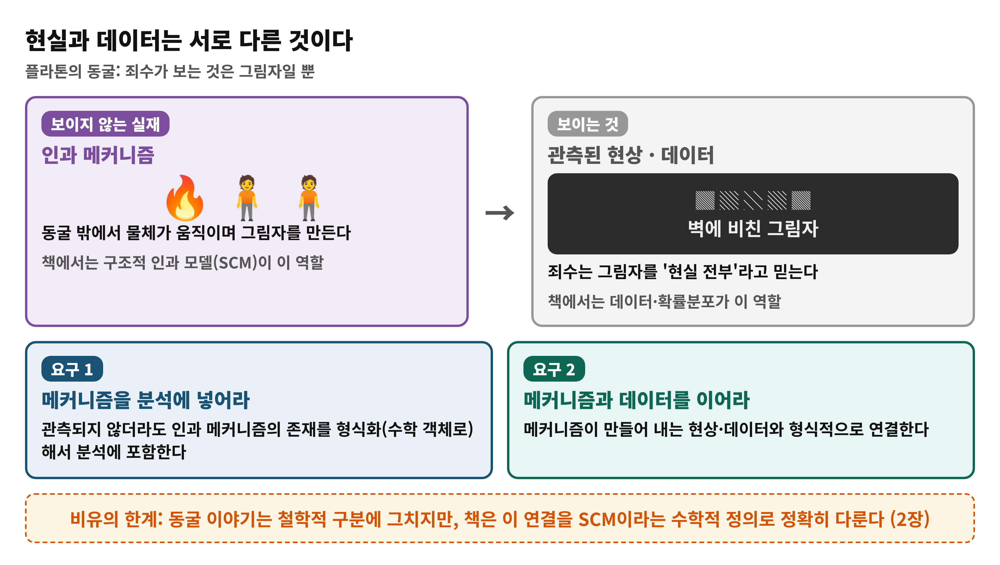
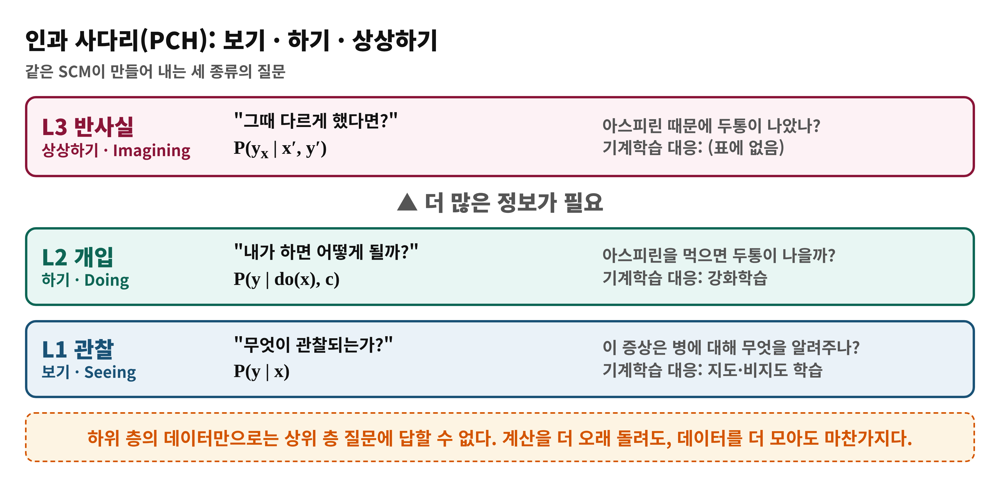
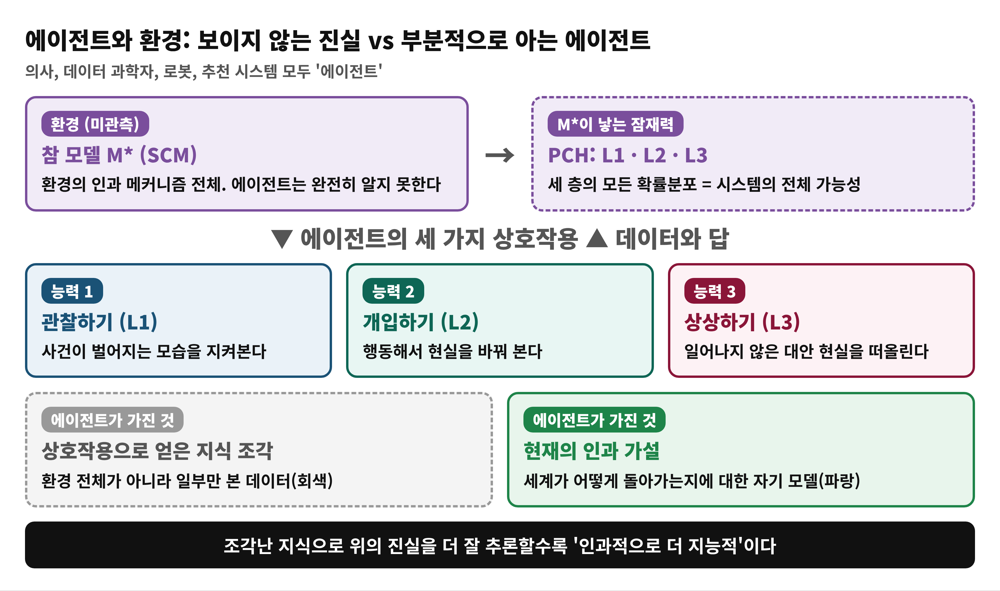
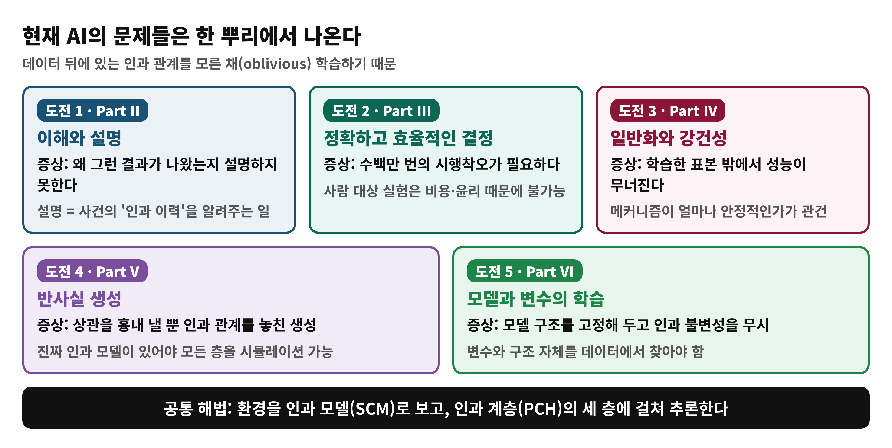
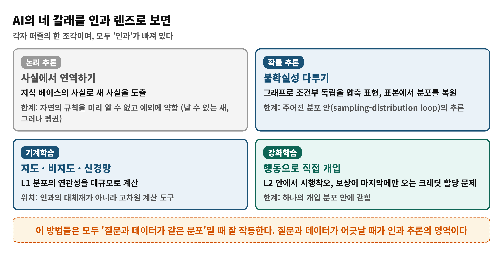

# Day 1 — 왜 '인과 AI'인가 (학습 노트)

> 근거: Causal Artificial Intelligence, PDF 13–35쪽 (인쇄 1–23) · Preface, 1.1–1.3.3 · 독자 수준: 입문
> 쪽 번호는 PDF 기준이며 인쇄 번호 = PDF − 12

## 한눈에 보기
- **이 범위가 푸는 문제**: 왜 지금의 AI는 안전성·설명 가능성·일반화에서 막히는가?
- **결론 한 줄**: 데이터 뒤에 있는 **인과 메커니즘을 모르고** 학습하기 때문이며, 책은 이를 SCM과 인과 사다리(PCH)로 정식화한다.
- **읽고 나면**: 보기·하기·상상하기의 차이를 설명하고, AI의 다섯 가지 도전을 인과 관점으로 말할 수 있다.

## 왜 필요한가
Preface의 가설은 이렇다. 현재 AI의 문제들(안전성·해석 가능성·설명 가능성 부족, 표본 비효율과 확장성, 약한 강건성·일반화, 의도와 어긋나는 생성)은 **데이터 밑에 깔린 인과 관계를 모른다는 한 가지 원인**에서 나온다. 튜링은 "경험에서 배우는 기계"를 목표로 삼았지만, 그 '경험'이 정확히 무엇인지는 비어 있었다. 이 책은 그 빈칸을 인과 사다리로 채운다 (1.3.1절).

## 용어 준비
| 용어 | 한 줄 뜻 | 예 |
|---|---|---|
| 인과 지능 (causal intelligence) | 인과 관계를 학습하고 활용하는 인지 능력 | 의사가 증상에서 원인을 추리 |
| SCM (structural causal model) | 세계의 인과 메커니즘을 함수와 불확실성으로 적은 모델 | 약 → 두통 완화의 메커니즘 |
| PCH (Pearl Causal Hierarchy) | 보기·하기·상상하기 세 층의 질문 체계 | 표 1.1의 아스피린 예 |
| 에이전트 (agent) | 환경과 상호작용하는 모든 주체 | 의사, 로봇, 추천 시스템 |
| 월드 모델 (world model) | 책에서는 SCM 의미를 갖는 인과 모델 | 개입·반사실 추론이 가능한 모델 |

## 개념 1. 인과 지능
**비유**: 아이는 작은 과학자다. "만약 ~하면?", "왜?"라고 묻고 직접 만져 보며 가설을 검증한다.

| 비유 | 개념 |
|---|---|
| 묻기 | 인과 질문 |
| 만져 보기 | 개입 |
| 세운 가설 | 인과 모델 |

> **비유의 한계**: 아이의 직관은 형식화되어 있지 않다. 이 책의 핵심은 그 능력을 **수학과 알고리즘**으로 다룬다는 점이다.

책은 계획, 책임 판단, 대안 상상, 환경 변화에 대한 일반화가 모두 이 능력 위에 선다고 본다 (1.1절). 또 컴퓨터가 20세기에 형식화를 거쳐 공학이 되었듯, 인과도 형식화를 거쳐 AI에 들어와야 한다고 주장한다.

## 개념 2. 현실과 데이터는 다르다 (1.2절)
- 인과 메커니즘은 보이지 않지만 관측 가능한 흔적(데이터)을 남긴다.
- 플라톤의 동굴: 죄수는 벽의 그림자를 현실 전부로 믿는다.
- 틀이 갖춰야 할 요구 두 가지: **(1)** 메커니즘을 분석에 형식화해 넣는다. **(2)** 메커니즘과 그 산출물(데이터)을 형식적으로 연결한다.

> **비유의 한계**: 동굴 이야기는 철학적 구분에 머물지만, 책은 이 연결을 SCM이라는 수학적 정의로 다룬다 (2장).

## 개념 3. 인과 사다리 PCH (1.2절, 표 1.1)
| 층 | 활동 | 질문 | 기호 | 예 | 기계학습 대응 |
|---|---|---|---|---|---|
| L1 연관 | 보기 | 무엇이 관찰되나? | P(y\|x) | 증상이 병에 대해 알려주는 것 | 지도·비지도 학습 |
| L2 개입 | 하기 | 내가 하면? | P(y\|do(x), c) | 아스피린을 먹으면 나을까? | 강화학습 |
| L3 반사실 | 상상하기 | 왜? 다르게 했다면? | P(y_x \| x′, y′) | 아스피린 때문에 나았나? | (표에 없음) |

**비유**: 자전거. 보기 = 남이 타는 걸 구경, 하기 = 직접 타 보기, 상상하기 = "그때 핸들을 반대로 꺾었다면?"

> **비유의 한계**: 자전거 경험은 한 사람이 쌓아 가지만, PCH의 층은 **정보의 종류**가 다르다. 구경만 아무리 해도 L2 질문에 답할 수 없다.

**PCH는 계산 난이도와 다른 축이다.** 촘스키 위계나 P·NP는 계산 자원을 제한하지만, PCH에서는 계산 시간·공간·데이터를 더 늘려도 상위 층 질문에 답하지 못한다. 계산·통계·인과는 서로 보완적인 세 축이다.

## 개념 4. 에이전트와 환경 (1.3.1절)
환경은 에이전트가 완전히 알지 못하는 SCM **M\***이고, 에이전트는 세 가지 방식(관찰, 개입, 상상)으로 상호작용한다. 에이전트가 가진 것은 환경 전체가 아니라 **조각난 데이터**와 **현재의 인과 가설**이다. 이 조각들로 M\*에 대해 더 잘 추론할수록 인과적으로 더 지능적이다.

**월드 모델**: 책은 (1) 개입 하의 예측, (2) 반사실 추론, (3) 데이터로의 검증·반증 가능성을 갖춘 인과 모델만 진짜 월드 모델로 본다. 이는 책의 정의이며, 다른 문헌의 사용과 다를 수 있다.

## 개념 5. AI의 다섯 가지 도전 (1.3.2절)
| 도전 | 증상 | 책의 파트 |
|---|---|---|
| 이해와 설명 | 왜 그런지 설명하지 못함 | II |
| 정확·효율적 결정 | 수백만 번의 시행착오 | III |
| 일반화·강건성 | 표본 밖에서 성능 저하 | IV |
| 반사실 생성 | 상관을 흉내 낸 생성 | V |
| 모델·변수 학습 | 구조를 고정하고 인과 불변성을 무시 | VI |

## 개념 6. 현재 AI를 인과 렌즈로 (1.3.3절)
- **논리 추론**: 사실에서 연역한다. 자연의 규칙을 미리 알 수 없고 예외(날 수 있는 새 vs 펭귄)에 약하다.
- **확률 추론**: 그래프로 조건부 독립을 압축해 표현한다. 주어진 분포 안의 추론이다.
- **기계학습**: L1 분포의 연관성을 대규모로 계산하는 도구다. 인과의 대체재가 아니다.
- **강화학습**: L2 안에서 시행착오로 배운다. 하나의 개입 분포 안에 갇혀 있고, 보상이 끝에만 오는 크레딧 할당 문제가 있다.

**sampling-distribution loop**: (보이지 않는 진실, 그 분포에서 뽑은 표본, 진실을 복원하는 절차) 세 요소의 고리다. 대수의 법칙처럼 '옳은 답'은 그 고리 안에서만 정의되며, 질문과 데이터가 다른 분포이면 고리 밖으로 나가야 한다 (Day 2).

## 흔한 오해
- ❌ "데이터를 충분히 모으면 인과 질문에도 답할 수 있다" → ✅ 데이터와 계산을 늘려도 L2·L3 질문은 풀리지 않는다.
- ❌ "강화학습은 이미 인과적이다" → ✅ L2의 하나의 개입 분포 안에서 학습할 뿐이다.
- ❌ "신경망이 뇌를 모방하니 충분하다" → ✅ 현재 ML과 신경과학의 연결은 대체로 영감 수준이다.

## 정리
1. 현재 AI의 한계는 인과 관계에 대한 무지에서 나온다.
2. 현실(SCM)과 데이터는 다르며, 이를 형식적으로 잇는 것이 출발점이다.
3. PCH의 세 층은 보기(L1), 하기(L2), 상상하기(L3)다.
4. 에이전트는 조각난 지식으로 SCM을 추론하며, 그 능력이 인과 지능이다.
5. 다섯 도전이 책의 파트 II–VI이다.

## 이해 점검 퀴즈
**Q1. (개념 확인)** 이 책이 말하는 '인과 지능'에 가장 가까운 것은?
- A) 대규모 데이터에서 패턴을 가장 잘 찾아내는 능력
- B) 인과 관계를 학습하고 활용하는 인지 능력
- C) 주어진 규칙에서 정답을 연역해 내는 능력
- D) 사람의 말투와 행동을 흉내 내는 능력

정답 및 해설

정답: **B**. 책은 인과 지능을 "인과 관계를 배우고 이용하는 인지 능력"으로 정의한다. A는 L1 연관성, C는 논리 접근의 특징, D는 튜링 테스트식 관점이다.

**Q2. (적용)** 병원 기록에 "아스피린을 먹은 환자가 두통이 덜했다"는 관찰만 있다. "내가 지금 먹으면 나을까?"에 대해 맞는 것은?
- A) L1 질문이며 이 기록으로 충분히 답할 수 있다
- B) L2 질문이며 이 기록만으로는 일반적으로 답할 수 없다
- C) L3 질문이며 기록이 많을수록 정확히 답할 수 있다
- D) 질문이 아니라 사실이므로 추론이 필요 없다

정답 및 해설

정답: **B**. 행동의 효과는 P(y | do(x)), 곧 L2다. 관찰(L1)만으로는 일반적으로 답할 수 없고 인과 가정이 필요하다. C는 L3가 '그때 안 먹었다면'의 질문이므로 틀리고, 기록량을 늘려도 층이 올라가지 않는다.

**Q3. (오개념 교정)** 다음 중 **틀린** 설명은?
- A) PCH의 세 층은 같은 SCM에서 나온다
- B) 데이터를 충분히 모으면 L1 데이터만으로도 L3 질문에 답할 수 있다
- C) 계산 자원을 늘려도 상위 층 질문에 답하지 못할 수 있다
- D) 강화학습은 L2의 개입 분포 안에서 학습하는 방법으로 볼 수 있다

정답 및 해설

정답: **B**. 계산도 데이터량도 층 사이의 간극을 메우지 못한다(2장의 인과 계층 정리가 정식화). A, C, D는 맞는 설명이다.

## 다음 날로 이어지는 고리
조각난 지식으로 M\*을 추론하려면 질문·데이터·가정을 어떻게 다뤄야 할까? Day 2는 이를 '인과 추론 엔진'과 책 전체 지도로 정리한다.
