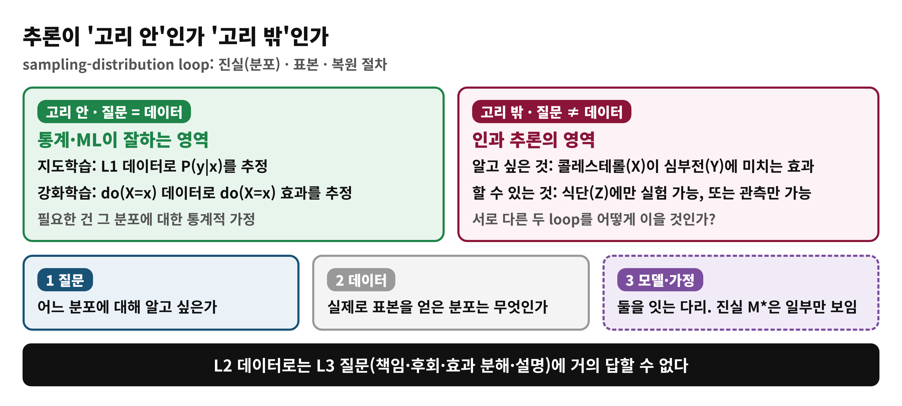
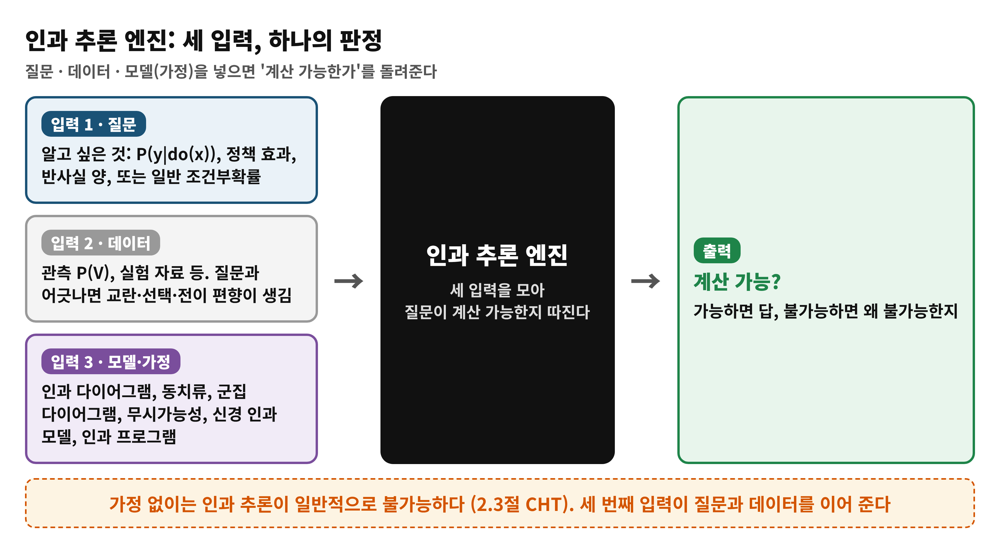
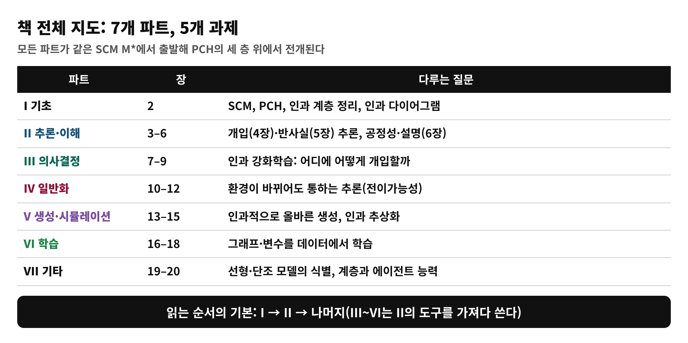
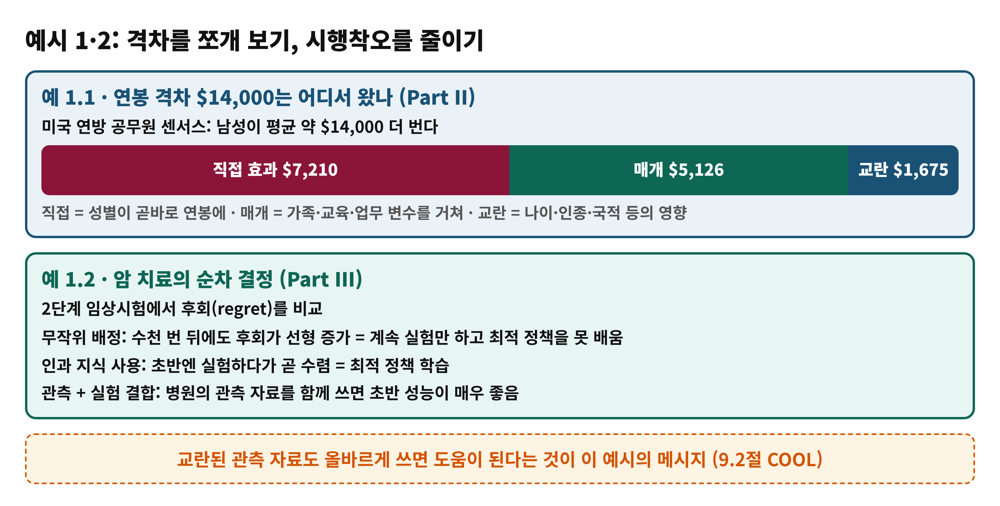
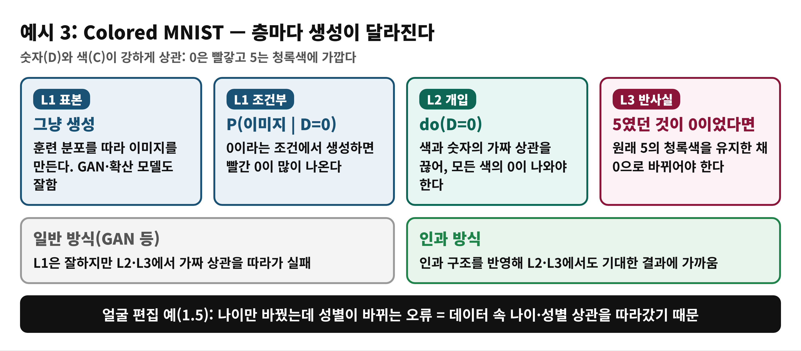

# Day 2 — 책 전체 지도와 인과 추론 엔진 (학습 노트)

> 근거: Causal Artificial Intelligence, PDF 36–52쪽 (인쇄 24–40) · 1.3.3 끝 ~ 1.3.5 (Detailed Book Tour) · 독자 수준: 입문
> 쪽 번호는 PDF 기준이며 인쇄 번호 = PDF − 12

## 한눈에 보기
- **이 범위가 푸는 문제**: 서로 다른 AI 과제들을 하나의 틀로 어떻게 묶는가?
- **결론 한 줄**: **질문 · 데이터 · 가정** 세 입력을 인과 추론 엔진에 넣어 '계산 가능한가'를 따진다. 책의 7개 파트는 이 틀 위에서 펼쳐진다.
- **읽고 나면**: 추론이 '고리 안/밖'인지 구분하고, 책의 지도와 예시 역할을 설명할 수 있다.

## Day 1에서 이어받은 것
환경은 보이지 않는 SCM(M∗)이고 PCH의 세 층이 거기서 나온다. 에이전트는 보기·하기·상상하기로 조각난 지식을 얻는다. 다섯 도전이 파트 II–VI에 대응한다.

## 개념 1. 고리 안과 고리 밖 (1.3.3절 끝)
- **고리 안**: 질문과 데이터가 같은 분포다. 지도학습은 L1 데이터로 P(y|x)를, 강화학습은 do(X=x) 데이터로 do(X=x) 효과를 추정한다. 필요한 것은 그 분포에 대한 통계적 가정뿐이다.
- **고리 밖**: 질문과 데이터가 다른 분포다. 예를 들어 콜레스테롤(X)이 심부전(Y)에 미치는 효과를 알고 싶은데 식단(Z)에만 실험할 수 있는 경우, do(X)와 do(Z)는 서로 다른 고리라서 저절로 이어지지 않는다.
- L2 데이터로는 L3 질문(책임, 후회, 효과 분해, 설명)에 거의 답할 수 없다.

**비유**: 교실 CCTV 영상(관찰)만으로 "자리를 바꾸면 성적이 어떻게 될까?"(개입)를 맞히려는 상황.

| 비유 | 개념 |
|---|---|
| CCTV 영상 | L1 데이터 |
| 자리 바꾸기 | do(X) |
| 영상으로 답하려는 질문 | 고리 밖 질문 |

> **비유의 한계**: 책은 실험이 불가능한 경우(윤리·비용)까지 포함해 **가정으로 두 분포를 잇는** 방법을 다룬다. 비유는 관찰과 개입의 구분만 보여준다.

## 개념 2. 인과 추론 엔진 (1.3.4절)
세 입력을 받아 질문이 계산 가능한지 따지는 엔진이다.
1. **질문**: 알고 싶은 것. P(y|do(x)), 정책 개입, 반사실 양, 일반 조건부확률.
2. **데이터**: 관측 P(V), 실험 자료 등. 질문과 어긋나면 교란, 선택, 전이 편향이 생긴다.
3. **모델·가정**: 인과 다이어그램, 동치류, 군집 다이어그램, 무시가능성, 신경 인과 모델, 인과 프로그램.

가정 없이는 인과 추론이 일반적으로 불가능하다 (2.3절의 CHT). 세 번째 입력이 질문과 데이터를 이어 준다. 책은 이 엔진을 암묵적으로 두지 않고 중심에 명시적으로 둔다.

## 개념 3. 책의 지도 (1.3.4–1.3.5절)
| 파트 | 장 | 과제와 핵심 질문 |
|---|---|---|
| I 기초 | 2 | SCM, PCH, CHT, 인과 다이어그램, d-분리 |
| II 추론·이해 | 3–6 | 개입(4), 반사실(5), 공정성·설명(6) |
| III 의사결정 | 7–9 | 인과 강화학습: 어디에 어떻게 개입할까 |
| IV 일반화 | 10–12 | 환경이 바뀌어도 통하는 추론 |
| V 생성·시뮬레이션 | 13–15 | 인과적으로 올바른 생성, 인과 추상화 |
| VI 학습 | 16–18 | 그래프·변수를 데이터에서 학습 |
| VII 기타 | 19–20 | 선형·단조 모델 식별, 계층과 에이전트 능력 |

### 파트별 한 줄 요약
- **Part II**: 개입 효과를 미리 알 수 있는가, 책임과 공정성은 어떻게 판단하는가. 개입은 do-calculus, 반사실은 ctf-calculus와 식별 알고리즘, 식별 불가일 때는 부분 식별(경계)을 쓴다.
- **Part III**: RL과 인과 추론은 같은 구성요소(반사실 관계)의 다른 측면이다. 오프라인→온라인(COOL), 어디에 개입할지, 반사실 의사결정, 인과 모방학습, 인과 게임이론을 다룬다.
- **Part IV**: 학습한 환경과 배포 환경이 다를 때 무엇이 공유되는가를 L1(분류기) → L2(정책) → L3(설명) 순으로 따진다.
- **Part V**: 참 모델 M∗은 일반적으로 학습할 수 없으므로 대리 모델을 만든다. 생성 모델이 곧 인과 모델은 아니다.
- **Part VI**: 그래프를 모를 때 동치류, 관측+실험 결합, 다중 도메인, 변수 학습을 다룬다.

## 예시로 맛보기 (1.3.5절)

| 예 | 파트 | 내용 |
|---|---|---|
| 1.1 연봉 격차 | II | 남녀 평균 연봉 차 약 $14,000를 직접 $7,210, 매개 $5,126, 교란 $1,675로 분해 |
| 1.2 암 치료 | III | 인과 지식을 쓰면 후회가 수렴하고, 관측 자료를 결합하면 초반 성능이 좋음 |
| 1.3 일반화 | IV | 본문이 자리표시 문구(Lorem ipsum)로 되어 있음 |
| 1.4 Colored MNIST | V | L1·L2·L3 각 층의 생성 과제 비교 |
| 1.5 얼굴 편집 | V | 나이를 바꿀 때 성별 등 다른 특성이 변하지 않아야 함 |
| 1.6 인간·보노보 뇌 | VI | 관측과 병변 실험을 합쳐 뇌 영역 간 인과 구조 추정 |

**이 PDF를 읽을 때 주의**: 'Ch. ??' 참조가 비어 있고, 서문의 파트 번호와 본문의 파트 번호가 어긋나는 곳이 있다(서문은 생성 모델을 VI, 학습을 V로 적음). 초안 상태로 보이므로 목차(toc)의 번호를 기준으로 삼는다.

## 흔한 오해
- ❌ "인과 추론이란 곧 그래프를 그리는 일" → ✅ 그래프는 가정을 적는 한 방법이다. 엔진은 질문·데이터·가정을 함께 본다.
- ❌ "강화학습으로 실험하면 모든 인과 질문이 풀린다" → ✅ do(X)와 do(Z)는 다른 고리다.
- ❌ "생성 모델이 잘 만들어지면 인과 모델이다" → ✅ 상관을 흉내 내는 생성은 L2·L3에서 틀릴 수 있다.

## 정리
1. 추론은 질문과 데이터가 같은 분포인가(고리 안/밖)로 나뉜다.
2. 인과 추론 엔진은 질문·데이터·가정을 받아 계산 가능 여부를 판정한다.
3. 책은 이해 → 결정 → 일반화 → 생성 → 학습으로 전개된다.
4. Day 3부터 틀의 재료인 SCM과 PCH를 수학적으로 정의한다.

## 이해 점검 퀴즈
**Q1. (개념 확인)** 'sampling-distribution loop 안의 추론'이 가리키는 상황은?
- A) 질문의 분포와 데이터의 분포가 같은 경우
- B) 인과 가정 없이 반사실을 추론하는 경우
- C) 데이터가 전혀 없는 경우
- D) 질문이 항상 L3인 경우

정답 및 해설

정답: **A**. 질문과 데이터가 같은 분포이면 통계적 추정만으로 충분하다. B는 고리 밖이며 일반적으로 불가능하고, C는 표본이 없어 고리가 성립하지 않으며, D는 층과 무관하게 일치 여부가 기준이다.

**Q2. (적용)** 콜레스테롤(X)의 효과를 알고 싶지만 X는 직접 조작할 수 없고 식단(Z)에는 실험이 가능하다. 가장 잘 설명하는 것은?
- A) do(X)와 do(Z)는 서로 다른 고리이며 연결하려면 가정이 필요하다
- B) 식단 실험 자료만으로 do(X) 효과를 항상 얻을 수 있다
- C) 관측 자료가 충분하면 가정은 필요 없다
- D) 이 문제는 지도학습으로 풀 수 있다

정답 및 해설

정답: **A**. 책은 do(Z) 자료로 do(X) 효과를 저절로 알 수 없다고 말한다. B의 '항상'은 틀리고, C는 가정 없이 일반적으로 불가능하며(CHT), D의 지도학습은 L1 연관성을 다룬다.

**Q3. (오개념 교정)** 인과 추론 엔진에 대한 설명 중 **틀린** 것은?
- A) 입력은 질문, 데이터, 모델(가정)이다
- B) 출력은 질문이 계산 가능한지에 대한 판정이다
- C) 가정 없이 데이터만 넣어도 어떤 인과 질문이든 답한다
- D) 가정은 인과 다이어그램 외에도 여러 형태로 표현될 수 있다

정답 및 해설

정답: **C**. 데이터만으로는 인과 질문에 일반적으로 답할 수 없다. A, B, D는 맞는 설명이다.

## 다음 날로 이어지는 고리
틀의 재료를 정확히 정의할 차례다. Day 3은 SCM = ⟨U, V, F, P(U)⟩와 세 층의 평가(valuation)를 읽는다 (PDF 55–65쪽).
