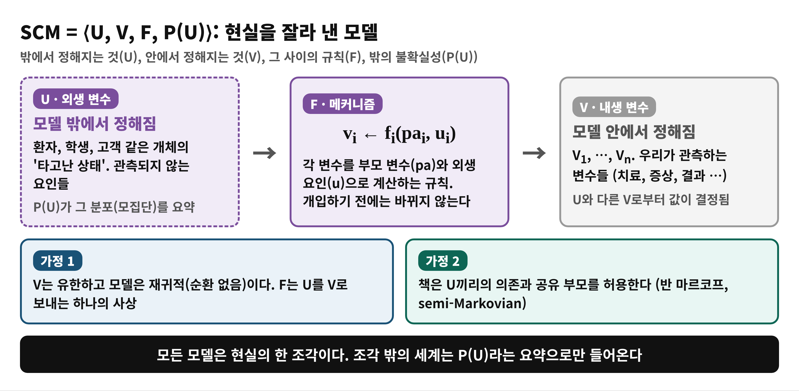
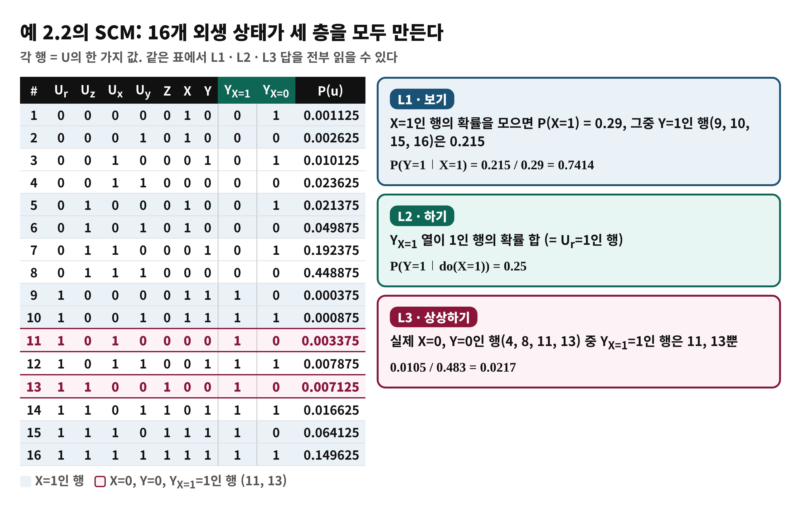
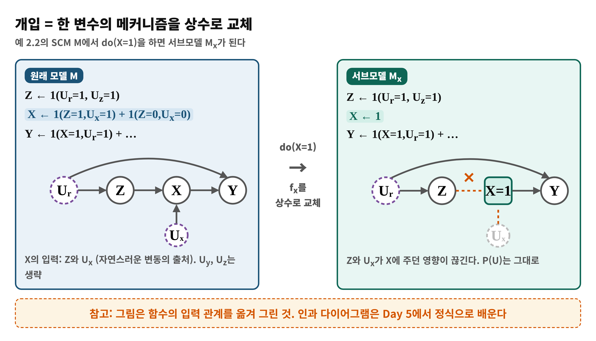
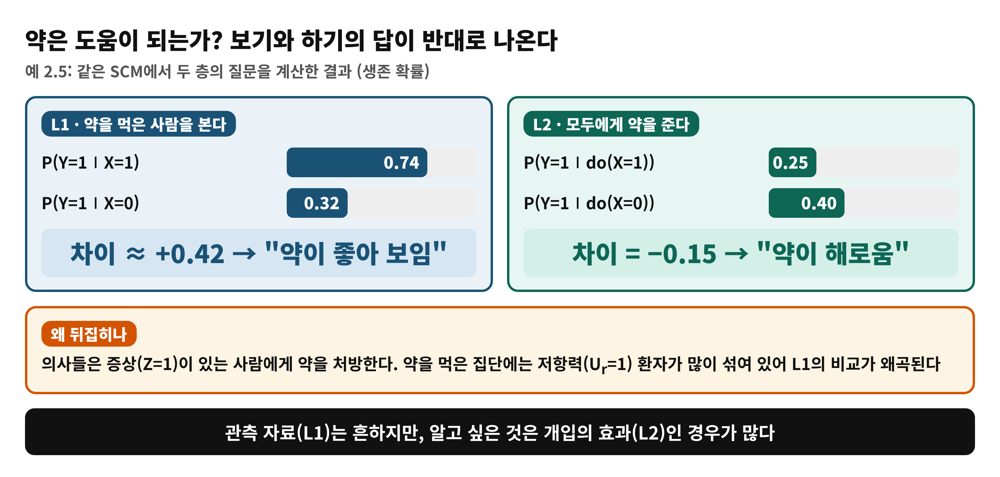
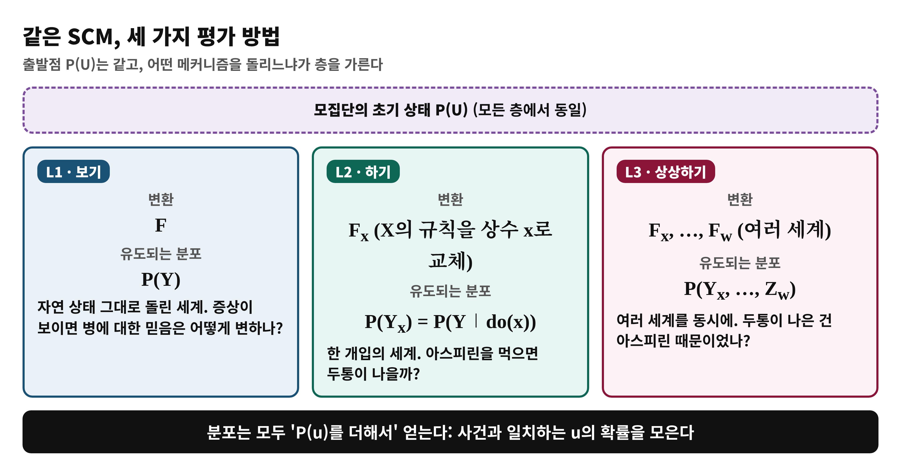

<!--
  book-explainer · Day 3 (PDF 55–65쪽) · Causal Artificial Intelligence
  빌드: python build_pptx.py day03.md
-->

# Day 3 — 구조적 인과 모델(SCM)과 인과 사다리의 세 층

**책**: Causal Artificial Intelligence · **범위**: PDF 55–65쪽 (인쇄 43–53) · 2장 도입, 2.1 SCM, 2.2 PCH · **수준**: 입문

---

# 한눈에 보기
<!-- _class: small -->

- **이 범위가 푸는 문제**
  - 같은 세계에서 '보기·하기·상상하기'가 왜 서로 다른 질문이 되는가?
- **결론 한 줄**
  - 세계를 **SCM = ⟨U, V, F, P(U)⟩** 로 적으면, 메커니즘 F를 그대로 돌리면 L1, 일부를 상수로 바꿔 돌리면 L2, 여러 세계를 동시에 돌리면 L3 분포가 나온다
- **읽고 나면**
  - SCM의 네 부품을 설명하고, 한 표(예 2.2)에서 L1·L2·L3 확률을 직접 계산할 수 있다

---

# Day 2에서 이어받은 것

- 에이전트가 사는 환경은 보이지 않는 **참 모델 M∗**이다
- 인과 추론 엔진은 **질문 · 데이터 · 가정**을 받아 '계산 가능한가'를 따진다
- 오늘은 그 M∗의 정체인 **SCM을 수학적으로 정의**한다 (2.1절)
- 오늘의 질문: **같은 SCM에서 세 종류의 질문은 어떻게 갈라지는가?**

---

# 왜 필요한가 — 말로는 같은 '효과'인데 답이 다르다

- 병원 기록에서 약을 먹은 환자의 생존율이 높다 → "약이 효과 있다"?
- 모두에게 약을 억지로 먹이면 생존율은 오히려 **떨어질 수 있다** (예 2.5)
- 이미 사망한 환자에게 "그때 약을 줬다면?"을 묻는 질문도 있다 (예 2.6)
- 세 질문을 **하나의 모델**에서 **정확히** 구분해 계산할 도구가 필요하다 → SCM
- 책은 SCM이 기존의 인과 접근 대부분을 포괄하는 형식이라고 설명한다 (p.56)

---

# 용어 준비
<!-- _class: small -->

| 용어 | 한 줄 뜻 | 예 |
|:---|:---|:---|
| 외생 변수 U (exogenous) | 모델 밖에서 정해지는 배경 요인 | 환자의 타고난 저항력 |
| 내생 변수 V (endogenous) | 모델 안의 다른 변수들로 정해지는 변수 | 치료 X, 생존 Y |
| 메커니즘 F | 변수를 부모와 U로 계산하는 함수 모음 | y ← f(x, u) |
| 서브모델 M_x | X의 메커니즘을 상수 x로 교체한 모델 | 모두에게 약 투여 |
| 잠재결과 Y_x(u) | 개체 u에게 개입 x를 했을 때의 Y | 이 환자가 약을 먹었다면 |

---

# 개념 1 — SCM의 네 부품
<!-- _class: small -->

Definition 2.1.1 (p.56): U, V, F, P(U)

---

# 개념 1 — 비유로 이해하기: 보드게임
<!-- _class: small -->

- **비유**
  - 규칙집(F)은 고정, 주사위(U)가 매번 달라서 말의 위치(V)가 달라진다
- **개념 대응**
  - 규칙집 = F · 주사위 눈 = U · 주사위의 확률 = P(U) · 보드 위 말의 위치 = V
- **핵심**
  - 같은 규칙집이라도 주사위가 다르면 결과가 다르다. 규칙을 한 줄 바꾸는 것이 곧 '개입'이다
- **비유의 한계**
  - 실제 환경에서 U는 보이지 않고 F도 모른다. 책은 이를 모르는 채 추론하는 법을 다룬다

---

# 개념 1 — 가장 작은 예: 주사위 SCM (예 2.1)
<!-- _class: small -->

- 두 주사위 U1, U2를 굴리고, **합 X와 차 Y만** 관측한다
- 메커니즘: X ← U1 + U2, Y ← U1 − U2, 각 눈의 확률은 1/6
- 이것이 완전히 명시된 SCM M1이다 (p.57)

$$
P(U_1=k)=P(U_2=k)=\frac{1}{6},\quad k=1,\dots,6
$$

- 관측되는 쪽은 V = {X, Y}, 보이지 않는 쪽은 U = {U1, U2}
- 앞으로 L1·L2 예에서 계속 쓰인다

---

# 개념 1 — 의학 SCM (예 2.2)
<!-- _class: small -->

- **변수**: X 치료(약), Y 생존, Z 증상(고혈압), 외생 U_r(저항력), U_x, U_y, U_z
- **메커니즘의 이야기**
  - 저항력(U_r=1)이 있으면 치료와 무관하게 생존하기 쉽다
  - 증상(Z=1)이 있으면 의사가 약(X=1)을 처방한다
  - 약은 저항력 있는 환자에게 도움이 되고, 없는 환자에게는 해롭다
- **확률**: P(U_r=1)=0.25, P(U_z=1)=0.95, P(U_x=1)=0.9, P(U_y=1)=0.7
- 외생 상태 16가지(표 2.2)가 모든 계산의 재료다

---

# 개념 2 — Layer 1: 보기 (Definition 2.2.1)
<!-- _class: small -->

- **절차**
  - ① 개체 u마다 Nature가 F를 순서대로 평가한다
  - ② 사건 Y=y와 맞는 u의 확률 P(u)를 모두 더한다
- **주사위 예**
  - U=(1,1)일 때 X=2, Y=0이고 이는 그 조합뿐이므로 P(X=2, Y=0) = 1/36
  - P(Y=0)=1/6인데 X=2를 알면 P(Y=0∣X=2)=1이다. 합이 2이면 차는 반드시 0
- **의학 예 (예 2.3)**
  - P(Y=1∣X=1) = 0.215 / 0.29 = 0.7414, P(Y=1∣X=0) = 0.3197

---

# 개념 2 — 한 표에서 세 층이 나온다
<!-- _class: small -->

예 2.2의 16개 외생 상태와 L1·L2·L3 계산 (표 2.2 + 잠재결과 열)

---

# 개념 3 — 개입은 '메커니즘 교체' (Definition 2.2.2–2.2.3)
<!-- _class: small -->

서브모델 M_x와 잠재결과 Y_x(u) (p.60)

---

# 개념 3 — Layer 2: 하기 (Definition 2.2.4–2.2.5)
<!-- _class: small -->

- **절차**: ① X의 규칙을 상수로 교체 → ② 각 u마다 F_x 평가 → ③ Y_x=y와 맞는 P(u)를 더하기
- **표기**: P(Y_x) 를 P(Y∣do(x)) 로 쓴다. do(x)는 조건부 식 전체에 적용된다 (식 2.9)
- **Effectiveness**: do(x)를 하면 X=x일 확률이 1이다. 자연스러운 변동의 출처와 끊어졌기 때문이다
- **예 2.4 (속이는 관찰자)**: 합을 2라고 허위 보고해도 차는 안 바뀐다
  - P(Y=0∣do(X=2)) = P(Y=0) = 1/6 이고, 관측 P(Y=0∣X=2)=1과 다르다
  - X는 Y에 인과 효과가 없다

---

# 개념 3 — 보기와 하기의 반전 (예 2.5)
<!-- _class: small -->

모두에게 약을 투여하면 (X ← 1) 어떻게 되는가

---

# 개념 4 — Layer 3: 상상하기 (Definition 2.2.6)
<!-- _class: small -->

- **새로운 점**: 서로 다른 아래첨자(다른 세계)가 한 식에 함께 들어간다
- **절차**: 세계마다 해당 메커니즘을 교체 → 각 세계에서 같은 u를 평가 → 조건에 맞는 P(u)를 더하기
- **예 2.6**: 약 없이 사망한 환자가 약을 받았다면 살았을까?
  - P(Y_{X=1}=1 ∣ X=0, Y=0) = 0.0105 / 0.483 ≈ 0.0217
  - 약을 줬어도 약 2%만 살았을 것이다. 약은 그 죽음을 막지 못했다
- **분모는 L1**, **분자는 두 세계를 동시에 보는 L3**이므로 실험으로 직접 얻을 수 없다

---

# 개념 4 — 세 층 한눈에 (Figure 2.6)
<!-- _class: small -->

같은 P(U)에서 출발해 다른 변환을 적용한다

---

# 개념 4 — L3의 여러 양
<!-- _class: small -->

- **필요 확률 PN**: P(y′_{x′} ∣ x, y) — 노출·질병이 실제 일어났을 때, 노출이 없었다면 질병이 없었을 확률
- **충분 확률 PS**: P(y_x ∣ x′, y′) — 노출되지 않은 건강한 사람이 노출됐다면 질병에 걸렸을 확률
- **PNS**: P(y_x, y′_{x′}) — 필요하면서 충분할 확률, '왜'라는 질문의 핵심
- **중첩 반사실**: Y_{x, M_{x′}} 로 간접 효과를 정의 (5장에서 자세히)
- 용도: 책임 소재, 공정성 분석, 설명 (p.65)

---

# 수식 풀이 (1) — L1: 관측 분포
<!-- _class: small -->

$$
P(y)=\sum_u \mathbf{1}\,(Y(u)=y)\,P(u)
$$

- **P(y)**: 변수 Y가 y일 확률
- **Y(u)**: 외생 상태 u에서 F를 평가한 Y의 값
- **1(·)**: 괄호 안이 참이면 1, 아니면 0 (지시 함수)
- **합 ∑_u**: 모든 외생 상태에 대해 더한다
- 말로: "Y=y가 되는 u들의 확률을 전부 모은 것"이다 (식 2.4)

---

# 수식 풀이 (2) — L2: 개입 분포
<!-- _class: small -->

$$
P(y_x)=\sum_u \mathbf{1}\,(Y_x(u)=y)\,P(u)
$$

- L1 식에서 Y(u)를 **서브모델의 Y_x(u)** 로 바꿨을 뿐이다 (식 2.8)
- P(y_x)를 P(y∣do(x))로 쓴다. 조건이 있으면 do(x)가 식 전체에 적용된다
- 평균 인과 효과: E(Y_{X=1}) − E(Y_{X=0})
- 예 2.5: u 중 U_r=1인 경우만 Y_{X=1}=1이므로 P(Y=1∣do(X=1)) = P(U_r=1) = 0.25

---

# 수식 풀이 (3) — L3: 반사실 확률
<!-- _class: small -->

$$
P(Y_{X=1}=1\mid X=0,Y=0)=\frac{0.003375+0.007125}{0.023625+0.448875+0.003375+0.007125}
$$

- **분자**: 실제로는 X=0, Y=0이면서 X=1 세계에서는 Y=1인 u의 확률 (표의 11, 13행)
- **분모**: 실제로 X=0, Y=0인 u의 확률 (4, 8, 11, 13행)
- 일반식 (식 2.18): 한 u에 대해 여러 세계의 결과를 함께 평가하고 조건을 모두 만족하면 P(u)를 더한다
- 값은 0.0105 / 0.483 ≈ 0.0217

---

# 흔한 오해

> ❌ "U는 그냥 잡음(노이즈)이다"

- ✅ U는 개체(환자, 학생 …)와 모집단의 변동을 담는다. 반사실은 같은 u를 여러 세계에서 평가하는 것이다
- ❌ "P(Y∣X)와 P(Y∣do(X))는 같은 값이다" → ✅ 예 2.5에서 부호가 반대다
- ❌ "반사실은 실험으로 확인하면 된다" → ✅ 한 개체가 두 세계를 동시에 살 수 없다. L2 자료로도 부족하다
- ❌ "SCM이 있어야만 L1을 알 수 있다" → ✅ SCM이 주어지면 세 층이 모두 정의되지만, 에이전트는 보통 SCM을 모른다

---

# 정리

- SCM = ⟨U, V, F, P(U)⟩. 외생 U와 메커니즘 F가 관측 V를 만든다
- **L1**: F를 그대로 평가, **L2**: 메커니즘을 상수로 교체(do), **L3**: 여러 세계를 동시에 평가
- 보기와 하기는 다른 답을 낼 수 있다. 반사실은 어느 실험으로도 직접 얻을 수 없다
- 다음 날(Day 4): 이 세 층이 **서로 환원되지 않는다는 정리(CHT)** 를 읽는다

---

# 이해 점검 퀴즈 Q1

**(개념 확인)** SCM에서 개입 do(X=x)를 모델링하는 방법은?

- A) 데이터에서 X=x인 행만 고른다
- B) X의 메커니즘을 상수 x로 교체한 서브모델을 만든다
- C) P(U)를 X=x에 맞게 바꾼다
- D) 다른 변수의 메커니즘을 모두 없앤다

---

# Q1 정답 및 해설

- **정답: B**
- 왜 맞나: 정의 2.2.2는 X의 원래 메커니즘을 X ← x로 대체해 F_x를 만든다
- A가 틀린 이유: 그건 조건화(L1)이고 개입이 아니다
- C가 틀린 이유: 개입은 P(U)를 바꾸지 않는다. 메커니즘만 바꾼다
- D가 틀린 이유: 다른 변수의 메커니즘은 그대로다

---

# 이해 점검 퀴즈 Q2

**(적용)** 주사위 SCM(X=U1+U2, Y=U1−U2)에서 옳은 것은?

- A) P(Y=0∣X=2)=1이고 P(Y=0∣do(X=2))=1/6이다
- B) 두 값이 모두 1이다
- C) 두 값이 모두 1/6이다
- D) P(Y=0∣do(X=2))=1이다

---

# Q2 정답 및 해설

- **정답: A**
- 왜 맞나: 합이 2라는 관측은 (1,1)을 뜻하므로 차는 0이다. 하지만 합을 바꿔 보고해도 주사위는 안 바뀐다
- B, C가 틀린 이유: 관측과 개입 값이 다르다
- D가 틀린 이유: 개입은 U와 Y의 메커니즘을 건드리지 않는다

---

# 이해 점검 퀴즈 Q3

**(오개념 교정)** 예 2.5에서 P(Y=1∣X=1) > P(Y=1∣X=0)인데도 약이 해롭다고 결론 내린 이유는?

- A) 계산 실수가 있었다
- B) 의사가 증상이 있는 환자에게 약을 처방해 L1 비교가 왜곡됐고, do로 계산하면 효과가 음수다
- C) L2의 값은 항상 L1보다 작다
- D) 약의 효과는 정의할 수 없다

---

# Q3 정답 및 해설

- **정답: B**
- 왜 맞나: 약을 먹은 집단에 저항력 있는 환자가 몰려 있다. 모두에게 투여(do)하면 0.25 − 0.40 = −0.15
- A가 틀린 이유: 책의 계산 그대로이며 L1과 L2는 다른 양이다
- C가 틀린 이유: 값의 크기 관계는 일반 법칙이 아니다
- D가 틀린 이유: 평균 인과 효과 E(Y_{X=1}) − E(Y_{X=0})로 정의된다
