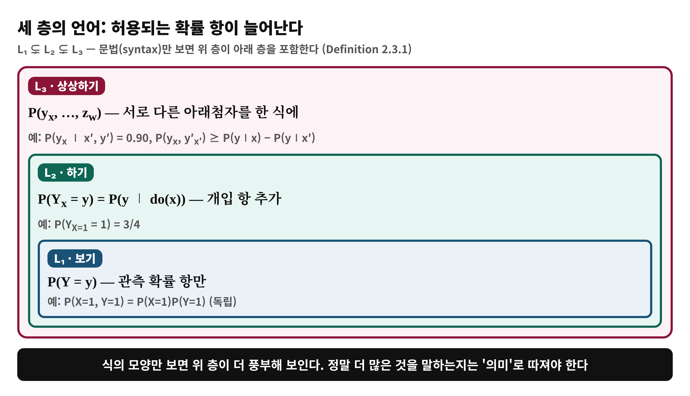
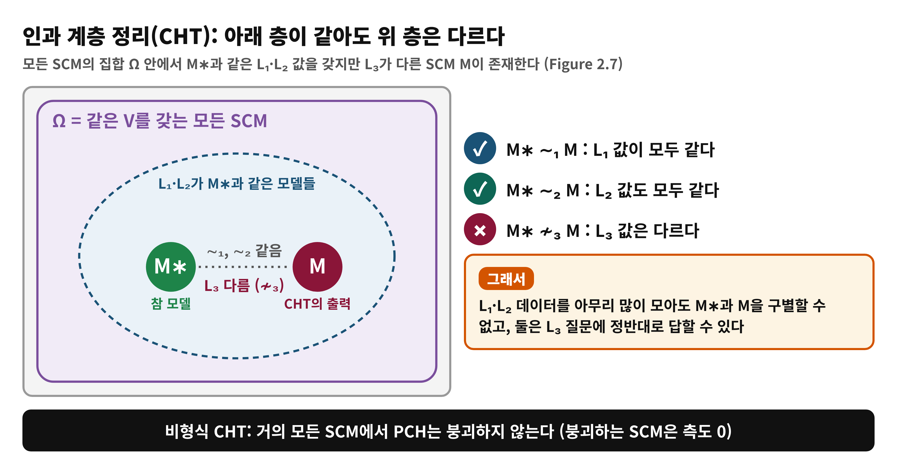
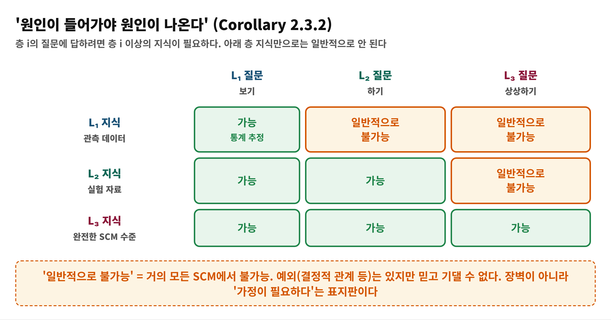
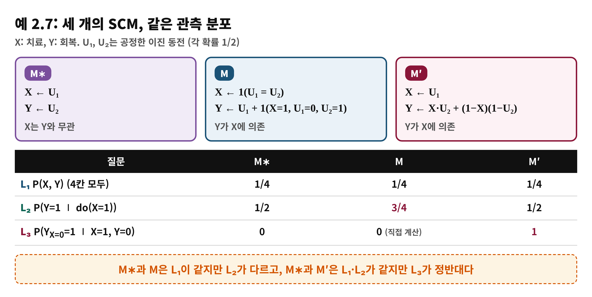
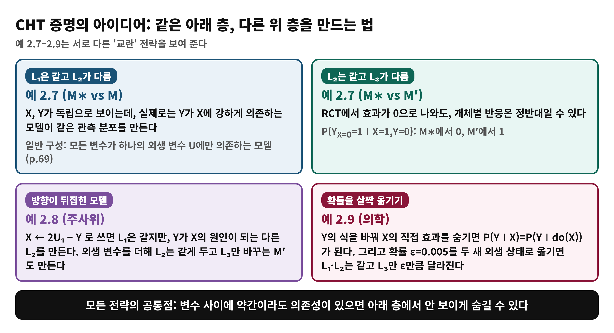

<!--
  book-explainer · Day 4 (PDF 66–72쪽) · Causal Artificial Intelligence
  빌드: python build_pptx.py day04.md
-->

# Day 4 — 인과 계층 정리(CHT): 상관만으로는 부족한 이유

**책**: Causal Artificial Intelligence · **범위**: PDF 66–72쪽 (인쇄 54–60) · 2.3절 · **수준**: 입문

---

# 한눈에 보기
<!-- _class: small -->

- **이 범위가 푸는 문제**
  - 하위 층 데이터가 상위 층의 답을 결정하지 못한다는 것을 어떻게 정확히 말할 수 있는가?
- **결론 한 줄**
  - **인과 계층 정리(CHT)**: 거의 모든 SCM에서 L1·L2가 같아도 L3가 다른 SCM이 존재한다. 그래서 인과 추론에는 가정이 논리적으로 필요하다
- **읽고 나면**
  - 세 층의 언어, 붕괴(collapse)의 뜻, CHT와 'no causes in, no causes out'을 예로 설명할 수 있다

---

# Day 3에서 이어받은 것

- 하나의 SCM이 **L1(보기)·L2(하기)·L3(상상하기)** 분포를 모두 만든다
- 예 2.5: 같은 SCM에서 P(Y∣X)와 P(Y∣do(X))의 부호가 반대였다
- 그렇다면 **우리가 가진 L1 자료로 L2·L3 답을 구할 수 있는가?**
- 오늘의 질문: 이 불가능성을 **정리(theorem)로** 어떻게 말하는가?

---

# 왜 필요한가 — 자료가 같아도 세계는 다를 수 있다

- 데이터에서 치료와 회복이 독립으로 보인다 → "약은 효과가 없다"고 말해도 될까?
- 같은 데이터를 만드는 **서로 다른 세계**가 있다면 결론은 세계에 따라 달라진다
- 실험(RCT)에서 평균 효과가 0이어도, 개체별로는 정반대 반응일 수 있다
- 이것은 '데이터가 부족해서'가 아니라 **논리적 한계**임을 보이는 것이 CHT다
- 한계를 알아야 어떤 가정이 필요한지 따질 수 있다 (Day 5 이후)

---

# 용어 준비
<!-- _class: small -->

| 용어 | 한 줄 뜻 | 예 |
|:---|:---|:---|
| 기호 언어 L1, L2, L3 | 허용되는 확률 항으로 구분한 세 문장 체계 | P(y), P(y_x), P(y_x, y′_x′) |
| Ω | 같은 V를 갖는 모든 SCM의 집합 | M∗도 M도 Ω의 원소 |
| L_i-이론 | SCM에서 참이 되는 L_i 문장의 모음 | 관측 분포가 같으면 L1-이론이 같다 |
| M ∼_i M′ | 두 SCM이 모든 L_i 문장에서 일치 | M∗ ∼₂ M |
| 붕괴 (collapse) | 하위 층만으로 상위 층 답이 정해지는 경우 | 결정적 관계 같은 예외 |

---

# 개념 1 — 세 층의 언어 (Definition 2.3.1)
<!-- _class: small -->

L1 ⊊ L2 ⊊ L3: 허용되는 확률 항이 늘어난다 (p.66)

---

# 개념 1 — 비유로 이해하기: 요리 사진과 레시피
<!-- _class: small -->

- **비유**
  - 완성된 요리 사진(관측)만으로는 레시피(메커니즘)를 알 수 없다. 같은 사진이 나오는 서로 다른 레시피가 있다
- **개념 대응**
  - 요리 사진 = L1 분포 · 레시피 = F · 같은 사진을 내는 다른 레시피 = M ∼₁ M∗
- **핵심**
  - 사진을 더 선명하게(표본을 더 많이) 찍어도 레시피의 차이는 드러나지 않는다
- **비유의 한계**
  - 현실에서는 요리법에 대한 상식(가정)으로 레시피 후보를 좁힌다. 책은 바로 그 가정을 다음에 다룬다

---

# 개념 2 — PCH의 정의와 '엄격한 계층' (Definition 2.3.2)
<!-- _class: small -->

- **PCH**: 완전한 SCM M∗이 만드는 L1, L2, L3 분포 전체 (p.67)
- **문법상** L1 ⊊ L2 ⊊ L3이다. L2에는 P(y_x)가 있지만 L1에는 없다
- 하지만 **의미상** 정말 더 많은 것을 말하는지는 별개의 질문이다
- 책의 비교: 정수·유리수·실수의 크기(기수)를 생각해 보자. 직관은 '정수 < 유리수 < 실수'이지만 정수와 유리수는 같은 크기였다
- 층이 서로 구분되지 않으면 인과·상상에 대한 말은 낮은 층 언어의 '수사'에 불과해진다

---

# 개념 2 — ∼_i와 붕괴 (Definition 2.3.3)
<!-- _class: small -->

- **M ∼_i M′**: 두 SCM의 L_i-이론이 같다. L_i 자료만으로는 구별되지 않는다
- **붕괴**: M∗ ∼_i M이면 항상 M∗ ∼_j M (i < j)이라는 뜻
  - 즉 층 i의 자료로 **모든** 층 j 질문에 답할 수 있다
- **L2가 L1로 붕괴**하면 모든 개입 효과를 상관에서 알 수 있다
- **L3가 L2로 붕괴**하면 모든 반사실을 개입 실험으로 계산할 수 있다
- 붕괴는 **예외적인 상황**에서만 생긴다. 예: 함수 관계가 결정적일 때

---

# 개념 3 — 인과 계층 정리 CHT
<!-- _class: small -->

비형식 버전 (Theorem 2.3.1, p.68): 거의 모든 SCM에서 PCH는 붕괴하지 않는다

---

# 개념 3 — CHT의 형식 버전과 '측도 0'
<!-- _class: small -->

- **형식 버전 (Theorem 2.3.3, p.69)**: L3-동치류의 공간에 르베그 측도를 주면, 붕괴가 일어나는 SCM의 집합은 **측도 0**이다
- **쉬운 말**: SCM을 부드러운 분포로 무작위로 뽑으면 붕괴할 확률은 0이다
- **이론 중립적**: 그래프나 부모 집합을 안다는 가정이 없다. 메커니즘에 시간(재귀) 순서가 있다는 정도만 필요하다
- **자주 하는 걱정**: '측도 0'은 '불가능'이 아니라 '예외'라는 뜻이다. 결정적 관계처럼 붕괴하는 예도 실제로 있다

---

# 개념 4 — 'no causes in, no causes out' (Corollary 2.3.2)
<!-- _class: small -->

층 i 질문에 답하려면 층 i 이상의 지식이 필요하다 (p.69)

---

# 개념 4 — 장벽이 아니라 표지판
<!-- _class: small -->

- 철학자 Nancy Cartwright가 대중화한 구호: **원인이 들어가야 원인이 나온다**
- 인과 추론은 인과 **가정** 없이 불가능하다. 데이터만으로 L2·L3를 약속하는 방법은 존재하지 않는다
- 책은 이를 '넘을 수 없는 벽'이 아니라 **이론적 경계**로 본다
- 경계를 알면, 어떤 가정이 있으면 추론이 되는지를 찾을 수 있다
- 다음 날 배울 **인과 다이어그램**이 그 가정을 적는 대표 도구다

---

# 증명의 아이디어 — L2는 L1로 붕괴하지 않는다
<!-- _class: small -->

- **L2 → L1**: 어떤 SCM이든 L1 분포가 같으면서 L2가 다른 SCM이 항상 있다
- 변수 사이에 의존이 있다면, **모든 변수가 하나의 외생 변수 U에만 의존**하도록 모델을 다시 짜면 같은 관측 분포를 낼 수 있다 (p.69)
- 의존이 전혀 없는 SCM이라면, 관측에서는 안 보이게 의존을 끼워 넣을 수 있다
- **L3 → L2**는 더 섬세하다. 함수의 입력을 바꾸면 보통 L2도 변하기 때문이다
- 필요한 것: L2 사실은 그대로 두고 **여러 잠재결과의 결합 확률만** 바꾸는 구성 (예 2.7–2.9)

---

# 예 2.7 (1) — 독립으로 보여도 원인일 수 있다
<!-- _class: small -->

M∗, M, M′: 같은 관측 분포, 다른 인과 구조 (p.70)

---

# 예 2.7 (2) — 실험으로도 못 푸는 개체의 질문
<!-- _class: small -->

- **M∗**에서 X는 Y와 무관하고, **M′**에서는 Y ← X·U₂ + (1−X)(1−U₂)이다
- 두 모델 모두 RCT를 하면 P(Y∣do(X)) = P(Y), 즉 **평균 효과가 0**이다
- 치료받고 사망한 환자 S에 대해 **"치료를 안 받았다면 살았을까?"**
  - M∗: P(Y_{X=0}=1∣X=1, Y=0) = **0**, S는 어차피 사망
  - M′: 같은 값이 **1**, 치료 때문에 사망
- L1·L2 자료가 같아도 **책임 소재가 정반대**로 갈린다 (p.70–71)

---

# 예 2.8, 2.9 — 다른 방법으로 같은 결론
<!-- _class: small -->

예 2.1과 2.2를 이용한 구성들 (p.71–72)

---

# 수식 풀이 (1) — 붕괴의 정의
<!-- _class: small -->

$$
M^*\sim_i M\;\Rightarrow\;M^*\sim_j M\quad(\mathrm{for\ all}\ M\in\Omega,\ i<j)
$$

- **M∗ ∼_i M**: 두 모델이 L_i 문장 전부에서 일치
- **⇒**: 그러면 L_j 문장에서도 일치해야 한다
- **모든 M ∈ Ω**: 같은 V를 갖는 SCM 전체를 대상으로 한다
- 반례 하나만 있으면 붕괴가 아니다: M∗ ∼_i M이지만 M∗ ≁_j M인 M
- CHT는 거의 모든 M∗에 대해 이런 반례 M이 있다고 말한다

---

# 수식 풀이 (2) — 예 2.7의 반사실 계산
<!-- _class: small -->

$$
P(Y_{X=0}=1\mid X=1,Y=0)=\frac{P(Y_{X=0}=1,\,X=1,\,Y=0)}{P(X=1,\,Y=0)}
$$

- 표 2.3에서 (U₁,U₂)=(1,0)인 행이 X=1, Y=0인 유일한 행이다 (확률 1/4)
- **M∗**: 그 행에서 Y_{X=0}=0이므로 값 0
- **M′**: 같은 행에서 Y_{X=0}=1이므로 값 1
- 분모는 둘 다 1/4이다. 분자만 다르다. 분자가 곧 **두 세계를 함께 보는 L3 항**이다

---

# 흔한 오해

> ❌ "CHT는 인과 추론이 불가능하다는 뜻이다"

- ✅ 가정 없이는 불가능하다는 뜻이다. 적절한 가정이 있으면 가능하다
- ❌ "측도 0이므로 붕괴는 실제로는 없다" → ✅ 결정적 관계처럼 붕괴하는 SCM은 실제로 존재한다. '거의 모든'이 '모든'은 아니다
- ❌ "표본이 아주 많으면 L1 자료로 L2를 알 수 있다" → ✅ 표본 수의 문제가 아니라 같은 L1을 만드는 다른 세계가 있다는 문제다
- ❌ "RCT를 하면 반사실도 구할 수 있다" → ✅ L2로는 L3를 알 수 없다 (예 2.7)

---

# 정리

- 세 층의 언어는 L1 ⊊ L2 ⊊ L3로 늘어난다
- **CHT**: 거의 모든 SCM에서 하위 층이 같아도 상위 층은 달라진다
- **Corollary**: 층 i 질문에는 층 i 이상의 지식이 필요하다 (no causes in, no causes out)
- 가정은 선택이 아니라 필수다. 다음 날(Day 5)은 가정을 담는 도구, **인과 다이어그램**을 읽는다

---

# 이해 점검 퀴즈 Q1

**(개념 확인)** 'L3가 L2로 붕괴한다'는 말의 뜻은?

- A) L3 분포를 L2 실험 자료만으로 모든 SCM에서 계산할 수 있다
- B) L3 질문은 어떤 SCM에서도 답할 수 없다
- C) L2 자료가 있으면 L1은 필요 없다
- D) L3 문장이 L2 문장보다 짧아진다

---

# Q1 정답 및 해설

- **정답: A**
- 왜 맞나: 붕괴는 M∗ ∼₂ M이면 M∗ ∼₃ M이라는 뜻이다. 즉 L2 정보가 L3 사실을 모두 결정한다
- B가 틀린 이유: 붕괴하지 않는다는 뜻의 설명이다. 그것도 '거의 모든' SCM에서의 이야기다
- C가 틀린 이유: 층 사이의 포함 관계이지 필요 여부가 아니다
- D가 틀린 이유: 문장의 길이와 무관하다

---

# 이해 점검 퀴즈 Q2

**(적용)** RCT에서 P(Y∣do(X))=P(Y)로 효과가 없다고 나왔다. 치료받고 사망한 환자에 대해 "치료를 안 받았다면 살았을까?"를 묻는 것에 대해 옳은 설명은?

- A) 효과가 없으므로 답은 반드시 '아니오'이다
- B) L2 자료만으로는 모델에 따라 답이 정반대일 수 있어 정해지지 않는다
- C) 표본을 늘리면 결정된다
- D) 관측 자료를 더하면 반드시 결정된다

---

# Q2 정답 및 해설

- **정답: B**
- 왜 맞나: 예 2.7에서 M∗는 0, M′는 1로 정반대 답을 낸다. 둘은 L1과 L2가 같다
- A가 틀린 이유: 평균 효과가 0이어도 개체별 반응은 다를 수 있다
- C가 틀린 이유: 같은 분포를 만드는 모델 간의 차이라 표본 수와 무관하다
- D가 틀린 이유: 관측 자료는 L1이라 오히려 정보가 더 약하다

---

# 이해 점검 퀴즈 Q3

**(오개념 교정)** CHT에 대한 설명 중 **틀린** 것은?

- A) 거의 모든 SCM에서 PCH가 붕괴하지 않는다
- B) 층 i 질문에는 층 i 이상의 지식이 필요하다
- C) 인과 그래프를 알고 있어야만 증명할 수 있는 정리다
- D) 붕괴가 아예 불가능하다는 뜻은 아니다

---

# Q3 정답 및 해설

- **정답: C** (틀린 설명)
- 왜 틀렸나: CHT는 이론 중립적이다. 그래프나 부모 집합을 안다는 가정 없이 성립한다
- A: 비형식 CHT 그대로다
- B: Corollary 2.3.2다
- D: 결정적 관계 같은 예외적 SCM에서는 붕괴가 일어난다
