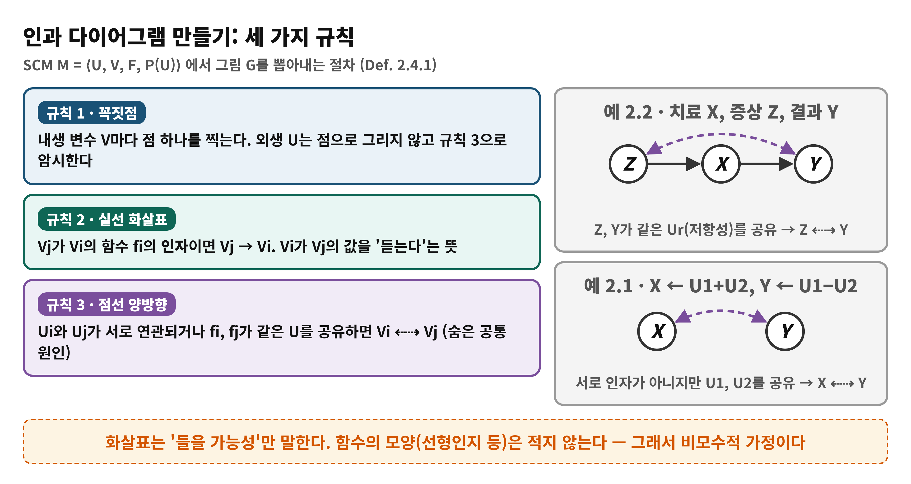
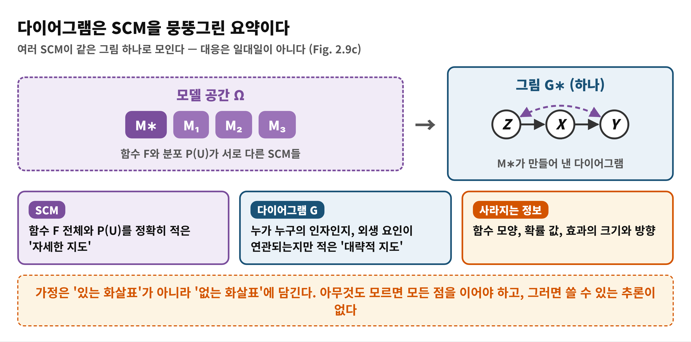
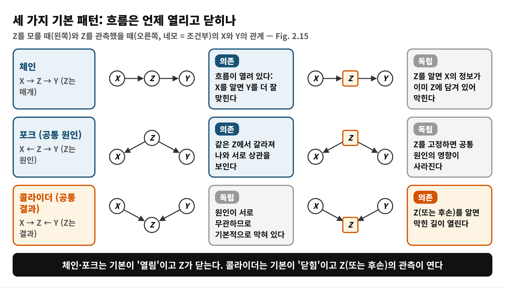
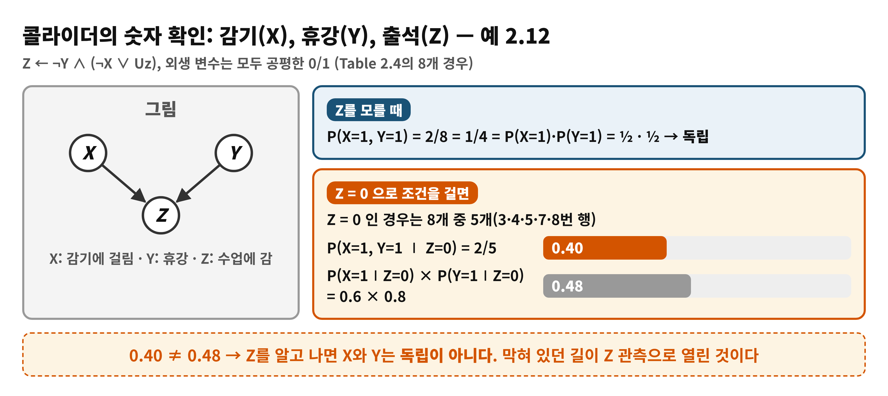
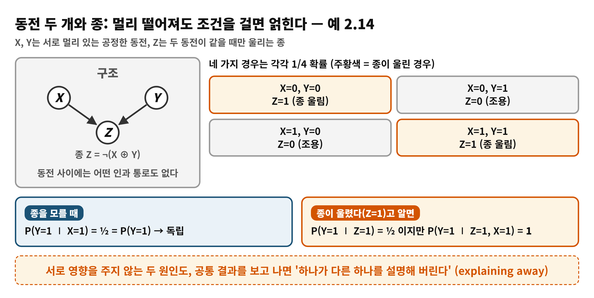

# Day 5 — 인과 다이어그램과 조건부 독립 (학습 노트)

> 근거: Causal Artificial Intelligence, PDF 73–86쪽 (인쇄 61–74) · 2.4절 도입, 2.4.1 Causal Diagrams, 2.4.2 앞부분(조건부 독립과 세 가지 패턴) · 독자 수준: 입문
> 쪽 번호는 PDF 기준이며 인쇄 번호 = PDF − 12
> 오늘의 핵심 질문: 그래프의 어떤 구조가 데이터의 어떤 독립 관계를 낳는가?

## 한눈에 보기
- **이 범위가 푸는 문제**: 참 모델 M∗를 모르는 채로, 어떤 '약한 지식'을 가정으로 삼아 상위 층의 추론을 시작할 수 있는가?
- **결론 한 줄**: 인과 다이어그램은 SCM의 대략적 요약이고, 그림의 **구조**가 관측 분포의 **조건부 독립**이라는 흔적을 남긴다. 체인·포크·콜라이더 세 패턴이 그 기본 부품이다.
- **읽고 나면**: SCM에서 다이어그램을 그릴 수 있고, 세 패턴에서 조건을 걸 때 독립이 생기거나 깨지는 이유를 설명할 수 있다.

## Day 4에서 이어받은 것
Day 4의 인과 계층 정리(CHT)는 "하위 층 데이터만으로는 상위 층의 답이 정해지지 않는다"고 말했다(no causes-in, no causes-out). 그러면 L1 데이터에서 L2·L3로 올라가려면 **가정**이 반드시 필요하다. 그런데 M∗ 전체를 아는 일은 현실에서 거의 없다. 2.4절은 이 틈을 메울 '가운데 길'을 찾는다. 책이 던지는 조건은 세 가지다: 직관적으로 이해되고 투명할 것, 데이터로 검증할 수 있을 것, 그리고 M∗를 아는 것처럼 층 사이 추론을 허락할 만큼 강력할 것 (p.73).

## 왜 필요한가
- M∗를 정확히 알면 모든 층의 모든 질문이 계산된다. 하지만 함수 F와 외생 분포 P(U)를 정확히 적는 일은 불가능에 가깝다.
- 반대로 데이터만 쥐면, CHT 때문에 L1 데이터와 맞으면서 L2에서 완전히 다른 이야기를 하는 SCM이 언제나 존재한다 (Fig. 2.8).
- 그래서 책은 **질적 지식**만 쓴다. "누가 누구의 값을 듣는가", "어떤 변수 쌍이 숨은 공통 요인을 공유하는가"만 그림으로 적는다. 이 그림은 데이터의 독립 관계로 번역되어 **반증 가능한 예측**을 내놓는다.

## 용어 준비
| 용어 | 한 줄 뜻 | 예 |
|---|---|---|
| 인과 다이어그램 (causal diagram) G | SCM에서 인자 관계와 외생 요인의 연관만 뽑은 그림 | Z → X → Y |
| 방향 간선 V_j → V_i | f_i가 V_j를 인자로 쓸 **가능성** | 치료 X가 결과 Y의 인자 |
| 양방향 점선 | 두 변수의 외생 요인이 연관되거나 같은 U를 공유 (미관측 교란) | 저항성 Ur를 공유하는 Z, Y |
| 비모수 (non-parametric) | 함수의 모양(선형 등)을 전혀 가정하지 않음 | 화살표만 있고 계수는 없음 |
| 조건부 독립 | Z를 알면 X가 Y에 추가 정보를 주지 못함 | 비를 알면 교통량과 우산은 무관 |
| 마코비안 SCM | 외생 변수가 서로 독립이고 각각 내생 변수 하나에만 영향 | 모든 U_i가 독립 |
| 위상 순서 | 원인이 결과 앞에 오도록 한 나열. 유일하지 않음 | X, Z, Y |
| 비후손 Nd_i, 부모 Pa_i | V_i의 후손이 아닌 변수들 / V_i의 직접 부모 | |

## 개념 1. 인과 다이어그램 만들기 (Def. 2.4.1, p.73–75)
SCM M = ⟨U, V, F, P(U)⟩가 주어졌을 때 다이어그램 G는 다음 세 규칙으로 만든다.

1. **꼭짓점**: 내생 변수 V마다 점 하나. 외생 변수 U는 점으로 그리지 않고 규칙 3으로 암시한다 (각주 11: 필요하면 명시해도 된다).
2. **방향 간선**: V_j가 f_i의 인자이면 V_j → V_i.
3. **양방향 점선**: U_i와 U_j가 연관되거나, f_i와 f_j가 같은 U를 인자로 공유하면 V_i ⇠⇢ V_j.

**예 2.1** F = {X ← U1 + U2, Y ← U1 − U2}. X와 Y는 서로의 인자가 아니므로 직접 화살표는 없다. 하지만 둘 다 U1, U2에 의존하므로 X ⇠⇢ Y가 생긴다. 이처럼 외생 요인을 공유하는 상황을 책은 **미관측 교란**이라 부르며 인과 추론의 큰 장애물로 꼽는다.

**예 2.2** 치료 X, 결과 Y, 증상 Z. Z는 다른 내생 변수를 듣지 않는 뿌리 노드이고, X는 Z를, Y는 X를 듣는다. 환자의 저항성 Ur가 Z와 Y 양쪽에 영향을 주므로 Z ⇠⇢ Y가 추가된다. 그림은 Z → X → Y와 Z ⇠⇢ Y다.

**비유: 단체 채팅방의 '귀 기울이기'.** 각 사람(변수)은 누구의 말을 듣는지만 표시하고 어떻게 반응하는지는 적지 않는다. 같은 소문을 각자 따로 들은 사람들은 점선으로 묶는다. 책도 Pearl의 말을 빌려 이 '듣기 은유'가 네트워크가 전하는 지식의 전부라고 소개한다(각주 9).

| 비유 | 개념 |
|---|---|
| 누구의 말을 듣는가 | 방향 간선 (인자 관계) |
| 같은 소문을 각자 들음 | 양방향 점선 (외생 요인 공유) |
| 반응 방식은 적지 않음 | 비모수: 함수 모양을 가정하지 않음 |

> **비유의 한계**: 화살표는 '반드시 듣는다'가 아니라 '들을 **가능성**'이다. f_j가 V_i를 인자로 받고도 값에 쓰지 않을 수 있다. 채팅 비유는 '누구 말을 듣는지 표시한다'만 보여 주고, 가정이 **없는 화살표**에 있다는 점은 따로 이해해야 한다.

### 그림이 말하는 것과 말하지 않는 것 (p.75)
책이 짚는 관찰은 다섯 가지다.
1. 각 SCM은 **하나의** 다이어그램을 낳는다.
2. 그림을 그리는 데 필요한 지식은 **질적**이다. 모든 변수 쌍마다 "듣는가? 외생 요인이 연관되는가?"만 묻는다. M∗를 정확히 아는 것보다 훨씬 약한 요구다.
3. 그래도 그림을 그리는 일은 쉽지 않다.
4. 화살표는 **가능성**을 말한다. 가정이 실리는 곳은 있는 화살표가 아니라 **빠진 화살표**다. 빠진 방향 간선은 "인자가 아니다"를, 빠진 양방향 간선은 "외생 변이가 독립이다"를 단언한다.
5. 아무것도 모르면 모든 점을 잇는 완전 그래프를 그리게 되고, 이때 인과 추론 장치가 허락하는 결론은 없다. 추론의 출력은 항상 입력한 가정의 함수다.

한 그림에는 여러 SCM이 대응한다(Fig. 2.9(c)). 그림은 F의 구체적 모양과 확률 값, 효과의 크기와 방향 같은 정보를 버린 요약이다.

## 개념 2. 마코비안 SCM과 베이즈 분해 (Thm. 2.4.1, p.76–77)
G가 관측 분포 P(V)와 어떻게 이어지는지 보려면 먼저 SCM이 P(V)를 어떻게 만드는지 적어야 한다. 책은 식 (2.41)~(2.44)에서 다음을 보인다.

- 외생 상황 u를 정하면 모든 내생 변수가 결정되므로 P(v)는 ∑_u 1[V(u)=v] P(u)다.
- 위상 순서를 따라 연쇄 법칙을 쓰고, V_i가 부모 pa_i와 자기 외생 요인 u_i에만 의존한다는 SCM의 구조를 쓰면 **P(v) = ∑_u P(u) ∏_i P(v_i ∣ pa_i, u_i)** 가 된다.

이것은 SCM의 **함수적 모듈성**(각 변수는 자기 가족만 본다)이 L1의 확률로 표현된 것이다.

**마코비안 SCM**이란 모든 외생 변수가 서로 독립이고 각각 내생 변수 하나에만 영향을 주는 재귀 SCM이다(각주 13). 이 경우 다음이 성립한다.

**Theorem 2.4.1 (마코비안 분해)**: P(v) = ∏_i P(v_i ∣ pa_i).

> **주의 (각주 14)**: 이 분해를 '인과 모델과 같은 것'으로 오해하는 경우가 있다. 이는 L1의 분해일 뿐이며 L2·L3 질문은 여전히 CHT의 제약을 받는다. 또 이 분해는 비마코비안 모델이나 다른 층의 분포로는 확장되지 않는다.

### 수식 풀이: 왜 부모만 남는가 (식 2.46~2.51)
출발점은 ∑_u P(u) ∏_i P(v_i ∣ pa_i, u_i) 이다.

| 단계 | 식 | 이유 |
|---|---|---|
| (2.47) | ∏_i ∑_{u_i} P(v_i ∣ pa_i, u_i) P(u_i) | U_i들이 서로 독립이고 각 U_i가 V_i 하나에만 관여하므로, 합과 곱을 바꿔 변수별로 쪼갠다 |
| (2.48) | … P(u_i ∣ pa_i) | U_i가 V_i의 부모와 독립이라 P(u_i)를 P(u_i ∣ pa_i)로 쓸 수 있다 |
| (2.49)~(2.50) | … P(v_i, u_i ∣ pa_i) | 조건부 확률의 정의로 P(u_i ∣ pa_i)가 약분된다 |
| (2.51) | ∏_i P(v_i ∣ pa_i) | u_i에 대해 합(주변화)하면 u_i가 사라진다 |

말로 풀면 "각 변수의 값은 부모와 자기만의 잡음이 정한다. 잡음이 서로 무관하면 변수별 조건부 확률을 곱하는 것으로 전체 분포를 만들 수 있다"는 뜻이다.

## 개념 3. 조건부 독립과 로컬 마르코프 조건 (Def. 2.4.2, p.77–79)
**독립**: 두 변수에서 하나의 값을 알아도 다른 하나의 확률이 바뀌지 않으면 독립이다. P(Y=y ∣ X=x) = P(Y=y) (식 2.52), 기호로 Y ⊥⊥ X. 현실에서 이런 한계 독립은 드물다. 날씨가 이틀 전과 오늘 사이에 어제 날씨를 거쳐 이어지는 것처럼 대부분의 변수는 간접적으로라도 이어져 있기 때문이다.

**조건부 독립 (Def. 2.4.2)**: Z를 알고 나면 X의 값이 Y의 가능성을 더 바꾸지 않는다. P(Y=y ∣ X=x, Z=z) = P(Y=y ∣ Z=z), 기호로 (Y ⊥⊥ X ∣ Z) (식 2.53). 책의 예: 교통량과 우산은 상관이 있지만 비가 오는지 알면 독립이고, 입시와 학습 습관은 SAT 점수를 알면 독립이다.

**로컬 마르코프 조건**: 마코비안 모델에서 V_i는 자신의 **비후손** Nd_i와 독립이다. 단 부모 Pa_i를 알 때다.
V_i ⊥⊥ (Nd_i \ Pa_i) ∣ Pa_i (식 2.58). 부모가 'V_i가 듣는 모든 것'이기 때문이다. 식 (2.55)~(2.57)에서 책은 외생 U_i를 포함한 형태 (V_i ⊥⊥ Nd_i \ Pa_i ∣ Pa_i, U_i)로 시작해 마코비안일 때 U_i를 떼어 낸다 (Exercise 2.21).

> **비유: 같은 반 친구들의 소문.** 어떤 친구(V_i)에 대한 소문은 그 친구와 직접 연결된 사람(부모)에게서만 들으면 충분하고, 나머지 사람들은 이미 그 사람들을 통해 모두 반영되어 있다.
> **비유의 한계**: 이 속성은 **마코비안**일 때만 성립한다. 숨은 공통 원인이 있으면 부모를 알아도 비후손이 정보를 줄 수 있다(Day 6에서 다룬다).

이 독립 관계는 원리적으로 **관측 데이터에서 추정 가능**하다(L1 제약). 그래서 그림이 낳는 독립 관계를 데이터로 검사해 그림을 반증할 수 있다.

## 개념 4. 세 가지 기본 패턴 (예 2.10~2.14, p.79–86)

| 패턴 | 구조 | Z를 모를 때 X, Y | Z를 알 때 X, Y |
|---|---|---|---|
| 체인 (예 2.10) | X → Z → Y | 의존 | 독립 |
| 포크 (예 2.11) | X ← Z → Y | 의존 | 독립 |
| 콜라이더 (예 2.12) | X → Z ← Y | 독립 | 의존 |

책은 앞의 둘을 **정상(normal)**, 콜라이더를 **비정상(abnormal)** 패턴이라 부른다. 정상 패턴은 기본적으로 정보가 흐르고 Z가 그 흐름을 막는다. 비정상 패턴은 기본적으로 흐름이 없고 Z(또는 후손)를 관측하면 길이 열린다.

### 4-1. 체인 (예 2.10: 공부 습관 → SAT → 합격)
SCM: X ← Ux, Z ← X ∨ ¬Uz, Y ← Z ∧ Uy, 외생 요인은 서로 독립. 
- Z를 모를 때: P(X=1, Y=1) = P(Ux=1)P(Uy=1)인데 P(X=1)P(Y=1)은 P(Uz=0) ≠ 1이면 이와 같지 않다 (식 2.63 vs 2.68). 습관이 좋다는 사실은 합격 가능성을 바꾼다. X ⊥⊥ Y는 성립하지 않는다.
- Z를 알 때: P(x,y∣z) = P(x)P(z∣x)P(y∣z) / P(z) = P(x,z)/P(z) · P(y∣z) = P(x∣z)P(y∣z) (식 2.69~2.72). SAT 점수를 알고 나면 습관의 정보는 모두 점수에 담겨 있어 X ⊥⊥ Y ∣ Z.
- 이 유도는 F와 P(U)의 구체적 모양을 쓰지 않았다. 그래서 **그림이 같으면 모든 SCM에서** 성립한다 (Fig. 2.9(c)).

### 4-2. 포크 (예 2.11: 비 → 교통, 우산)
SCM: Z ← Uz, X ← Z ∨ ¬Ux, Y ← Z ∨ Uy. 우산(Y)이 보이면 비(Z)가 올 가능성이 높아지고, 비가 오면 길이 막힐(X) 가능성이 높아진다. 따라서 X와 Y는 한계 의존이다. 하지만 비가 오는지 직접 알면 P(x,y∣z) = P(z)P(x∣z)P(y∣z)/P(z) = P(x∣z)P(y∣z)로 독립이다 (식 2.74~2.76). 공통 원인 Z가 만든 상관은 Z를 고정하면 사라진다.

> **비유의 한계**: 포크의 상관은 X가 Y의 원인이어서가 아니다. 우산과 교통량 사이에는 화살표가 없다.

### 4-3. 콜라이더 (예 2.12: 감기, 휴강, 출석)
SCM: X ← Ux, Y ← Uy, Z ← ¬Y ∧ (¬X ∨ Uz), 외생 변수는 모두 공평한 0/1. Table 2.4의 8개 경우를 쓴다.

- 한계 독립: P(X=1, Y=1) = 2/8 = 1/4 = (1/2)(1/2) (식 2.78~2.82).
- 조건부: Z = 0이 되는 행은 3, 4, 5, 7, 8번이므로 P(Z=0) = 5/8. P(X=1, Y=1 ∣ Z=0) = (2/8)/(5/8) = 0.40, P(X=1 ∣ Z=0) = 3/5 = 0.60, P(Y=1 ∣ Z=0) = 4/5 = 0.80. 곱은 0.48이므로 0.40 ≠ 0.48. **Z를 알면 X와 Y는 독립이 아니다.**

### 4-4. 후손, 동전과 종, 설명해 버리기 (예 2.13, 2.14, p.84–86)

- **후손 (예 2.13)**: Z를 직접 못 보고 출석부 기록 W (W ← Z ⊕ Uw, 25% 오기재)만 알아도 X와 Y는 의존한다. 책의 표현으로 X에서 Z로 내려온 영향이 관측 때문에 '다시 튀어 올라' Y로 간다. 책이 계산한 값은 P(Y=1, X=0 ∣ W=0) = 0.4, P(Y=1 ∣ W=0)P(X=0 ∣ W=0) = 0.8 × 0.4 = 0.32 (식 2.88~2.89)이다.
- **동전과 종 (예 2.14)**: 멀리 떨어진 공정한 동전 X, Y와 두 동전이 같을 때만 울리는 종 Z (Z ← ¬(X ⊕ Y)). 종을 모를 때는 독립(P(Y=1∣X=1) = 1/2)이다. 종이 울렸고(Z=1) X=1이면 Y=1이 확률 1로 정해진다(식 2.98). 반면 종만 알 때 P(Y=1∣Z=1) = 1/2 (식 2.102). 동전 사이에 아무 통로가 없어도 조건을 걸면 얽힌다.
- **Explaining away**: 대학이 성적 우수(X) 또는 음악 재능(Y)이 있는 지원자를 합격(Z)시킬 때, 합격자 중 음악 재능이 있다고 알면 성적 우수일 확률이 일반 지원자보다 낮아진다. 재능이 이미 합격을 설명하기 때문이다.

> **비유의 한계(입학 예)**: 이것은 **조건(선택)** 때문에 생기는 통계적 현상이다. 성적과 재능 사이에 새 인과 경로가 생긴 것이 아니다. 책도 이 현상을 '정보가 흐르는 길이 열렸다'로 말할 뿐 인과가 생겼다고 하지 않는다.

## 책 읽을 때 주의 (원문 표기)
- Def. 2.4.2 제목 옆에 'chec.'이라는 편집 흔적이 남아 있다 (p.78).
- Example 2.12의 보조 계산에서 P(Y=1∣Z=0) 등의 수치는 Table 2.4를 직접 세어 확인하면 책의 값(0.40, 0.60, 0.80)과 일치한다.
- 'Ch. ??'처럼 아직 채워지지 않은 상호 참조가 일부 있다 (구조 학습 등).

## 흔한 오해
- ❌ "화살표가 있어야 가정이고 없으면 가정이 아니다" → ✅ 가정은 **없는** 화살표에 담긴다. 있는 화살표는 '가능성'일 뿐이다.
- ❌ "조건을 걸수록 변수들이 더 독립이 된다" → ✅ 콜라이더와 그 후손은 정반대다. 조건을 걸면 독립이던 것이 의존이 된다.
- ❌ "그림을 알면 SCM이 정해진다" → ✅ 한 그림에 여러 SCM이 대응한다 (일대일이 아니다).
- ❌ "P(v)=∏P(v_i∣pa_i)가 곧 인과 모델이다" → ✅ L1의 분해일 뿐이며 CHT의 제약을 그대로 받는다.
- ❌ "같은 변수는 항상 같은 역할이다" → ✅ 변수가 체인의 중간일 수도 콜라이더일 수도 있다. 역할은 경로마다 달라진다 (Day 6에서 확장).

## 정리
1. 인과 다이어그램은 SCM의 질적 요약이다. 방향 간선 = 인자, 양방향 간선 = 외생 요인의 연관이고, 가정은 **빠진 간선**에 있다.
2. 마코비안 SCM에서 P(v)는 부모 조건부 확률의 곱으로 분해되고, 로컬 마르코프 조건 (V_i ⊥⊥ Nd_i \ Pa_i ∣ Pa_i)이 따른다.
3. 체인·포크는 Z를 알면 막히고, 콜라이더는 Z(또는 후손)를 알면 열린다.
4. 이 독립 관계는 L1 데이터에서 검사할 수 있으므로 그림을 **반증**할 수 있다.

## 이해 점검 퀴즈
**Q1. (개념 확인)** 다이어그램에서 X와 Y 사이에 직접 화살표도 양방향 점선도 **없다**는 사실이 말하는 것은?
- A) Y의 메커니즘에 X가 인자로 들어가지 않고, 두 변수의 외생 요인은 서로 독립이라는 주장이다
- B) X와 Y는 어떤 조건에서도 반드시 독립이다
- C) X가 Y에 미치는 효과가 매우 작다는 뜻이다
- D) 아직 데이터를 보지 못했다는 뜻이다

정답 및 해설

정답: **A**. 빠진 방향 간선은 '인자가 아님'을, 빠진 양방향 간선은 '외생 변이가 독립임'을 단언한다. B는 다른 변수를 거치는 경로가 있으면 의존할 수 있어 틀리고, C는 화살표가 크기가 아니라 가능성만 적으므로 틀리며, D는 그림이 모델에 대한 주장이라 데이터 유무와 무관하다.

**Q2. (적용)** 대학이 성적 우수(X) 또는 음악 재능(Y)이 있는 지원자를 합격(Z=1)시킨다. 합격자 한 명을 무작위로 뽑아 음악 재능이 있다(Y=1)는 것을 알았다. 이 학생의 성적이 우수할 확률은 일반 지원자에 비해?
- A) 더 높아진다
- B) 더 낮아진다
- C) 변함없다
- D) 이 구조에서는 알 수 없다

정답 및 해설

정답: **B**. X→Z←Y 콜라이더에서 Z를 조건으로 걸면 X와 Y가 의존이 된다. 재능이 이미 합격을 설명하므로 성적 쪽 설명이 덜 필요해져 확률이 낮아진다(explaining away). A는 '돕는' 방향이 아니라 '대신 설명하는' 방향이라 틀리고, C는 Z를 조건으로 걸지 않았을 때의 결과이며, D는 책이 이 상황을 명시적으로 설명한다.

**Q3. (오개념 교정)** 다음 중 **틀린** 설명은?
- A) 체인 X→Z→Y에서 Z를 알면 X와 Y는 독립이다
- B) 포크 X←Z→Y에서 Z를 알면 X와 Y는 독립이다
- C) 콜라이더 X→Z←Y에서 X와 Y가 독립이므로 Z를 알아도 독립이다
- D) 마코비안 SCM에서 P(v)는 각 변수의 '부모를 조건으로 하는 확률'의 곱이다

정답 및 해설

정답: **C**. 콜라이더는 Z를 모를 때 독립이지만, Z(또는 후손)를 알면 의존이 된다. 예 2.12에서 0.40 ≠ 0.48이었다. A, B는 중간 Z를 알면 흐름이 막히므로 맞고, D는 Theorem 2.4.1이다.

## 다음 날로 이어지는 고리
세 패턴은 변수 세 개의 이야기다. 실제 그림에는 변수도 경로도 훨씬 많다. 그래프가 데이터의 어떤 독립을 낳는지 **읽는 일반 규칙**이 필요하다. Day 6은 이 패턴들을 임의의 그래프로 확장한 **d-분리(d-separation)**, 그리고 숨은 변수가 있을 때 국소성을 되찾는 **교란 컴포넌트(c-component)**를 읽는다 (PDF 87–99쪽).
