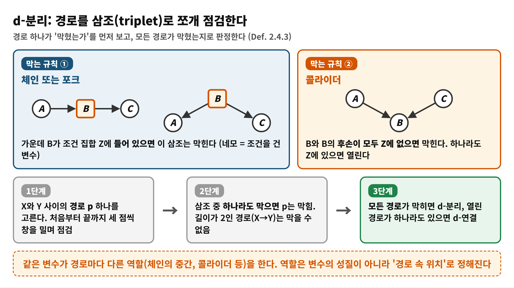
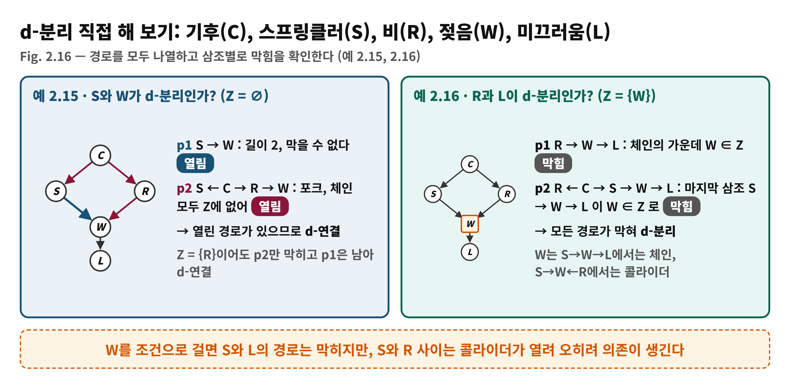
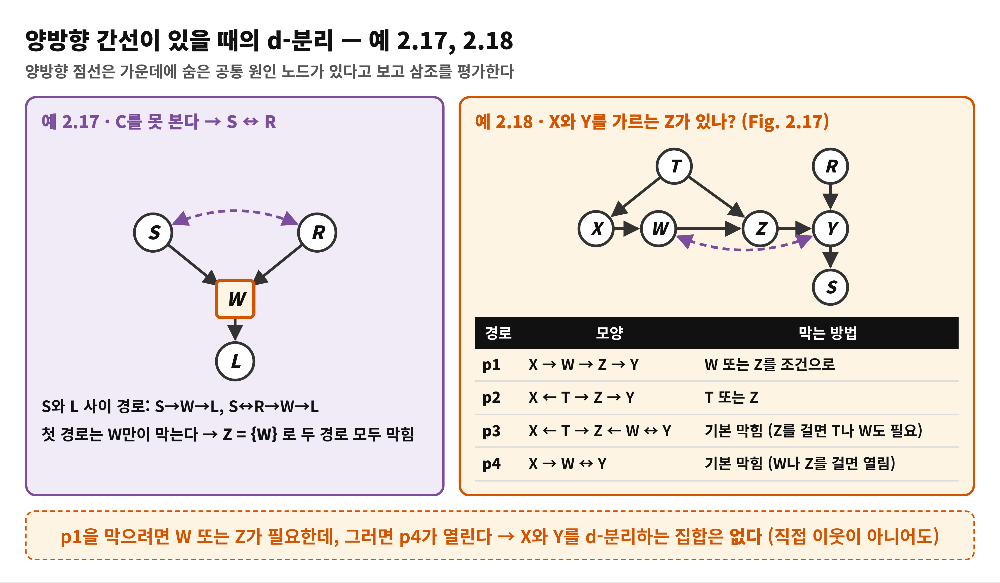
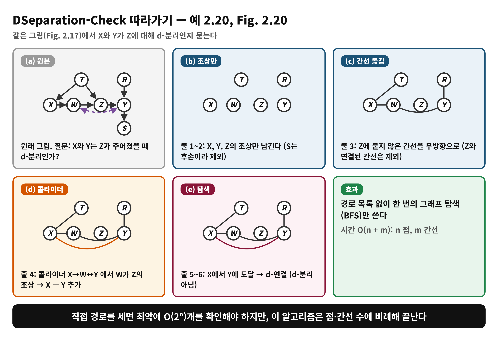
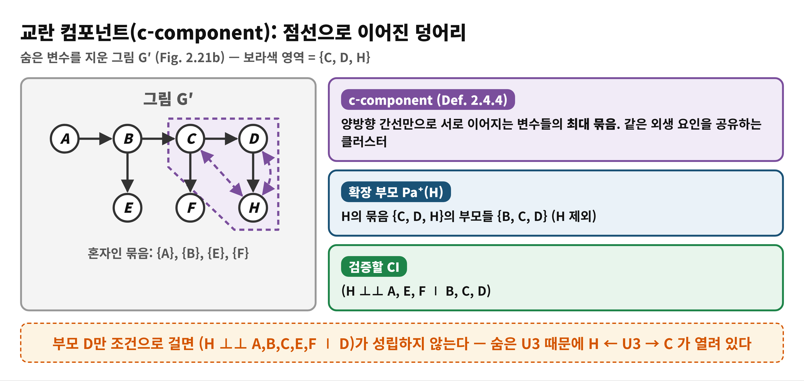

# Day 6 — d-분리와 테스트 가능한 함의, 교란 컴포넌트 (학습 노트)

> 근거: Causal Artificial Intelligence, PDF 87–99쪽 (인쇄 75–87) · 2.4.2절 후반 (d-분리, DSeparation-Check, 숨은 변수가 있는 모델의 테스트 가능한 함의) · 독자 수준: 입문
> 쪽 번호는 PDF 기준이며 인쇄 번호 = PDF − 12
> 오늘의 핵심 질문: 그래프 하나로 검증 가능한 데이터 제약을 어떻게 도출하는가?

## 한눈에 보기
- **이 범위가 푸는 문제**: 그림이 데이터에 요구하는 독립 관계를 빠짐없이, 그리고 빠르게 읽어내는 방법은?
- **결론 한 줄**: **d-분리**는 그림에서 '막힌 경로'로 조건부 독립을 읽는 규칙이다. 숨은 변수가 있으면 '부모만 알면 충분하다'는 국소성이 깨지므로 **교란 컴포넌트(c-component)**로 국소성을 복원한다.
- **읽고 나면**: 경로를 삼조로 쪼개 d-분리를 판정하고, 숨은 변수가 있을 때 어떤 독립 관계를 검증해야 하는지 말할 수 있다.

## Day 5에서 이어받은 것
인과 다이어그램은 SCM의 질적 요약이고 가정은 **빠진 화살표**에 있다. 변수 세 개짜리 패턴에서 체인·포크는 Z를 알면 막히고 콜라이더는 Z(또는 후손)를 알면 열린다. 마코비안 SCM에서는 P(v) = ∏ P(v_i ∣ pa_i)와 로컬 마르코프 조건이 성립한다. 책은 마지막에 "정상(normal)/비정상(abnormal)" 패턴을 나누고, 이 삼조 규칙을 임의의 그래프로 확장하는 일반 기준을 예고했다 (p.87).

## 왜 필요한가
- **경로 폭발**: 변수가 늘면 두 변수 사이의 경로 수가 2의 거듭제곱으로 증가한다. 책의 Fig. 2.19 예에서 필수 노드 A, B에 선택 노드가 3개 있으면 경로 2³ = 8개, 노드 20개 규모의 같은 구조에선 2⁹ = 512개다 (p.92).
- **숨은 변수**: 외생 요인이 여러 변수를 동시에 움직이면 국소성이 깨진다. 이때 무엇을 검증해야 하는지 새로운 기준이 필요하다.
- 따라서 책은 (1) 일반 d-분리 기준, (2) 경로를 나열하지 않는 알고리즘, (3) 숨은 변수에서도 통하는 c-component 로컬 마르코프 성질을 차례로 제시한다.

## 용어 준비
| 용어 | 한 줄 뜻 | 예 |
|---|---|---|
| 경로 (path) | 화살표 방향과 무관하게 두 변수를 잇는 간선들의 나열 | S ← C → R → W |
| 삼조 (triplet) | 경로 위에서 연속된 세 점 | S ← C → R |
| 막힘 (blocked) | 조건 집합 Z가 경로의 정보 흐름을 끊음 | 체인의 가운데가 Z에 있을 때 |
| d-분리 / d-연결 | Z가 X,Y 사이 **모든** 경로를 막음 / 그렇지 않음 | (X ⊥⊥ Y ∣ Z)_G |
| 테스트 가능한 함의 | 그림이 데이터에 요구하는 조건부 독립 | (S ⊥⊥ R ∣ C) |
| 조상 An(·), 후손 De(·) | 자신을 포함한 모든 위쪽/아래쪽 변수 | |
| 반-마르코비안 | 일부 외생 요인이 둘 이상 변수에 영향 (양방향 간선 존재) | |
| 확장 부모 Pa⁺ | 부모 + 같은 c-component 이웃 + 그 부모 | Pa⁺(H) = {B, C, D} |
| c-component | 양방향 간선만으로 이어진 변수들의 최대 묶음 | {C, D, H} |

## 개념 1. d-분리 (Def. 2.4.3, p.87–90)
**정의**: 그림 G와 서로소인 내생 변수 집합 X, Y, Z가 있다. X ∈ X와 Y ∈ Y 사이 경로 p는 다음 중 하나일 때 Z에 의해 **막힌다**.
1. p가 체인 A → B → C 또는 포크 A ← B → C를 포함하고 가운데 B가 Z에 있다.
2. p가 콜라이더 A → B ← C를 포함하고, 충돌 노드 B와 **그 후손 모두**가 Z에 없다.

(책 원문은 "B or any of its descendants is not in Z"로 적혀 있는데, 문맥상 'B도 후손도 Z에 없다'는 뜻이다. Day 5의 콜라이더 설명과 예 2.13이 이 해석을 뒷받침한다.)

Z가 X와 Y 사이의 **모든** 경로를 막으면 d-분리(닫힘), 아니면 d-연결(열림)이다. 길이가 2인 경로(X → Y)는 삼조가 없어서 항상 열려 있다. 중요한 점은 변수의 역할이 **경로마다** 다르다는 것이다. 한 변수가 어떤 경로에서는 체인의 가운데이고 다른 경로에서는 콜라이더일 수 있다.

**비유: 소식이 흐르는 통신 채널.** 책은 화살표를 통신 채널로 보는 해석을 소개한다. 송신자와 수신자 사이에 직렬·병렬 채널이 있고, 하나라도 열린 채널이 있으면 메시지가 도착한다. 중간 변수의 값을 고정(조건)하면 원래 메시지가 지워져 그 채널이 닫힌다.

| 비유 | 개념 |
|---|---|
| 채널 하나가 열려 있음 | 막히지 않은 경로 존재 → d-연결 |
| 중간 노드의 값을 고정 | 체인·포크의 가운데를 Z에 넣음 |
| 모든 채널이 닫힘 | 모든 경로 막힘 → d-분리 |

> **비유의 한계**: 콜라이더는 이 비유와 반대로 움직인다. 기본이 '닫힘'이고 조건을 걸어야 '열린다'. 그래서 채널 비유만으로는 explaining away를 설명할 수 없다.

### 직접 해 보기: 예 2.15, 2.16 (Fig. 2.16, p.87–89)
기후 C → 스프링클러 S, C → 비 R, S → 젖음 W, R → W, W → 미끄러움 L.

- **예 2.15**: S와 W는 Z = ∅에서 d-분리인가? 경로 p1: S → W (길이 2라 막을 수 없음), p2: S ← C → R → W (C, R이 Z에 없으므로 열림). 열린 경로가 있으므로 d-연결이다. Z = {R}로 p2를 막아도 p1이 남는다.
- **예 2.16**: Z = {W}일 때 R과 L은? p1: R → W → L은 체인의 가운데 W가 Z에 있어 막힌다. p2: R ← C → S → W → L의 첫 두 삼조는 열려 있지만 마지막 삼조 S → W → L이 W ∈ Z로 막혀 p2도 막힌다. 모든 경로가 막혀 d-분리다.
- 같은 W가 S → W → L에서는 체인(조건 걸면 닫힘), S → W ← R에서는 콜라이더(조건 걸면 열림)다. 그래서 W를 조건으로 걸면 S와 L은 끊기지만 S와 R은 오히려 연결된다.

### 양방향 간선이 있을 때: 예 2.17, 2.18 (p.89–90)
양방향 간선 V_i ↔ V_j는 가운데에 숨은 공통 원인 노드가 있다고 보고 삼조를 평가하면 된다. 단 그 숨은 노드는 조건을 걸 수 없다.

- **예 2.17**: C를 못 보면 S ↔ R이다. S와 L을 가르는 Z를 찾는다. 경로 S → W → L은 W만이 막고, S ↔ R → W → L은 R 또는 W가 막으므로 Z = {W}로 충분하다.
- **예 2.18 (Fig. 2.17)**: 그림은 T → X, T → Z, X → W, W → Z, Z → Y, R → Y, Y → S, W ↔ Y다. X와 Y 사이에는 네 경로가 있다. p1: X → W → Z → Y (W 또는 Z를 조건으로 막음), p2: X ← T → Z → Y (T 또는 Z), p3: X ← T → Z ← W ↔ Y (기본으로 막힘, Z를 걸면 T나 W도 필요), p4: X → W ↔ Y (기본으로 막힘이지만 W나 Z를 조건으로 걸면 열림). p1을 막으려면 W 또는 Z가 필요한데 그러면 p4가 열리므로 X와 Y를 d-분리하는 집합은 **없다**. X와 Y가 서로 이웃이 아닌데도 그렇다.

## 개념 2. d-분리가 데이터에 주는 약속 (Thm. 2.4.2, p.91)
> **Theorem 2.4.2**: (X ⊥⊥ Y ∣ Z)_G → (X ⊥⊥ Y ∣ Z)_P
> G에서 Z가 X와 Y를 d-분리하면, G와 호환되는 **모든** 분포 P(V)에서 X와 Y는 Z가 주어졌을 때 독립이다. 반대로 d-분리가 아니면 호환되는 분포 중 **적어도 하나**에서는 의존이다.

기호 ⊥⊥는 '그림에서의 분리'와 '분포에서의 독립'이라는 서로 다른 대상에 겹쳐 쓰이므로(Exercise 2.34) 아래 첨자 G, P로 구분한다. 이렇게 그림으로부터 **테스트 가능한 함의**를 얻는다.

**예 2.19 (Fig. 2.18)**: C → S, C → R, S → W, R → W에서 빠진 선(S—R, C—W)이 낳는 제약은 (S ⊥⊥ R ∣ C)와 (C ⊥⊥ W ∣ S, R)이다. 두 식 모두 콜라이더 쪽 변수는 조건에 넣지 않고(첫 식에서 W 제외), 그 외 필요한 변수를 넣어 구성한다.

**참고 상자(R)**: U들이 서로 독립이면 P(v)가 만족하는 제약은 (i) F와 P(u)의 모양과 무관하고 (ii) 그림에서 읽을 수 있다. 하지만 **그 반대**는 비마코비안에서 성립하지 않는다. 직접 연결이 없어도(예 2.18의 X, Y) 독립 제약이 생기지 않을 수 있다. 이때 로컬 마르코프 조건(식 2.58)도 깨진다.

## 개념 3. 경로를 세지 않는 알고리즘 (Algorithm 1, p.92–94)
d-분리를 정의대로 판정하려면 모든 경로를 나열해야 하는데 이는 최악에 지수적이다. 책의 DSeparation-Check(G, X, Y, Z)는 다음 6줄이다.

| 줄 | 하는 일 | 이유 |
|---|---|---|
| 1 | A = An(X, Y, Z)를 구한다 | 조상이 아닌 변수를 지나는 경로엔 콜라이더가 있고 그 콜라이더는 Z의 조상도 아니라 이미 막혀 있다 (Exercise 2.33) |
| 2 | A의 변수만으로 새 그래프 G_A를 만든다 | |
| 3 | A \ Z의 변수 사이 모든 간선(방향·양방향)을 무방향 간선으로 넣는다 | Z에 있는 비콜라이더는 경로를 막으므로 Z에 붙은 간선은 제외 |
| 4 | Z의 조상으로 모이는 콜라이더의 양 끝 Vi, Vj를 무방향 간선으로 잇는다 | 조건 걸린 콜라이더(또는 후손)는 열림 |
| 5 | X의 변수에서 Y의 변수로 G_A에서 도달 가능한지 탐색 (예: BFS) | |
| 6 | 도달 못 하면 True(d-분리) | |

**복잡도**: 조상 계산 O(n+m), G_A 초기화 O(n), 3번 O(m), 4번 O(n+m), 탐색 O(n+m) → 전체 **O(n + m)**. 경로를 나열하는 O(2ⁿ)과 비교하면 매우 효율적이다.

**예 2.20 (Fig. 2.20)**: Fig. 2.17에서 X와 Y가 Z에 대해 d-분리인지 확인한다. A = {T, X, W, Z, Y, R} (S는 후손이라 빠짐) → Z에 붙지 않은 간선 T—X, X—W, W—Y, R—Y를 무방향으로 넣음 → 콜라이더 X → W ↔ Y에서 W가 Z의 조상이므로 X—Y 추가 → X에서 Y 도달 → d-분리가 **아니다**.

## 개념 4. 테스트 가능한 함의: 전역 검사와 지역 검사 (2.4.2.2, p.93–96)
- **전역(global) 관점**: 그림이 낳는 CI를 모두 검사한다. 예 2.21의 그림(변수 10개, 간선 12개)은 d-분리 형태로 **35,787개**의 CI를 낳는다. 옳지만 비효율적이다.
- **지역(local) 관점**: 마코비안에서는 각 변수가 부모를 조건으로 비후손과 독립인지만 확인하면 된다. 예 2.22의 10개 CI가 전부이고, 이를 만족하는 것과 35,787개를 모두 만족하는 것은 **필요충분**이다 (검사 수가 O(4ⁿ)에서 O(n)으로 준다). 이는 SCM 메커니즘의 자율성에서 나온다.

### 숨은 변수 앞에서 지역 검사가 깨진다 (예 2.23, 2.24)
- **예 2.23**: U1, U2, U3를 관측하지 못하면 로컬 마르코프의 CI는 U를 포함하므로 못 쓴다. '관측된 부모와 비후손만' 쓴 대체 CI (H ⊥⊥ A,B,C,E,F ∣ D) (식 2.109)는 H ← U3 → C 경로가 열려 있어 그림에서 성립하지 않는다.
- **예 2.24 (Fig. 2.22)**: V1 ↔ V2 ↔ V3 ↔ V4. 이 그림은 (V1 ⊥⊥ V3), (V2 ⊥⊥ V4) 등을 낳는다. 이웃 변수끼리는 어떤 관측 변수로도 분리되지 않으므로 마코비안 그림에서는 V1 − V2 − V3 − V4가 모두 이웃이어야 하고, V1 ⊥⊥ V3를 위해 V1 → V2 ← V3, V2 ⊥⊥ V4를 위해 V2 → V3 ← V4가 되어야 하는데 둘은 양립할 수 없다. 즉 **관측 변수만의 마코비안으로 바꿔 검사하는 길도 막혀 있다**.
- 결국 전역 관점은 맞지만 비효율적이고, 표준 지역 관점은 깨졌다. 지역성을 다시 세워야 한다.

## 개념 5. 교란 컴포넌트와 확장 부모 (Def. 2.4.4, p.96–97)
**동기 (예 2.25)**: H의 비후손 중 일부는 양방향 간선으로 H와 이어져 있어 부모 D만 알아서는 H를 가르지 못한다. 이를 가르려면 그 이웃 C, D와 **그들의 부모 B**까지 조건에 넣는다. 그 결과 관측값만으로 (H ⊥⊥ A,E,F ∣ B,C,D)를 얻는다.

**Def. 2.4.4 (c-component)**: 그림 G의 변수 집합 V를 분할한 Ci가 c-component이려면 Ci 안의 어느 두 변수 사이에도 **양방향 간선만으로** 이루어진 경로가 있고 Ci가 최대여야 한다. 변수 V를 포함한 묶음을 C(V)_G로 쓴다. 이는 방향 간선과 무관하게 같은 외생 변이를 공유하는 클러스터다. Fig. 2.21(b)에서 H의 c-component는 {C, D, H}이고 A는 혼자다.

**확장 부모**: 위상 순서 ≺를 고정하고 G(V_i)를 V≤i로 이루어진 부분 그림이라 하자. V_i의 확장 부모는 Pa⁺_i = Pa(C(V_i)) \ {V_i}다 (C(V_i)는 G(V_i) 속의 c-component). 점선으로 이어진 변수(콜라이더로 연결된 변수)들이 모두 이 집합에 들어간다.

### 수식 풀이: 반-마르코비안 분해 (Thm. 2.4.3, 식 2.110)
**P(v) = ∏_i P(v_i ∣ pa⁺_i)**

- 말로 먼저: 변수마다 '자기 부모'가 아니라 '자기 묶음의 부모들'을 조건으로 하는 확률을 곱한다.
- 마코비안(양방향 간선 없음)이면 c-component가 자기 자신뿐이므로 Pa⁺_i = Pa_i이고 베이즈 분해(Thm. 2.4.1)가 된다.
- **예 2.26**: 순서 A ≺ B ≺ C ≺ D ≺ E ≺ F ≺ H에서 P(a)P(b∣a)P(c∣b)P(d∣c)P(e∣b)P(f∣c)P(h∣b,d,c). 연쇄 법칙의 긴 조건들과 비교하면 (C ⊥⊥ A ∣ B), (F ⊥⊥ A,B,D,E ∣ C), (H ⊥⊥ A,E,F ∣ B,C,D)가 읽힌다.

## 개념 6. 순서마다 달라지는 확장 부모와 C-LMP (Def. 2.4.5–2.4.6, p.98–99)
- **예 2.27 (Fig. 2.23)**: 같은 그림이라도 위상 순서에 따라 Pa⁺(X)가 달라진다. 세 순서에서 각각 {B}, {H}, {H, E}이고, 낳는 CI는 (X ⊥⊥ C,D,E,F ∣ B), (X ⊥⊥ A,D,I ∣ H), (X ⊥⊥ A,F,I ∣ H,E)다. 어떤 순서에서는 확장 부모였던 E가 다른 순서에서는 H로 분리된다. 마코비안과 달리 확장 부모가 반드시 '분리 불가능'한 것은 아니다.
- 모든 순서를 훑는 식 (2.112)는 두 군데에서 군더더기가 생긴다. (1) 다른 순서가 같은 Pa⁺를 낳는다. (2) 한 순서의 CI가 다른 순서의 CI를 함의한다. 이상적인 것은 모든 CI를 함의하면서 진부분집합은 그렇지 않은 **기저(basis)**다.
- **Def. 2.4.5 조상 c-component**: 위상 순서 ≺, 변수 V_i가 주어졌을 때, V≤i의 조상 집합 S가 있어 C가 S로 유도된 부분 그림에서 V_i의 c-component이면 C는 V_i에 대한 조상 c-component다. 예: S = {A, B, C, X, J}는 조상 집합이지만 S′ = {A, B, C, J}는 X(J의 조상)가 없어 조상 집합이 아니다.
- **Def. 2.4.6 C-LMP**: 모든 변수 V_i와 조상 c-component C에 대해 V_i ⊥⊥ (S⁺ \ Pa(C)) ∣ (Pa(C) \ {V_i}), 여기서 S⁺ = V≤i \ De(Spo(C) \ Pa(C)). Spo(·)는 배우자(양방향 이웃), De(·)는 자신을 포함한 후손이다.
- **예 2.28**: 이 정의가 Fig. 2.23에서 만드는 CI의 예(세 조상 c-component)를 계산한다. 이 PDF 범위는 세 번째 예의 중간에서 끝난다.

> **참고**: 두 정의의 핵심은 "각 변수에 대해 **자신의 c-component와 그 부모로 둘러싸면** 나머지 비후손이 독립이 된다"이다. Day 11~12의 식별 알고리즘에서 c-component는 **분해의 단위**로 다시 등장한다.

## 책 읽을 때 주의 (원문 표기)
- Fig. 2.16 캡션이 "Slippery (W)"로 되어 있는데 본문 예 2.16은 L을 미끄러움으로 쓴다. L의 오타로 보인다.
- 예 2.20의 본문은 X와 Y가 d-분리인지 묻지만 Fig. 2.20의 캡션은 'W is d-separated from Y'로 적혀 있다. 본문(X와 Y)을 기준으로 읽으면 그림과 맞는다.
- Def. 2.4.3에서 콜라이더 규칙이 'B or any of its descendants is **not** in Z'로 적혀 있어 문자 그대로는 모호하다. 'B도 후손도 Z에 없다'로 읽는다.
- 예 2.28의 계산에서 Pa(C) = Pa({X, B}) = {X, B}처럼 Pa(C)가 C 자신을 포함하는 표기를 쓰고, Spo/Sp 표기가 섞여 있다. 이 책의 Pa(A)는 A 자체를 포함하는 관례로 보인다 (그래서 식에서 Pa(C) \ {V_i}를 쓴다. 이는 예에서 추론한 해석이다).
- 예 2.25에서 'G 2', 'G 1' 같은 표기가 'G′', 'G'의 오기로 보이는 곳이 있다. 'Ch. ??' 참조도 남아 있다 (구조 학습).

## 흔한 오해
- ❌ "X와 Y 사이에 화살표가 없으면 반드시 독립이다" → ✅ 다른 경로가 열려 있으면 독립이 아니다. 숨은 변수가 있으면 직접 이웃이 아니어도 d-분리가 안 된다 (예 2.18).
- ❌ "변수의 역할(체인/콜라이더)은 변수마다 정해져 있다" → ✅ 경로마다 다르다. W는 S → W → L에서 체인, S → W ← R에서 콜라이더다.
- ❌ "조건 집합이 클수록 더 많이 막는다" → ✅ 콜라이더나 그 후손을 넣으면 오히려 열린다.
- ❌ "d-연결이면 모든 분포에서 의존한다" → ✅ 호환 분포 중 **적어도 하나**에서 의존이라는 뜻이다.
- ❌ "로컬 마르코프만 검사하면 항상 충분하다" → ✅ 마코비안일 때만이다. 숨은 변수가 있으면 c-component 버전(C-LMP)이 필요하다.
- ❌ "c-component는 방향 화살표로 이어진 묶음이다" → ✅ 양방향 간선(공유 외생 요인)으로만 이어진 묶음이다.

## 정리
1. **d-분리**: 삼조 규칙으로 경로의 막힘을 보고, 모든 경로가 막히면 (X ⊥⊥ Y ∣ Z)가 호환되는 **모든 분포**에서 성립한다 (Thm. 2.4.2).
2. DSeparation-Check는 조상 그래프 + 무방향 간선 + 콜라이더 연결 + 탐색으로 **O(n+m)**에 판정한다.
3. 마코비안에서는 O(n)개의 로컬 CI로 충분하지만 숨은 변수가 있으면 깨진다. **c-component**와 **확장 부모**를 써서 반-마르코비안 분해(Thm. 2.4.3)와 C-LMP로 국소성을 복원한다.
4. d-분리는 Part II 전체(백도어, do-calculus)의 기본기이고, c-component는 식별 알고리즘(Day 11~12)에서 다시 쓰인다.

## 이해 점검 퀴즈
**Q1. (적용)** 그림이 X → M ← Y 이고 M → D 이다. 조건 집합이 Z = {D}일 때, X와 Y 사이의 이 경로는?
- A) M이 Z에 없으므로 막힌다
- B) 콜라이더 M의 후손 D가 Z에 있으므로 열린다
- C) D를 관측하면 모든 경로가 막힌다
- D) 방향만으로는 판단할 수 없다

정답 및 해설

정답: **B**. 콜라이더 규칙은 '콜라이더 또는 그 후손이 모두 Z에 없을 때' 막힌다고 한다. D가 M의 후손이고 Z에 있으므로 열려 X와 Y가 의존한다(예 2.13의 출석부 W와 같은 상황). A는 후손 때문에 틀리고, C는 콜라이더 쪽은 조건을 걸수록 열리므로 틀리며, D는 정의가 삼조의 모양과 Z 포함 여부만으로 판정하므로 틀리다.

**Q2. (개념 확인)** Theorem 2.4.2가 보장하는 것은?
- A) G에서 d-분리이면, G와 호환되는 모든 분포에서 조건부 독립이다
- B) 데이터에서 조건부 독립이 보이면 G에서 항상 d-분리이다
- C) G에서 d-연결이면 호환되는 모든 분포에서 의존한다
- D) 숨은 변수가 없을 때에만 성립한다

정답 및 해설

정답: **A**. 그림의 구조는 F와 P(U)의 구체적 모양과 상관없이 호환되는 모든 분포에 독립을 강제한다. B는 역방향이며 책은 '적어도 하나의 분포에서' 의존이 나타난다고만 말한다(특정 데이터에서 우연히 독립일 수 있다). C는 '모든'이 아니라 '어떤' 분포이며, D는 양방향 간선이 있는 그림(예 2.17~2.18)에서도 d-분리를 쓰므로 틀리다.

**Q3. (오개념 교정)** 다음 설명 중 **틀린** 것은?
- A) 마코비안 모델에서는 변수당 하나씩 O(n)개의 로컬 CI로 전체 CI를 대표한다
- B) 숨은 변수가 있으면 관측된 부모만 조건으로 한 로컬 마르코프가 깨질 수 있다
- C) c-component는 방향 간선으로 이어진 변수들의 묶음이다
- D) 마코비안 모델에서 각 변수의 c-component는 그 변수 하나뿐이다

정답 및 해설

정답: **C**. c-component는 **양방향 간선만**으로 이어진 변수들의 최대 묶음이다(Def. 2.4.4). A는 예 2.22에서 10개의 CI가 35,787개를 대표한 것과 같고, B는 예 2.23의 H ← U3 → C 경로가 그 예이며, D는 양방향 간선이 없으면 묶음이 자기 자신뿐이라 Pa⁺가 보통의 부모로 돌아가므로 맞다.

## 다음 날로 이어지는 고리
d-분리는 Part II 전체(Day 8의 백도어, Day 10의 do-calculus)의 기본 연장이고, c-component는 Day 11~12 식별 알고리즘에서 다시 쓰인다. 하지만 Part II의 문을 열기 전에 먼저 **'이해'란 무엇인가**를 묻는다. Day 7은 3장 '인과적 이해를 위한 구조적 설명'을 읽는다 (PDF 123–138쪽).
