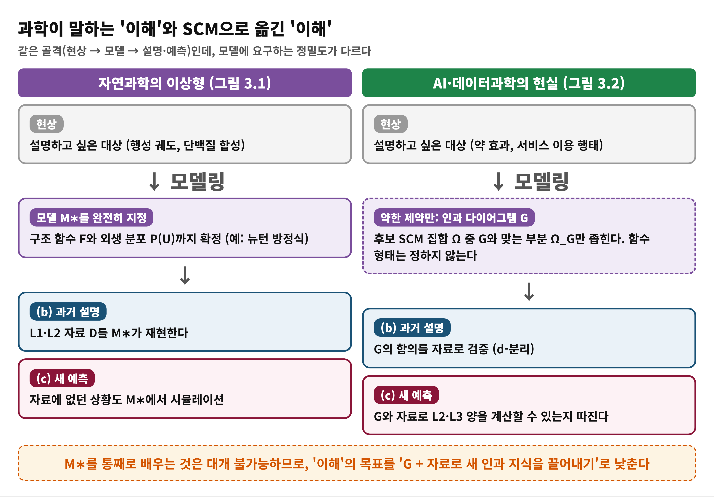
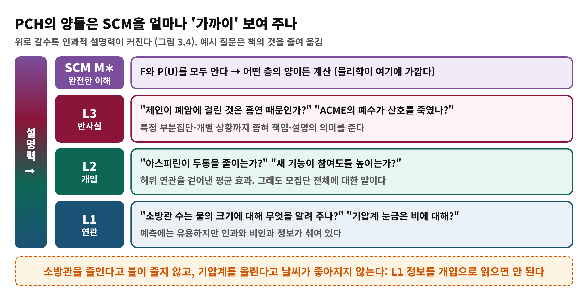
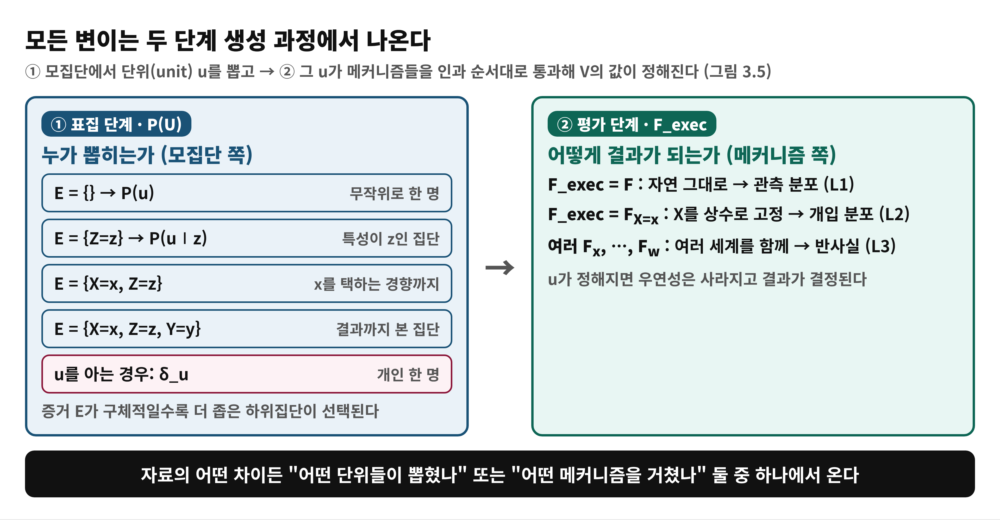
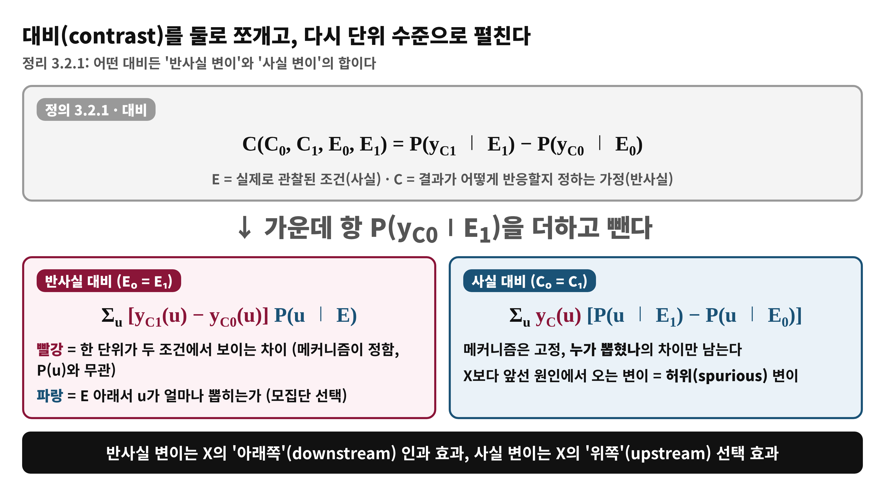
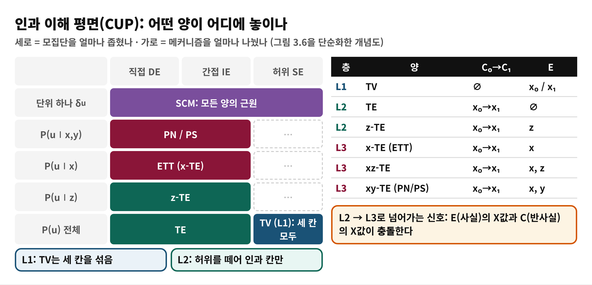

<!--
  book-explainer · Day 7 (PDF 123–138쪽) · Causal Artificial Intelligence
  빌드: python build_pptx.py day07.md
-->

# Day 7 — 인과적 이해란 무엇인가

**책**: Causal Artificial Intelligence · **범위**: PDF 123–138쪽 (인쇄 111–126) · 3장 3.1–3.2절 · **수준**: 입문

---

# 한눈에 보기
<!-- _class: small -->

- **이 범위가 푸는 문제**
  - SCM M∗를 통째로 알 수 없는데, 어떤 의미에서 세계를 '이해했다'고 말할 수 있는가?
- **결론 한 줄**
  - 이해는 정도의 문제다. **인과 다이어그램 G와 자료**로 PCH의 양(TV, TE, ETT, PN/PS…)을 얼마나 계산할 수 있는지가 이해의 깊이이고, 모든 양은 **'누가 뽑혔나'와 '어떤 메커니즘을 거쳤나'** 두 축으로 비교된다
- **읽고 나면**
  - 사실–반사실 대비(Def 3.2.1)를 쪼개고, 인과 이해 평면(CUP)에서 L1·L2·L3 양의 위치를 설명할 수 있다

---

# Part I에서 이어받은 것 · 왜 '이해'를 정의해야 하나
<!-- _class: small -->

- **이어받은 도구 (Day 3–6)**
  - SCM과 PCH, 인과 다이어그램, d-분리(자료로 모델을 검증하는 도구)
- **문제**
  - 물리학은 M∗를 거의 다 적어 우주선 궤도까지 계산하지만, 경제·보건·AI 분야에서는 불가능하다
  - 그렇다고 L1 자료만 보면 CHT(2.3절)에 따라 개입·반사실을 말할 수 없다
- **오늘의 질문**
  - 약한 가정(G)과 자료만으로 '이해했다'를 어떻게 정의하고 비교하는가? (3장 도입, 3.1절 · PDF 123–126쪽)

---

# 용어 준비
<!-- _class: small -->

| 용어 | 한 줄 뜻 | 예 |
|:---|:---|:---|
| 이해 (understanding) | 현상을 더 기본적인 부품으로 환원해 설명하고 새 상황을 예측함 | 단백질 합성을 단계별로 설명 |
| 질의 Q (query) | 사람의 언어로 적은 알고 싶은 것 | 이 약이 효과가 있나? |
| 단위 u (unit) | 모집단의 한 개체, 외생 변수 U의 값 | 환자 한 명 |
| 대비 (contrast) | 두 사실·반사실 조건의 결과 확률 차 | TV, TE, ETT |
| 구조적 기저 전개 | 대비를 단위별 차이와 단위 가중치의 합으로 쓰기 | 식 3.3, 3.4 |
| CUP | 양들을 모집단 축·메커니즘 축에 놓은 평면 | 그림 3.6 |

---

# 개념 1 — 과학에서의 '이해'
<!-- _class: small -->

- **좋은 설명의 요건 (3.1절, PDF 124–125쪽)**
  - (a) 현상을 더 단순한 부품으로 환원하는 모델링
  - (b) 과거 관측·실험(L1, L2 자료)을 설명
  - (c) 자료에 없던 **새 예측**을 낸다. 어려운 것은 (b)가 아니라 (c)다
- **M∗를 다 쓰는 이상형**
  - F와 P(U)를 확정하면 L1·L2·L3 어느 양이든 시뮬레이션할 수 있다 (예: 뉴턴 법칙으로 달 탐사 궤도)
- **AI·사회과학의 사정**
  - 사람이 개입하고 시스템이 열려 있어 우연성을 결정적으로 모델링할 수 없다
  - 그래서 M∗ 대신 **G라는 약한 제약**(Ω_G)만 적고 (b)는 d-분리로, (c)는 G+자료로 얻는다 (PDF 126–127쪽)

---

# 개념 1 — 도식: 이상형과 현실
<!-- _class: small -->

과학적 발견(그림 3.1)과 SCM으로 옮긴 발견(그림 3.2)의 비교

---

# 개념 1 — 비유로 이해하기: 요리 레시피
<!-- _class: small -->

- **비유**
  - 정확한 레시피(g 단위의 양, 불 세기, 시간)를 아는 요리사 vs. "채소를 먼저 볶고 그다음 소스를 넣는다" 정도의 순서 메모만 가진 사람
- **개념 대응**
  - 정확한 레시피 = M∗ · 순서 메모 = 인과 다이어그램 G · 완성된 요리 사진들 = 자료 D
- **핵심**
  - 순서 메모와 사진만으로도 "소스를 빼면 맛이 어떻게 변할까?" 같은 일부 질문은 답할 수 있다. 어느 질문이 되는지는 메모(가정)의 정보량에 달렸다
- **비유의 한계**
  - 책은 이를 정확히 따져 **어떤 L2·L3 질의가 계산 가능한지**를 다루고, 약한 메모일수록 예측이 줄어 아예 없을 수도 있다고 한다 (PDF 128쪽)

---

# 개념 2 — PCH의 양은 SCM에 얼마나 가까운가
<!-- _class: small -->

각 층의 질문은 SCM의 서로 다른 부분적 모습이다 (3.2절, 그림 3.4)

---

# 개념 2 — 이해는 정도의 문제이고, 추론은 이해를 만드는 과정
<!-- _class: small -->

- **인과 추론 = 이해 생성 (그림 3.3, PDF 127쪽)**
  - 입력: ① 자료(L1, 가끔 L2) + ② 모델(가정) → 출력: ③ 자료에 없던 L2·L3 질의의 답
  - Day 2의 인과 추론 엔진이 과학 발견 도식과 겹친다
- **비유: 지도의 축척**
  - L1 = 광역 지도, L2 = 도시 지도, L3 = 골목 지도, SCM = 건물 설계도
- **비유의 한계**
  - 책은 "L3는 곧 개인 단위"라는 통념이 **온전히 맞지 않는다**고 짚는다. 같은 모집단 전체에 대한 효과(DE, IE 등)도 L3일 수 있다 (PDF 137쪽)
- **상위 층은 더 가정·자료를 요구**
  - 설명력과 가정의 양은 맞바꿈 관계다

---

# 개념 3 — 변이는 어디서 오는가: 두 단계 생성 과정
<!-- _class: small -->

표집(누가 뽑히나) → 평가(어떤 메커니즘을 거치나) (그림 3.5, PDF 130–131쪽)

---

# 개념 4 — 사실–반사실 대비 (정의 3.2.1)
<!-- _class: small -->

- **정의 (PDF 131쪽, 식 3.1)**
  - 대비 C = P(y_C1 ∣ E1) − P(y_C0 ∣ E0)
  - E는 **실제로 관찰된 조건**(사실), C는 **결과가 어떻게 반응하는지**를 정하는 반사실 절
- **두 특수형**
  - E0 = E1 이면 **반사실 대비**: 개입 차이만 담음
  - C0 = C1 이면 **사실 대비**: 관찰 집단 차이만 담음
- **보통은 둘 다 섞여 있다**
  - 같은 모집단을 비교하는지(E), 같은 메커니즘을 거치는지(C)를 따로 보게 해 준다
- **TV, TE, ETT가 모두 이 형식의 특수한 경우다**

---

# 수식 풀이 (1) — 정리 3.2.1
<!-- _class: small -->

대비의 분해(식 3.2)와 구조적 기저 전개(식 3.3, 3.4) (PDF 131–132쪽)

---

# 수식 풀이 (2) — 장난감 숫자로 계산해 보기
<!-- _class: small -->

단위 4명(각 확률 1/4)을 우리가 임의로 만든 예. 책의 예가 아니다

| 단위 | 자연스러운 X | y(x₀) | y(x₁) | 관측된 y |
|:---|:---|:---|:---|:---|
| u1 | 1 | 0 | 1 | 1 |
| u2 | 1 | 0 | 1 | 1 |
| u3 | 0 | 1 | 1 | 1 |
| u4 | 0 | 1 | 0 | 1 |

- **TV** = P(y∣X=1) − P(y∣X=0) = 1 − 1 = **0** (L1: 차이 없어 보임)
- **TE** = 평균[y(x₁)−y(x₀)] = (1+1+0−1)/4 = **0.25**
- **ETT** (X=1인 u1, u2만) = (1+1)/2 = **1**
- **분해 확인**: TV = ETT + [P(y_x0∣X=1) − P(y_x0∣X=0)] = 1 + (0 − 1) = 0
  - 앞은 인과적 변이, 뒤는 누가 x₁을 택했나의 허위 변이

---

# 개념 5 — 이해의 정도: 층별 대비 표 (표 3.1)
<!-- _class: small -->

| 층 | 양 | C0→C1 | E (사실) | 읽는 법 |
|:---|:---|:---|:---|:---|
| L1 | TV | 없음 | x0 / x1 | x를 자연스럽게 택한 두 집단의 비교 |
| L2 | TE | x0→x1 | 없음 | 모집단 전체의 개입 효과 |
| L2 | z-TE | x0→x1 | z | 특성 z 집단에 한정한 효과 |
| L3 | x-TE (ETT) | x0→x1 | x | 실제 x를 택한 단위가 반대로 했다면 |
| L3 | xz-TE | x0→x1 | x, z | ETT를 z 집단으로 좁힘 |
| L3 | xy-TE (PN/PS) | x0→x1 | x, y | 선택과 결과까지 본 단위 (필요·충분 확률) |

- 행이 내려갈수록 같은 메커니즘 항 위에서 **단위 선택(E)만 더 좁아진다** (PDF 133–135쪽)

---

# 개념 5 — 인과 이해 평면(CUP)
<!-- _class: small -->

모집단 축 × 메커니즘 축 위에 양들을 배치 (그림 3.6, PDF 135–136쪽)

---

# 흔한 오해

> ❌ "반사실은 개인 한 명에 대한 양이다"

- ✅ 반사실이 필요한 이유는 두 가지다: ① 모집단을 더 좁힌다(ETT) ② 메커니즘을 더 쪼갠다(직접·간접 효과). 후자는 모집단 전체에 대한 양이다 (PDF 137쪽)
- ❌ "TV가 0이면 인과 효과도 없다" → ✅ TV는 선택 효과와 인과 효과가 섞인 값이라, 위 장난감 예처럼 TV=0이어도 TE≠0일 수 있다
- ❌ "M∗를 학습해야 이해한 것이다" → ✅ 책은 G와 자료로 필요한 L2·L3 양을 얻는 것을 이해로 삼는다 (PDF 126쪽)
- ❌ "L1 양은 쓸모없다" → ✅ 수동적 예측에는 강력하지만, 능동적 의사결정에는 부적합하다 (PDF 137쪽)

---

# 정리

- **이해의 정의**: 약한 가정 G와 자료로 PCH의 양을 얼마나 계산하느냐
- **모든 대비 = 반사실 변이 + 사실 변이**: 메커니즘의 차이와 모집단 선택의 차이
- **CUP**: L1 → L2 → L3로 갈수록 단위 선택과 메커니즘 분해가 정교해진다
- 다음 날(Day 8): 이해를 구체화했으니 **가장 기본 질문**, 관측 자료만으로 P(y∣do(x))를 계산할 수 있는가(식별과 백도어)로 들어간다

---

# 이해 점검 퀴즈 Q1

**(개념 확인)** 정의 3.2.1에서 E0 = E1 인 대비를 무엇이라 부르는가?

- A) 사실 대비
- B) 반사실 대비
- C) 관측 대비
- D) 구조적 대비

---

# Q1 정답 및 해설

- **정답: B**
- 왜 맞나: 같은 사실 조건 아래서 C0과 C1만 다르므로 차이는 개입(반사실) 조건에서 온다
- A가 틀린 이유: 사실 대비는 C0 = C1 인 경우이며, 바뀌는 것은 E다
- C, D가 틀린 이유: 정의 3.2.1에는 없는 용어이며 책이 쓰지 않는다

---

# 이해 점검 퀴즈 Q2

**(적용)** 어떤 정책에서 TV = P(y∣x₁) − P(y∣x₀) 가 0이다. 이 정보만으로 말할 수 있는 것은?

- A) TE도 0이다
- B) 인과 효과가 없다
- C) 인과 효과와 선택 효과가 서로 상쇄했을 수 있다
- D) 자료가 부족하다

---

# Q2 정답 및 해설

- **정답: C**
- 왜 맞나: TV는 반사실 변이와 사실 변이의 합이라 둘이 상쇄하면 0이 될 수 있다 (정리 3.2.1, 장난감 예에서 TE=0.25)
- A, B가 틀린 이유: TV 하나로는 TE를 알 수 없다 (CHT의 정신)
- D가 틀린 이유: 표본 크기의 문제가 아니라 L1 정보의 한계다

---

# 이해 점검 퀴즈 Q3

**(오개념 교정)** 인과 이해 평면에 대한 설명 중 **틀린** 것은?

- A) 세로축은 모집단을 얼마나 좁히는지를 나타낸다
- B) 가로축은 메커니즘(직접·간접·허위 변이)의 분해를 나타낸다
- C) 직접·간접 효과 같은 L3 양은 반드시 한 개인에 대한 양이다
- D) ETT는 모집단 축에서 TE보다 위에 놓인다

---

# Q3 정답 및 해설

- **정답: C** (틀린 설명)
- 왜 틀렸나: 직접·간접 효과는 전체 모집단에 대한 양이지만 메커니즘을 쪼개기 위해 반사실이 필요하다
- A, B: 맞다. 두 축의 정의 그대로다
- D: 맞다. ETT는 X=x를 택한 단위로 좁힌 L3 양이다 (PDF 137쪽)
