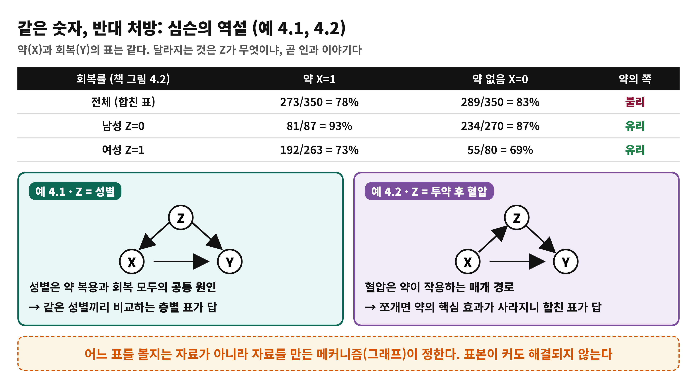
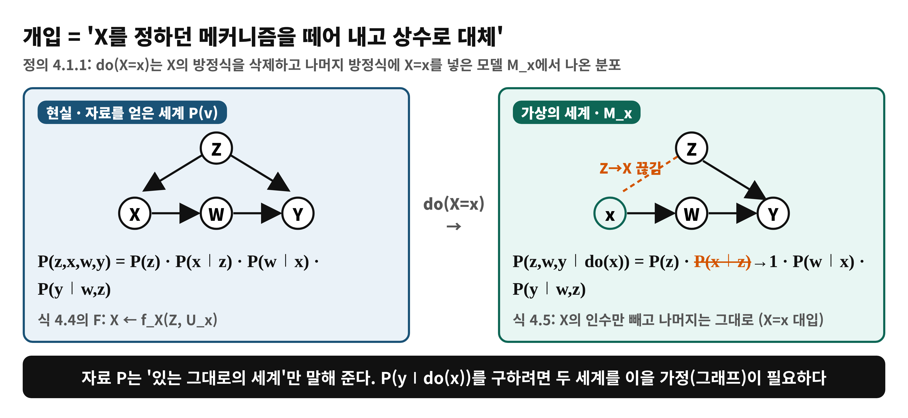
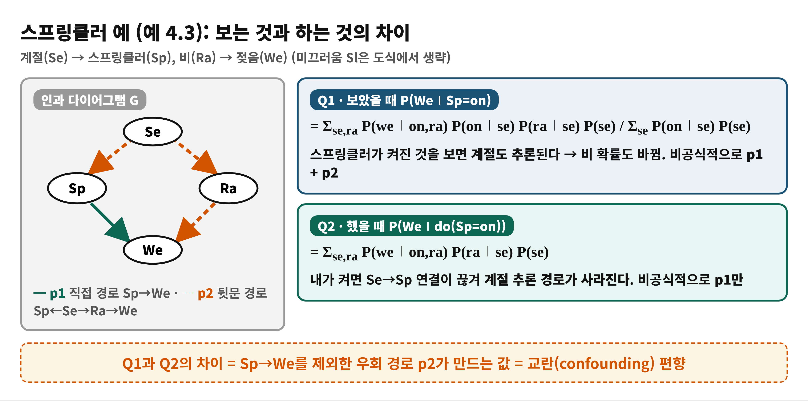
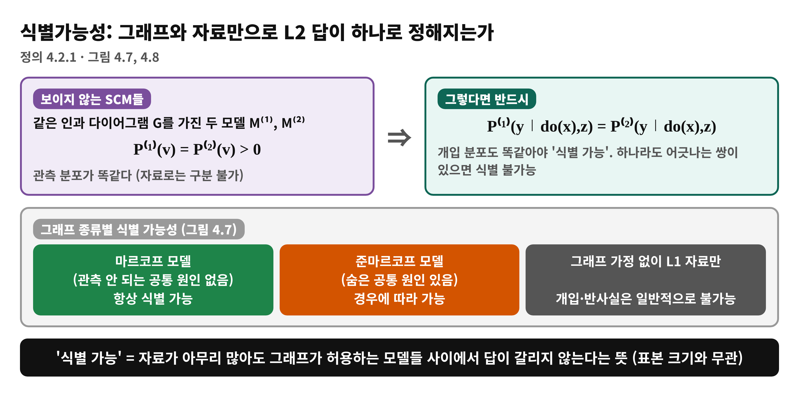
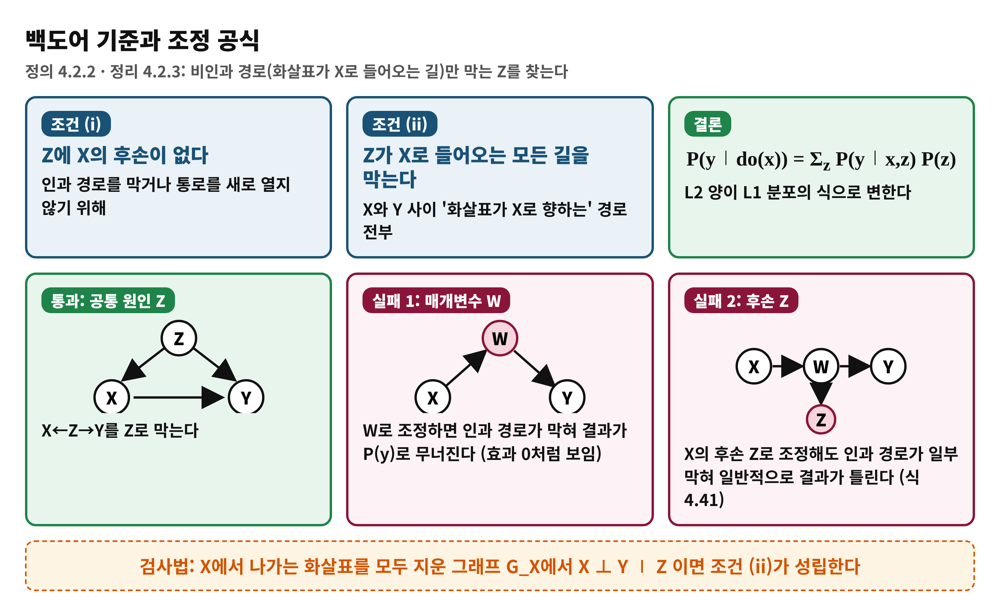

<!--
  book-explainer · Day 8 (PDF 139–153쪽) · Causal Artificial Intelligence
  빌드: python build_pptx.py day08.md
-->

# Day 8 — 개입 효과를 데이터로 계산할 수 있는가: 식별과 백도어

**책**: Causal Artificial Intelligence · **범위**: PDF 139–153쪽 (인쇄 127–141) · 4장 4.1–4.2.2절 · **수준**: 입문

---

# 한눈에 보기
<!-- _class: small -->

- **이 범위가 푸는 문제**
  - 실험 없이 관측 자료(L1)만으로 P(y∣do(x))(L2)를 구할 수 있는 조건은 무엇인가?
- **결론 한 줄**
  - 인과 다이어그램이 있으면 **식별 가능성**을 따질 수 있다. 가장 기본 도구인 **백도어 기준**을 만족하는 Z가 있으면 P(y∣do(x)) = Σ_z P(y∣x,z)P(z)로 계산된다
- **읽고 나면**
  - 심슨 역설에서 어느 표를 볼지 그래프로 판단하고, 백도어 조건 두 개가 왜 필요한지 설명할 수 있다

---

# Day 7에서 이어받은 것 · 왜 필요한가
<!-- _class: small -->

- **이어받은 것**
  - Day 7: 이해는 정도의 문제이고, L2 양은 L1 자료와 가정 G로 얻는다. Day 3 do-연산, Day 5–6 그래프와 d-분리
- **왜 필요한가**
  - 무작위 실험은 비용·기술·윤리 때문에 어려운 경우가 많다
  - 그런데 관측 자료만 보면 심슨 역설처럼 결론이 뒤집힌다
- **오늘의 질문**
  - 어떤 조건에서 관측 분포 P(v)로부터 개입 분포를 **계산**할 수 있나? (4장 도입, 4.1절 · PDF 139–141쪽)

---

# 용어 준비
<!-- _class: small -->

| 용어 | 한 줄 뜻 | 예 |
|:---|:---|:---|
| 개입 분포 (Def 4.1.1) | X의 방정식을 지우고 X=x를 넣은 모델의 분포 | P(y∣do(x)) |
| 교란 편향 | P(y∣x)와 P(y∣do(x))의 차이 | 약 복용과 성별 |
| 식별가능성 (Def 4.2.1) | 그래프 + 관측 분포로 질의 값이 하나로 정해짐 | 백도어 조정 |
| 마르코프 모델 | 숨은 공통 원인이 없는 모델 | 스프링클러 예 |
| 백도어 기준 (Def 4.2.2) | 비인과 경로만 막는 조정 집합 Z의 조건 | Z = {Rain} |
| G_X | X에서 나가는 화살표를 지운 그래프 | 백도어 검사용 |

---

# 개념 1 — 같은 표, 다른 답: 심슨의 역설
<!-- _class: small -->

예 4.1과 4.2: 합친 표와 층별 표가 반대를 말한다 (PDF 140–142쪽)

---

# 개념 1 — 어느 표를 볼 것인가
<!-- _class: small -->

- **예 4.1 (Z = 성별)**
  - 여성이 약을 더 자주 쓰고(76% vs 24%) 회복률은 낮다 → 성별이 공통 원인 → **층별 표**
- **예 4.2 (Z = 투약 후 혈압)**
  - 약의 핵심 작용은 혈압을 낮추는 것 → Z는 **매개** → 쪼개면 핵심 효과가 사라져 **합친 표**
- **교훈**
  - 확률의 공리는 이런 숫자를 막지 않는다. 표본이 커도 안 풀린다. 그래프가 답을 정한다
- **읽을 때 주의**
  - 책 본문은 예 4.1에서 약이 "유익해 보인다"고 쓰고 예 4.2에서 '음의 효과'라 쓰지만, 그림 4.2·4.3의 숫자는 둘이 같고 위 표와 같다. 문장보다 그림 숫자를 기준으로 읽는다

---

# 개념 2 — 개입은 '회로 절단'
<!-- _class: small -->

정의 4.1.1과 식 4.4–4.5: X의 메커니즘을 상수로 바꾼다 (PDF 142–144쪽)

---

# 개념 2 — 비유로 이해하기: 자동 온도조절기
<!-- _class: small -->

- **비유**
  - 방의 온도(X)를 자동 조절기(Z의 영향을 받는 규칙)가 정하는 집에서, 조절기를 떼고 손으로 온도를 고정하는 것
- **개념 대응**
  - 조절기를 뗌 = X의 방정식 삭제 · 손으로 고정 = X=x · 고정 뒤 결과의 분포 = P(y∣do(x))
- **핵심**
  - 관찰만 하면 "더운 날 에어컨을 많이 켠 집"처럼 조절기의 규칙이 섞인 통계가 나온다. 떼어 내면 그 규칙(Z→X)만 사라지고 나머지는 그대로다
- **비유의 한계**
  - 책의 개입은 **이상적**이다. 실제 개입이 다른 메커니즘까지 건드리는 경우는 이 정의에 담기지 않는다. 또 랜덤화 실험은 X를 새 외부 무작위성으로 정하는 방식이다 (PDF 143쪽)

---

# 개념 3 — 스프링클러: 보기 vs 하기
<!-- _class: small -->

예 4.3: P(We∣Sp=on) = p1 + p2, P(We∣do(Sp=on)) = p1 (PDF 144–145쪽)

---

# 개념 3 — 마르코프 모델은 언제나 식별된다
<!-- _class: small -->

- **절단 인수분해 (정리 4.1.1, 식 4.13)**
  - P(v∣do(x)) = ∏_{i: Vi∉X} P(vi∣pa_i) (X=x 대입)
  - 다시 쓰면 P(v) ÷ ∏_{X∈X} P(x∣pa_x) (식 4.14), 또는 P(v∣x,pa_x)P(pa_x) (식 4.15)
- **주변화 (정리 4.2.1)**
  - 마르코프 모델이면 모든 X, Y에 대해 P(y∣do(x))는 위 식에서 나머지를 합해 L1 분포만으로 얻어진다
- **부모로 조정 (정리 4.2.2)**
  - P(y∣do(x)) = Σ_{pa_x} P(y∣x,pa_x)P(pa_x) (식 4.17)
- **한계**
  - 부모가 관측되지 않는 비마르코프(준마르코프) 모델에선 쓸 수 없다 → 백도어 (PDF 145–147쪽)

---

# 개념 4 — 식별가능성 (정의 4.2.1)
<!-- _class: small -->

그래프가 같고 관측이 같은 모든 모델이 같은 L2 답을 내는가 (PDF 146쪽)

---

# 개념 5 — 백도어 기준과 조정
<!-- _class: small -->

정의 4.2.2, 정리 4.2.3 (PDF 148쪽)

---

# 수식 풀이 — 백도어 조정 공식 읽기
<!-- _class: small -->

- **말로 먼저**
  - Z가 같은 사람끼리 X와 Y의 관계를 보고(P(y∣x,z)), 그 결과를 **X와 상관없이 원래 Z 분포**(P(z))로 평균낸다
- **기호**
  - P(y∣do(x)): 구하려는 L2 양 · P(y∣x,z): 자료에서 센 조건부 확률 · P(z): Z의 주변 분포 (x가 아니라 P(z)임에 주의)
- **스프링클러에 적용 (식 4.28)**
  - Season이 숨겨져 있어도 Rain으로 조정: P(we∣do(sp)) = Σ_ra P(we∣sp,ra)P(ra)
  - Rain은 Sp의 후손이 아니고, 뒷문 경로 Sp←Se→Ra→We를 막는다
- **증명의 뼈대 (식 4.29–4.33)**
  - 부모 조정에서 시작해 Z를 끼워 넣고, 조건 (i)(ii)로 독립을 쓰면 P(z)만 남는다 (PDF 149쪽)

---

# 수식 풀이 — 왜 조건이 둘 다 필요한가
<!-- _class: small -->

- **조건 (i) 후손 금지: W가 매개일 때 (그림 4.10)**
  - W로 조정하면 X ⊥ Y ∣ W라 Σ_w P(y∣w)P(w) = P(y)가 된다
  - 이는 do(x)에 값이 무관하다는 뜻이라 X→W→Y가 있는 한 말이 안 된다
- **W의 후손 Z도 안 된다**
  - Σ_z P(y∣x,z)P(z)와 참값 사이엔 P(z) 대 P(z∣x)의 차이가 남아 일반적으로 ≠ (식 4.41)
- **조건 (ii) 막기**
  - 비인과 경로를 하나라도 열어 두면 교란 편향이 남는다
- **한 줄 정리**
  - 비인과 길은 모두 막고, 인과 길은 건드리지 않는다 (PDF 149–150쪽)

---

# 백도어 집합 찾기 — G_X 검사
<!-- _class: small -->

- **G_X**
  - X에서 **나가는** 화살표를 모두 지운 그래프. 남은 X–Y 경로는 전부 비인과(백도어) 경로다
- **검사**
  - G_X에서 X ⊥ Y ∣ Z (d-분리)이면 조건 (ii)가 성립한다. Day 6의 d-분리를 그대로 쓴다
- **그림 4.11(a) 예**
  - {Z1, Z4}는 통과. {Z4}만으로는 경로 X←Z3←Z1→Z4←Z2→Z5→Y가 열려 있어 실패(Z4가 충돌 노드라 조건화하면 열림)
  - Pa(X)는 항상 기준을 만족한다
- **따름정리 4.2.4**
  - 공집합이 백도어 기준을 만족하면 P(y∣do(x)) = P(y∣x). 연관 = 인과 (PDF 150–151쪽)

---

# 백도어의 확장 — 조건부 효과, 그리고 A-BDC
<!-- _class: small -->

- **조건부 효과 (정리 4.2.5)**
  - Z∪W가 기준을 만족하면 P(y∣do(x),w) = Σ_z P(y∣x,z,w)P(z∣w)
  - 예 4.4: 학교 유형(X)이 SAT(Y)에 미치는 효과를 학군 z1에서, 가계소득(Z2)으로 조정
- **고유 인과 경로 (정의 4.2.3)**
  - X의 원소를 도중에 지나지 않는 인과 경로. X가 하나면 모든 인과 경로가 고유하다
- **조정 백도어 기준 (정의 4.2.4, 정리 4.2.6)**
  - 후손도 일부 허용: 고유 인과 경로 위 노드의 후손이 Z에 없고, 모든 비인과 경로가 Z로 막히면 된다
  - 정리 4.2.6은 이것이 조정 공식이 성립할 필요충분조건이라고 말한다
- **X가 하나면** A-BDC 집합에서 후손을 빼도 백도어 기준을 만족한다 (따름정리 4.2.7) (PDF 151–153쪽)

---

# 흔한 오해

> ❌ "더 많이 조정(통제)할수록 좋다"

- ✅ 매개변수나 후손을 넣으면 인과 효과를 지우거나 왜곡한다 (예 4.2, 식 4.34–4.41)
- ❌ "합친 표는 항상 틀렸고 층별 표가 항상 옳다" → ✅ 그래프에 따라 달라진다. Z가 공통 원인이면 층별, 매개이면 합친 표
- ❌ "자료가 충분하면 식별이 된다" → ✅ 식별은 표본 크기가 아니라 그래프 구조의 성질이다
- ❌ "P(y∣x)와 P(y∣do(x))는 같다" → ✅ 비인과 경로가 막혀 있을 때만(공집합이 기준을 만족할 때) 같다 (따름정리 4.2.4)

---

# 정리

- **개입 = X의 메커니즘 절단**: P(y∣do(x))는 가상 세계의 분포이고 L1 자료만으론 알 수 없다
- **식별가능성**: 그래프 + P(v)로 값이 하나로 정해질 때. 마르코프 모델은 항상, 준마르코프는 경우에 따라
- **백도어**: (i) X의 후손 금지 (ii) 백도어 경로 차단 → P(y∣do(x)) = Σ_z P(y∣x,z)P(z)
- 다음 날(Day 9): 백도어는 교란을 **모두 관측**할 때만 통한다. 관측되지 않는 교란까지 다루는 **프론트도어**로 간다

---

# 이해 점검 퀴즈 Q1

**(개념 확인)** 백도어 기준의 두 조건으로 옳은 것은?

- A) Z가 X의 후손이어야 하고 모든 경로를 막아야 한다
- B) Z에 X의 후손이 없고, X로 들어오는 화살표가 있는 X–Y 경로를 모두 막는다
- C) Z가 Y의 원인이면 충분하다
- D) Z가 X와 독립이어야 한다

---

# Q1 정답 및 해설

- **정답: B**
- 왜 맞나: (i) 인과 경로를 건드리지 않기 위해 후손 금지, (ii) 비인과 경로만 차단
- A가 틀린 이유: 후손이면 인과 경로를 막거나 새 경로를 연다
- C가 틀린 이유: Y의 원인이라는 사실만으로 교란을 막지 못한다
- D가 틀린 이유: 교란이 있으면 Z는 X와 연관되어도 괜찮다. 필요한 것은 경로 차단이다

---

# 이해 점검 퀴즈 Q2

**(적용)** X→W→Y, X←Z→Y 구조에서 P(y∣do(x))를 구하려 한다. 올바른 조정 집합은?

- A) {W}
- B) {Z}
- C) {W, Z}
- D) 아무것도 조정하지 않는다

---

# Q2 정답 및 해설

- **정답: B**
- 왜 맞나: Z는 X의 후손이 아니며 X←Z→Y를 막는다. 공식은 Σ_z P(y∣x,z)P(z)
- A, C가 틀린 이유: W는 매개(후손)라 인과 경로를 막는다
- D가 틀린 이유: 비인과 경로 X←Z→Y가 열려 있어 P(y∣x)는 교란 편향을 포함한다 (따름정리 4.2.4의 조건 불충족)

---

# 이해 점검 퀴즈 Q3

**(오개념 교정)** 심슨 역설에 대한 설명 중 **틀린** 것은?

- A) 합친 표와 층별 표가 반대 방향을 가리킬 수 있다
- B) 표본이 충분히 크면 이런 역전은 사라진다
- C) 어느 표를 따를지는 인과 그래프가 정한다
- D) Z가 매개변수라면 합친 표를 따른다

---

# Q3 정답 및 해설

- **정답: B** (틀린 설명)
- 왜 틀렸나: 책은 큰 표본에서도 역전이 일어나며 표본 변동과 무관하다고 말한다. 원인은 L1 정보의 한계다
- A, C: 맞다. 예 4.1, 4.2의 교훈이다
- D: 맞다. 예 4.2에서 혈압은 약이 작용하는 경로라 쪼개면 안 된다 (PDF 142쪽)
