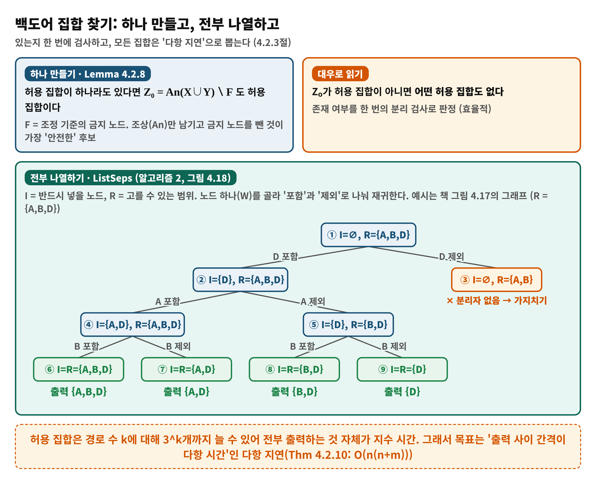
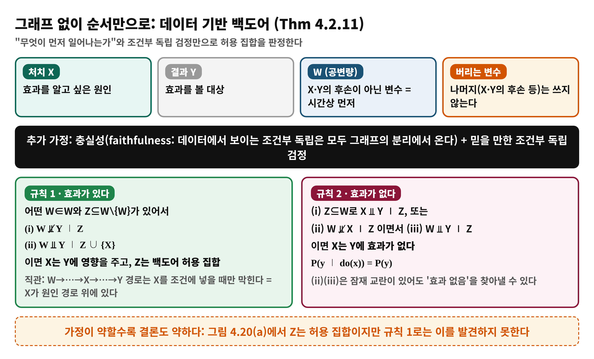
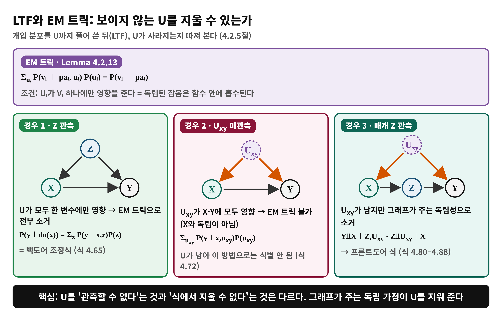
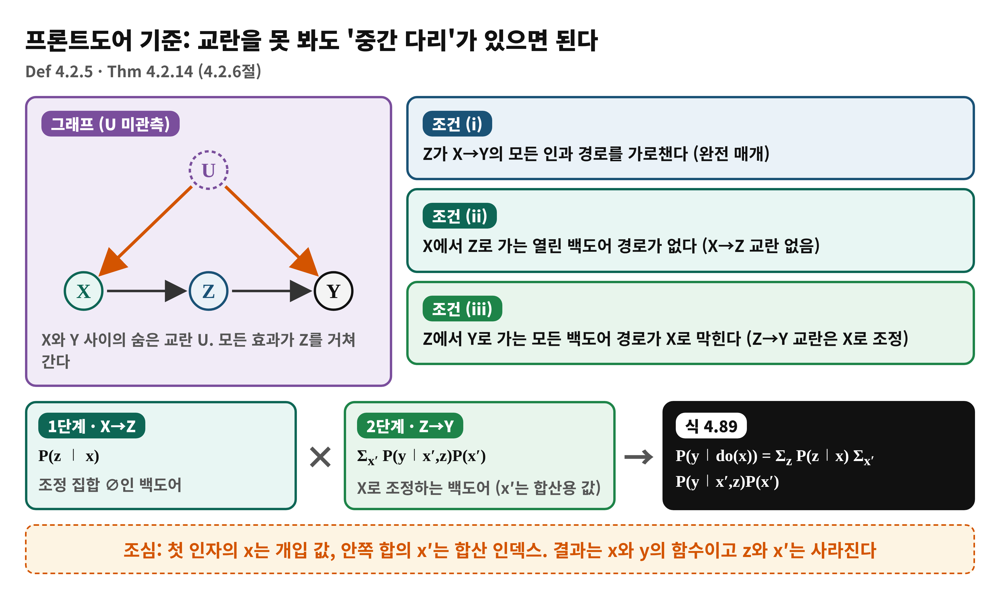
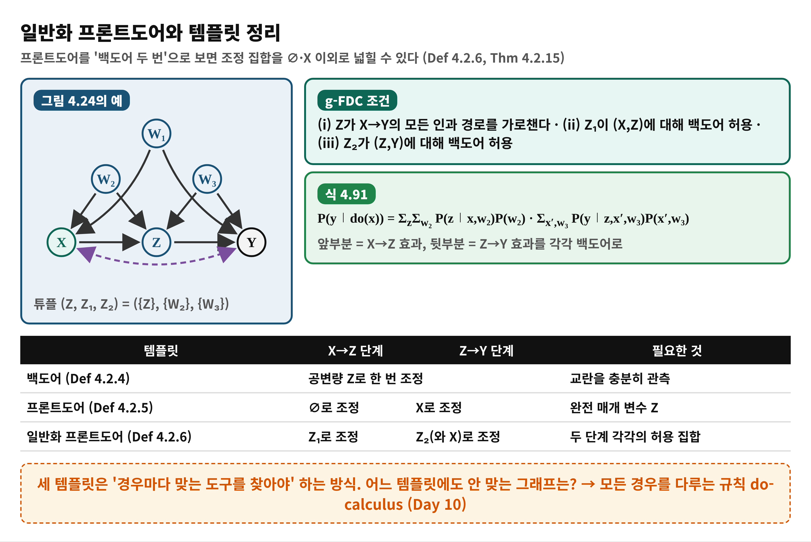

# Day 9 — 템플릿 기반 식별의 완성: 프론트도어 (학습 노트)

> 근거: Causal Artificial Intelligence, PDF 154–165쪽 (인쇄 142–153) · 4.2.3 ~ 4.2.6.1 · 독자 수준: 입문
> 쪽 번호는 PDF 기준이며 인쇄 번호 = PDF − 12. 일반화 프론트도어 정리의 식(4.90)은 PDF 166쪽에서 끝난다.

## 한눈에 보기
- **이 범위가 푸는 문제**: 교란 변수를 관측하지 못해도 개입 효과 P(y∣do(x))를 관측 자료로 계산할 수 있는가?
- **결론 한 줄**: 백도어가 교란을 '막는' 조정이라면, **프론트도어**는 X와 Y 사이의 중간 다리 Z를 이용해 효과를 두 조각으로 나눠 **백도어를 두 번** 쓰는 방법이다. 그래프를 그릴 수 없으면 변수의 순서 가정만으로 조정 집합을 찾는 길도 있다.
- **읽고 나면**: 허용 집합을 만들고 나열하는 방법, LTF·EM 트릭, 프론트도어 식(4.89)의 유도와 한계를 설명할 수 있다.

## Day 8에서 이어받은 것
Day 8은 개입 효과가 관측 분포로 계산 가능한 조건(식별가능성)과 백도어 기준(Def 4.2.2), 조정 백도어 기준 A-BDC(Def 4.2.4)를 다뤘다. 핵심 식은 P(y∣do(x)) = Σ_z P(y∣x,z)P(z)였고, 전제는 "교란을 충분히 측정했다"였다. 오늘은 그 전제가 깨질 때를 다룬다.

## 왜 필요한가
백도어는 (1) 허용되는 집합을 어떻게 찾는지, (2) 인과 그래프 전체가 없을 때는 어떻게 하는지, (3) 교란이 정말 관측 불가일 때는 어떻게 하는지에 답하지 않는다. 책은 4.2.3–4.2.4절에서 앞의 둘을, 4.2.5–4.2.6절에서 셋째를 다룬다.

## 용어 준비
| 용어 | 한 줄 뜻 | 예 |
|---|---|---|
| 허용 집합 (admissible set) | 조정에 써도 되는 변수 묶음 | A-BDC를 만족하는 Z |
| 금지 노드 F | 조정에 넣으면 안 되는 변수 | 인과 경로 위 변수의 후손 |
| 조상 집합 An(·) | 해당 노드들과 그 조상 | An(X∪Y) |
| 다항 지연 (polynomial delay) | 결과 하나를 낼 때마다 걸리는 시간이 다항식 | ListSeps |
| 충실성 (faithfulness) | 데이터의 조건부 독립은 모두 그래프의 분리에서 온다는 가정 | 4.2.4절 |
| LTF 곱 | 외생변수 U까지 풀어 쓴 개입 분포 | 식 4.51 |
| EM 트릭 | 독립된 외생 잡음을 합산해 지우는 규칙 | 식 4.64 |
| 프론트도어 | 매개 Z를 통한 효과 계산 기준 | Def 4.2.5 |

## 개념 1. 허용 집합 하나 만들기, 전부 나열하기 (4.2.3절, PDF 154–157)
- **Lemma 4.2.8**: 허용 집합이 하나라도 있으면 Z₀ = An(X∪Y) ∖ F도 허용 집합이다 (F는 조정 기준 조건 (i)이 금지하는 노드). 대우로, Z₀가 허용 집합이 아니면 허용 집합은 존재하지 않는다. 존재 여부를 한 번에 판정하는 효율적인 방법이다.
- **왜 전부 나열하나**: 측정 비용이 낮은 집합, 분산이 작은 집합, 프라이버시·공정성 제약을 만족하는 집합을 고르고 싶기 때문이다. 예: 유전 조건 A는 측정이 어렵고 두통 B는 쉽다면 {B}를 택한다.
- **어려움**: 후보 경로가 k개이면 허용 집합이 3^k개까지 늘 수 있다. 출력만 해도 지수 시간이므로 '출력 하나당 다항 시간'(polynomial delay)을 목표로 한다.
- **Lemma 4.2.9 + ListSeps**: I는 반드시 넣을 집합, R은 고를 수 있는 범위다. Z₀ = An(X∪Y∪I) ∩ R가 분리자이면 I⊆Z⊆R인 분리자가 존재한다. 이 검사를 ExistsSep이라 하고, 노드 W 하나를 골라 '포함/제외'로 나누어 재귀한다. 가능성이 없으면 그 가지를 접는다.
- **Thm 4.2.10**: 지연은 O(n(n+m)) (n: 노드 수, m: 간선 수).

**비유**: 여행 가방 싸기. 물건마다 넣을지 뺄지 정하다가 이미 불가능한 조합이면 그 아래는 보지 않고 접는다.

| 비유 | 개념 |
|---|---|
| 물건 | 후보 변수 W |
| 넣는다 / 뺀다 | I에 포함 / R에서 제외 |
| 불가능해서 접기 | ExistsSep 실패 → 가지치기 |

> **비유의 한계**: 실제 판정 기준은 취향이 아니라 **분리(separation) 검사**이다. 또 가방 비유는 '몇 개를 담았나'를 떠올리게 하지만 여기서는 '조건을 만족하는 모든 집합'이 목표다.

## 개념 2. 그래프 없이 순서만으로: 데이터 기반 백도어 (4.2.4절, PDF 157–159)
인과 그래프 전체를 그리기 어려울 때를 위한 약한 가정의 방법이다.
- 변수를 네 묶음으로 나눈다: 처치 X, 결과 Y, **W = X·Y의 후손이 아닌 변수**(시간상 먼저), 나머지(버림).
- 가정: 충실성, 그리고 믿을 만한 조건부 독립 검정.
- **Thm 4.2.11 규칙 1**: 어떤 W∈W와 Z⊆W∖{W}에 대해 (i) W와 Y가 Z 아래에서 독립이 아니고, (ii) Z∪{X} 아래에서는 독립이면, X는 Y에 영향을 주고 Z는 허용 집합이다. 직관은 W에서 Y로 가는 경로가 X를 조건에 넣어야만 막힌다는 것, 즉 X가 그 경로 위의 원인이라는 뜻이다.
- **규칙 2**: (i) Z⊆W로 X⫫Y∣Z이거나, (ii) W와 X가 Z 아래 독립이 아니고 (iii) W⫫Y∣Z이면 X는 Y에 효과가 없다 (P(y∣do(x)) = P(y)).
- **대가**: 가정이 약한 만큼 결론도 약하다. 그림 4.20(a)에서 Z가 허용 집합임은 규칙 1로 발견되지 않는다.

## 개념 3. LTF 곱과 EM 트릭 (4.2.5절, PDF 159–163)
- **LTF (Thm 4.2.12)**: P(v∣do(x)) = Σ_u Π_{V_i∉X} P(v_i∣pa_i,u_i) P(u) (X=x 대입). 마르코프 모델의 절단 분해(식 4.13)와 모양이 같지만 U가 들어 있다. 마르코프 모델은 곧바로 식별되지만 비마르코프 모델은 U가 식에 남을 수 있다.
- **EM 트릭 (Lemma 4.2.13)**: U_i가 V_i 하나에만 영향을 주는 독립된 잡음이면 Σ_{u_i} P(v_i∣pa_i,u_i)P(u_i) = P(v_i∣pa_i). 독립 잡음은 함수 안에 흡수된다.
- **경우 1 (Z 관측, 그림 4.21)**: 식을 묶고 EM 트릭을 적용하면 U가 모두 사라져 Σ_z P(y∣x,z)P(z)가 된다 (식 4.65 = 백도어 조정식).
- **경우 2 (U_xy 미관측, 그림 4.22)**: U_xy가 X와 Y에 모두 영향을 준다. 식 4.72의 Σ P(y∣x,u_xy)P(u_xy)에는 U_xy가 남고, X와 독립이 아니라 EM 트릭을 쓸 수 없다. 책은 이것이 불가능성 결과로 이어진다고 말하고 4.5절로 미룬다.
- **경우 3 (매개 Z 관측, 그림 4.23)**: U_xy는 남지만, 그래프에서 읽는 독립성 (Y⫫X∣Z,U_xy)와 (Z⫫U_xy∣X)를 써서 지울 수 있다. 결과가 프론트도어 식이다.

## 개념 4. 프론트도어 기준 (4.2.6절, PDF 163–165)
**Definition 4.2.5**: 다음을 만족하는 Z는 (X,Y)에 대해 프론트도어 기준을 만족한다.
1. Z가 X→Y의 모든 인과 경로를 가로챈다.
2. X에서 Z로 가는 열린 백도어 경로가 없다.
3. Z에서 Y로 가는 모든 백도어 경로가 X로 막힌다.

**Theorem 4.2.14**: P(y∣do(x)) = Σ_z P(z∣x) Σ_{x′} P(y∣x′,z)P(x′).

**비유**: 학원 등록(X)→공부 시간(Z)→성적(Y), 숨은 학습 동기(U)가 등록과 성적에 모두 영향을 준다. 등록이 공부 시간에 미치는 효과는 동기와 무관하게 잴 수 있고, 공부 시간이 성적에 미치는 효과는 등록 여부로 나눠 비교하면 동기가 걸러진다. 두 조각을 곱해 이으면 동기를 몰라도 전체 효과가 나온다.

| 비유 | 개념 |
|---|---|
| 학원 등록 | 처치 X |
| 공부 시간 | 매개 Z |
| 성적 | 결과 Y |
| 숨은 동기 | 미관측 교란 U |

> **비유의 한계**: 학원이 공부 시간이 아닌 다른 경로(친구, 동기 부여)로 성적에 영향을 주면 조건 (i)이 깨져 식이 성립하지 않는다. 또 조건 (ii),(iii)은 그림이 아닌 **가정**이라서 데이터만으로 확인할 수 없다.

## 수식 풀이
식 4.89를 말로 읽으면 다음과 같다.
1. **P(z∣x)**: X를 x로 바꿨을 때 Z가 z가 될 확률 (조정 집합이 ∅인 백도어).
2. **Σ_{x′} P(y∣x′,z)P(x′)**: Z를 z로 고정했을 때의 Y. Z→Y의 교란을 X로 조정해 없앤다. 여기의 x′는 **합산 인덱스**이고 개입 값 x와 다르다.
3. 두 조각을 Z의 모든 값 z에 대해 곱하고 합한다. 결과는 x, y의 함수이고 z와 x′는 사라진다.

### 숫자로 확인 (책 외 장난감 예: 직접 계산)
숨은 U∈{0,1} (각 0.5), X는 U에 따라, Z는 X에 따라, Y는 Z와 U에 따라 정해지는 이진 SCM. 관측 분포에서 P(x)=0.5, P(Z=1∣x=0)=0.1, P(Z=1∣x=1)=0.9, P(Y=1∣x,z)는 (0,0)=0.18, (0,1)=0.58, (1,0)=0.42, (1,1)=0.82.
- 안쪽 합: z=0이면 0.5·0.18+0.5·0.42 = 0.30, z=1이면 0.5·0.58+0.5·0.82 = 0.70.
- do(x=1): 0.1·0.30 + 0.9·0.70 = **0.66**. do(x=0): 0.9·0.30 + 0.1·0.70 = **0.34**. 이는 SCM으로 직접 계산한 참값과 일치한다.
- 단순 비교 P(Y=1∣x=1) = 0.78, P(Y=1∣x=0) = 0.22로 차이는 0.56이지만 참 효과 차이는 0.32다. U를 몰라도 프론트도어로 바로잡을 수 있다.

## 개념 5. 일반화 프론트도어와 템플릿 정리 (4.2.6.1절, PDF 165–166)
프론트도어는 두 단계에 쓰인 조정 집합이 ∅와 X인 특수한 경우다. 다른 집합도 쓸 수 있도록 일반화한 것이 **Def 4.2.6**의 g-FDC다: (i) Z가 X→Y의 모든 인과 경로를 가로채고, (ii) Z₁이 (X,Z)에 대해 백도어 허용, (iii) Z₂가 (Z,Y)에 대해 백도어 허용. **Thm 4.2.15**의 식 4.90은 P(y∣do(x)) = Σ_z Σ_{z₁} P(z∣x,z₁)P(z₁) Σ_{x′,z₂} P(y∣x′,z,z₂)P(x′,z₂)이다. 그림 4.24에서 ({Z},{W₂},{W₃})로 식 4.91이 얻어진다.

### 템플릿의 한계
백도어, 프론트도어, 일반화 프론트도어는 그래프 모양이 맞아야 쓰는 '케이스별 도구'다. 어느 것에도 안 맞는 그래프가 식별 불가인지 아닌지는 이 방식으로는 알 수 없다. 이를 체계적으로 다루는 규칙이 다음 날의 do-calculus(4.3절)다.

## 이 PDF를 읽을 때 주의
- 4.2.3절 본문에서 ListSeps 예시의 R를 V∖F로 두면서 {X,Y,A,B,D}라고 적었으나 F에 X,Y가 포함되어 있으므로 도표(그림 4.18)의 R={A,B,D}가 맞다. 이 자료는 후자를 따른다.
- 그림 4.15(d), 4.19 등 그림 번호 참조가 본문과 어긋나는 곳이 있고, "Sec. ??" 참조가 비어 있다 (초안).
- Thm 4.2.15의 식 4.90에서 Z→Y 조정에 X와 Z₂가 함께 쓰이는데, Def 4.2.6의 (iii) 문장만으로는 X의 역할이 분명하지 않다. 식을 기준으로 읽는 것이 안전하다.

## 흔한 오해
- ❌ "교란이 관측되지 않으면 효과는 절대 식별할 수 없다" → ✅ 프론트도어처럼 매개 변수와 독립 구조가 있으면 U를 몰라도 식별된다.
- ❌ "프론트도어는 Z로 조정하는 것이다" → ✅ X→Z와 Z→Y 효과를 각각 구해 이어 붙인다.
- ❌ "식 4.89의 x와 x′는 같은 값이다" → ✅ x는 개입 값, x′는 합산 인덱스다.
- ❌ "공변량은 많이 넣을수록 좋다" → ✅ 잘못 넣으면 백도어를 연다. 데이터 기반 백도어는 먼저 일어난 변수만 후보로 삼는다.

## 정리
1. 허용 집합은 Z₀ = An(X∪Y)∖F로 존재를 판정하고 ListSeps로 다항 지연 나열한다.
2. 순서 가정과 조건부 독립 검정만으로도 허용 집합과 '효과 없음'을 판정할 수 있다 (가정이 약한 만큼 결론도 약함).
3. 프론트도어: 매개 Z로 U 없이 P(y∣do(x)) = Σ P(z∣x) Σ P(y∣x′,z)P(x′).
4. 템플릿은 케이스별 도구이므로 → 다음 날 모든 경우를 다루는 do-calculus.

## 이해 점검 퀴즈
**Q1. (개념 확인)** Lemma 4.2.8의 용도로 옳은 것은?
- A) 백도어 허용 집합이 존재하는지 Z₀ 하나만 검사해 판정한다
- B) 허용 집합 중 가장 작은 것을 항상 찾는다
- C) 허용 집합을 제거해 인과 효과를 0으로 만든다
- D) 프론트도어 식을 유도한다

정답 및 해설

정답: **A**. 허용 집합이 있으면 Z₀도 허용 집합이므로 Z₀가 아니면 없다(대우). B는 최소 집합이 아니라 존재 판정이고, C는 조정이 효과를 바꾸지 않고 계산하는 도구이며, D의 프론트도어는 별도의 기준(Def 4.2.5)이다.

**Q2. (적용)** X→Z→Y 구조에서 U가 X와 Y에 모두 영향을 주고 U는 관측되지 않는다. Z는 관측된다. 효과를 구하는 식은?
- A) Σ_z P(y∣x,z)P(z)
- B) Σ_z P(z∣x) Σ_{x′} P(y∣x′,z)P(x′)
- C) P(y∣x)
- D) 식별할 수 없다

정답 및 해설

정답: **B**. Z가 모든 인과 경로를 가로채고 X→Z, Z→Y에 열린 백도어가 없거나 X로 막히므로 프론트도어 조건을 만족한다. A는 U를 막지 못하고, C는 교란된 단순 조건부 확률이며, D는 프론트도어 덕분에 틀리다.

**Q3. (오개념 교정)** 데이터 기반 백도어(Thm 4.2.11)에 대한 설명 중 **틀린** 것은?
- A) 인과 그래프 전체가 없어도 변수 간 시간 순서를 알면 쓸 수 있다
- B) 충실성과 신뢰할 만한 조건부 독립 검정을 가정한다
- C) 규칙 2는 효과가 없음을 판정할 수 있다
- D) 규칙 1은 모든 허용 집합을 빠짐없이 찾아 준다

정답 및 해설

정답: **D**. 가정이 약한 만큼 결론도 약하다. Z가 허용 집합인 경우(그림 4.20(a))에도 규칙 1로 발견되지 않는다. A, B, C는 맞다.

**Q4. (설명하기)** 학원 비유를 이용해 프론트도어가 '교란을 몰라도 되는' 이유를 한 문장으로 설명해 보라.

모범 답안

등록이 공부 시간에 미치는 효과는 숨은 동기와 무관하게 잴 수 있고, 공부 시간이 성적에 미치는 효과는 등록 여부로 나누어 비교하면 동기의 영향이 걸러지므로, 두 효과를 이으면 동기를 몰라도 전체 효과가 계산된다.

## 다음 날로 이어지는 고리
템플릿(백도어·프론트도어)은 케이스별 도구다. Day 10은 이를 모두 포괄하는 규칙인 do-calculus(4.3절, PDF 166–178쪽)를 읽는다.
