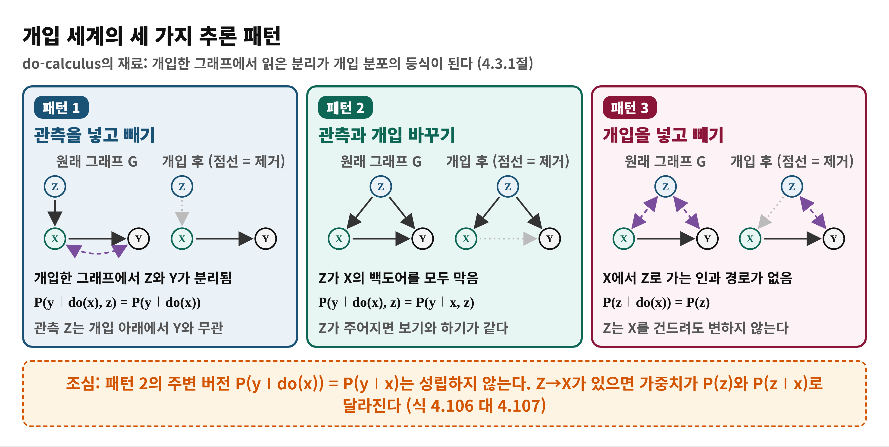
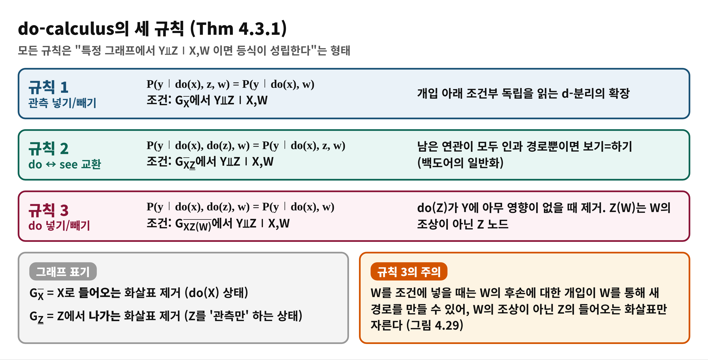
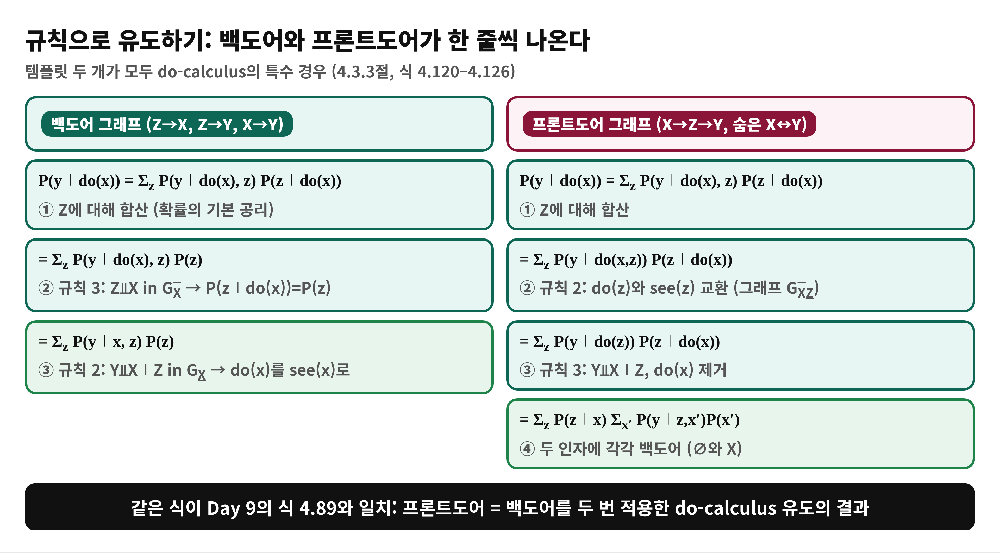
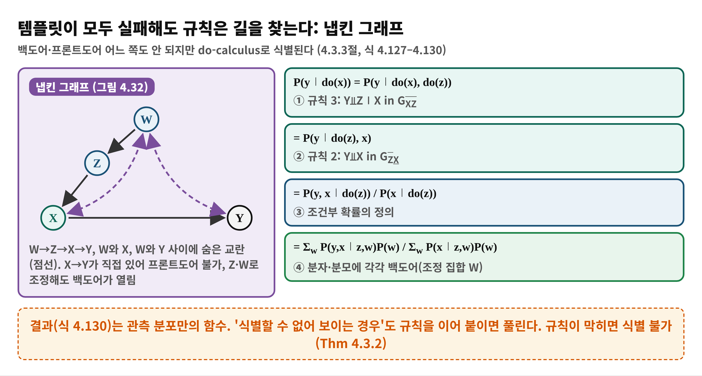
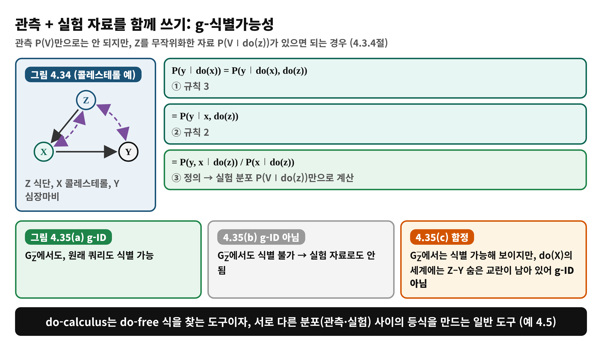

<!--
  book-explainer · Day 10 (PDF 166–178쪽) · Causal Artificial Intelligence
  빌드: python build_pptx.py day10.md
-->

# Day 10 — 기호 규칙으로 식별하기: do-calculus

**책**: Causal Artificial Intelligence · **범위**: PDF 166–178쪽 (인쇄 154–166) · 4.3절 Symbolic Identification (4.4절 도입부 포함) · **수준**: 입문

---

# 한눈에 보기
<!-- _class: small -->

- **이 범위가 푸는 문제**
  - 템플릿(백도어·프론트도어)이 맞지 않는 그래프에서도 P(y∣do(x))를 계산할 수 있는가?
- **결론 한 줄**
  - **세 개의 규칙**으로 do가 들어간 식을 do 없는 식으로 바꿀 수 있고, 어떤 효과가 식별 가능하다면 규칙의 연쇄로 반드시 유도된다 (건전성과 완전성)
- **읽고 나면**
  - 세 규칙을 그래프 조건과 함께 말할 수 있고, 백도어·프론트도어·냅킨 그래프를 규칙으로 유도할 수 있다

---

# Day 9에서 이어받은 것

- **백도어**: 교란이 모두 관측될 때 Σ P(y∣x,z)P(z)
- **프론트도어**: 매개 Z로 숨은 교란을 우회, **백도어를 두 번** 적용 (Def 4.2.5)
- 한계: 템플릿은 **그래프 모양에 따라 도구를 골라야** 하는 케이스별 방법
- 오늘의 질문: **규칙 몇 개로 식별 가능한 모든 효과를 도출한다는 말의 의미는?**

---

# 왜 필요한가 — 도구 상자 대신 규칙 체계
<!-- _class: small -->

- **템플릿의 문제**
  - 새 그래프마다 맞는 도구를 찾아야 하고, 없으면 식별 불가인지 몰라서 막힌다
- **do-calculus가 주는 것**
  - 그래프의 **국소 가정**(부모-자식 관계)을 **전역 제약**(먼 변수들 사이의 개입 등식)으로 바꿔 준다
  - do가 들어간 식을 do 없는 식으로 **체계적으로 변형**하는 규칙
- **한 가지 더**
  - 관측 자료뿐 아니라 **실험 자료**까지 섞어서 질문에 답하는 일에도 쓴다 (4.3.4절)

---

# 용어 준비
<!-- _class: small -->

| 용어 | 한 줄 뜻 | 예 |
|:---|:---|:---|
| 개입 그래프 | do(X)를 한 뒤의 그래프. X로 들어오는 화살표를 지움 | G에서 X̄를 적용한 그래프 |
| 규칙 1·2·3 | 관측 넣기·빼기 / do와 see 교환 / do 넣기·빼기 | Thm 4.3.1 |
| 건전성·완전성 | 규칙이 틀린 등식을 만들지 않음 / 식별 가능하면 반드시 유도됨 | Thm 4.3.2 |
| g-식별가능성 | 관측과 실험 분포 모음에서 효과가 식별되는가 | 4.3.4절 |
| 심슨의 역설 | 부분 집단과 전체의 결론이 반대로 보이는 현상 | 4.3.3.1절 |

---

# 개념 1 — 개입 세계의 세 가지 패턴
<!-- _class: small -->

관측 넣고 빼기 · 관측과 개입 바꾸기 · 개입 넣고 빼기 (4.3.1절, 그림 4.25–4.27)

---

# 개념 1 — 비유로 이해하기: 체스의 합법 수
<!-- _class: small -->

- **비유**
  - 체스에서는 정해진 합법 수만 연달아 두어 목표 포지션(do 없는 식)에 도달한다. 합법 수의 연쇄로 도달할 수 없으면 그 포지션은 만들 수 없다
- **개념 대응**
  - 합법 수 = 세 규칙 · 판 = 그래프 · 목표 포지션 = 관측 분포만의 식 · 도달 불가 = 식별 불가
- **핵심**
  - 규칙은 '아무 때나' 쓰는 것이 아니라 그래프의 분리 조건이 **허락할 때만** 쓴다
- **비유의 한계**
  - 체스는 수를 두는 순서가 임의지만, 여기서는 완전성 덕분에 **불가능하다는 결론**도 규칙이 막히는 것으로 확정된다

---

# 개념 2 — do-calculus의 세 규칙
<!-- _class: small -->

Theorem 4.3.1 (4.3.2절, 식 4.113–4.115)

---

# 개념 2 — 규칙을 어떻게 읽나
<!-- _class: small -->

- **규칙 1**: 한 개입 아래의 분포에서 d-분리로 조건부 독립을 읽는다. 관측 분포에서는 성립하지 않아도 개입 분포에서는 성립할 수 있다
- **규칙 2**: 남은 연관이 인과 경로뿐이면 보기와 하기가 같다. **백도어 기준의 일반화**
- **규칙 3**: 미래는 과거에 영향을 못 준다. 인과 경로가 없으면 do를 지운다. 다만 조건에 W를 넣으면 W의 **조상이 아닌** Z의 화살표만 자른다 (그림 4.29)
- **Thm 4.3.2 (건전성·완전성)**
  - P(y∣do(x),w)가 식별 가능 ⇔ 규칙과 확률 공리의 연쇄로 do 없는 식이 된다

---

# 개념 3 — 규칙으로 백도어·프론트도어 유도하기
<!-- _class: small -->

4.3.3절, 식 4.120–4.126

---

# 개념 3 — 냅킨 그래프: 템플릿이 모두 실패해도
<!-- _class: small -->

식 4.127–4.130 (그림 4.32)

---

# 수식 풀이 — 냅킨 그래프의 결과식 (식 4.130)
<!-- _class: small -->

$$
P(y \mid do(x)) = \frac{\sum_w P(y, x \mid z, w)\, P(w)}{\sum_w P(x \mid z, w)\, P(w)}
$$

- **분자**: do(z) 아래에서 (Y, X)가 함께 일어날 확률. W로 조정하는 백도어. Z에서 나가는 화살표를 지운 그래프에서 (Y,X)와 Z가 W 아래 분리되기 때문
- **분모**: do(z) 아래에서 X의 확률. 분자를 Y에 대해 합산한 것
- **읽는 법**: 앞 단계 P(y∣do(z),x) = P(y,x∣do(z)) / P(x∣do(z))에서 두 분포를 각각 백도어로 채운 것
- 모두 관측 분포 P(W,Z,X,Y)만으로 계산된다

---

# 개념 4 — 심슨의 역설을 do로 풀기
<!-- _class: small -->

숫자는 책 외 장난감 예 (직접 계산)

| 집단 | 치료(X=1) 회복률 | 비치료(X=0) 회복률 |
|:---|:---|:---|
| 경증 Z=1 | 64/80 = 80% | 17/20 = 85% |
| 중증 Z=0 | 2/20 = 10% | 10/80 = 12.5% |
| 전체 | 66/100 = 66% | 27/100 = 27% |

- 각 집단에서는 치료가 불리한데 전체에서는 유리해 보인다. 확률 공리상 모순은 아니고 **인과 해석을 붙일 때** 역설이 된다
- **Thm 4.3.3 (Sure Thing)**: 각 부분 집단에서 효과가 같은 방향이면, 처치가 부분 집단 분포를 바꾸지 않는 한 전체도 같은 방향
- **어느 표를 볼까**는 그래프로 결정: Z가 X의 원인(그림 4.33(a))이면 분할표, Z가 X의 결과(4.33(b))이면 합계표

---

# 개념 5 — 관측 + 실험 자료: g-식별가능성
<!-- _class: small -->

4.3.4절, 식 4.143–4.145, 그림 4.35

---

# 템플릿과 do-calculus의 관계, 그리고 다음
<!-- _class: small -->

- **관계**
  - 백도어와 프론트도어는 do-calculus 유도의 **특수 경우**다. 새 그래프는 규칙을 이어 붙여 식을 찾는다
- **예 4.5**
  - 관측과 실험 분포가 있을 때 규칙 3→합산→규칙 2→… 로 P(y∣do(x))를 도출 (식 4.146–4.154)
- **남은 문제**
  - 규칙을 **어떤 순서로** 써야 하는지, 막혔을 때 정말 불가능한지는 사람이 매번 판단해야 한다
- **4.4절 도입 (PDF 178쪽)**
  - 식별을 계산 문제로 정식화하고 c-factor를 도입 → Day 11–12의 식별 알고리즘

---

# 흔한 오해

> ❌ "백도어가 안 되면 식별할 수 없다"

- ✅ 냅킨 그래프처럼 백도어·프론트도어 모두 실패해도 do-calculus로 식별될 수 있다
- ❌ "규칙 2는 do(x)를 항상 x의 관측으로 바꿔도 된다고 말한다" → ✅ 조건이 맞을 때만. 주변 버전 P(y∣do(x)) = P(y∣x)는 Z→X가 있으면 성립하지 않는다
- ❌ "do-calculus는 식을 계산해 주는 알고리즘이다" → ✅ 규칙의 모음일 뿐, 어떤 순서로 쓸지는 따로 정해야 한다 (→ Day 11–12)
- ❌ "Z가 X보다 먼저인 변수는 항상 조정하라" → ✅ 그림 4.33(c)처럼 Z를 조건에 넣으면 오히려 경로가 열린다

---

# 정리

- **세 규칙**: 관측 넣고 빼기 · do와 see 교환 · do 넣고 빼기. 각각 특정 개입 그래프의 d-분리가 조건
- **건전성·완전성**: 식별 가능 ⇔ 규칙의 연쇄로 do 없는 식이 나옴
- 백도어·프론트도어·냅킨·g-ID를 모두 같은 규칙으로 유도
- 다음 날(Day 11): 규칙을 사람이 찾지 않고 **기계가 찾도록** 하는 식별 알고리즘

---

# 이해 점검 퀴즈 Q1

**(개념 확인)** do-calculus의 규칙 2가 하는 일은?

- A) do(z)를 관측 Z=z로 바꾸거나 그 반대로 바꾼다
- B) 항상 do(x)를 제거한다
- C) 잠재 변수를 관측으로 만든다
- D) 식별 불가능한 효과를 식별 가능하게 만든다

---

# Q1 정답 및 해설

- **정답: A**
- 왜 맞나: 규칙 2는 Y⫫Z∣X,W가 G(X로 들어옴 제거, Z에서 나감 제거)에서 성립하면 do(z)와 see(z)를 교환한다
- B가 틀린 이유: do 제거는 규칙 3의 역할이다
- C가 틀린 이유: 잠재 변수는 규칙으로 관측되지 않는다
- D가 틀린 이유: 식별 가능성은 그래프가 결정하고 규칙은 그것을 드러낼 뿐이다 (Thm 4.3.2)

---

# 이해 점검 퀴즈 Q2

**(적용)** 백도어 그래프에서 P(y∣do(x))를 do-calculus로 유도하는 올바른 순서는?

- A) Z로 합산 → 규칙 3으로 P(z∣do(x))=P(z) → 규칙 2로 do(x)를 x로
- B) 규칙 2로 do(x)를 x로 → Z로 합산 → 규칙 3
- C) 규칙 1 → 규칙 1 → 규칙 1
- D) 규칙 3으로 do(x)를 제거

---

# Q2 정답 및 해설

- **정답: A**
- 왜 맞나: Z로 합산한 뒤, X로 가는 Z의 경로를 끊은 그래프에서 Z⫫X이므로 규칙 3, 이어서 Z로 막힌 백도어 덕분에 규칙 2로 do(x)를 관측 x로 바꾼다 (식 4.120–4.122)
- B가 틀린 이유: 합산 전에는 규칙 2의 조건 Z를 쓸 수 없다
- C가 틀린 이유: 규칙 1은 관측을 넣고 빼는 규칙이다
- D가 틀린 이유: do(x)를 지울 수 없다. X는 Y의 원인이다

---

# 이해 점검 퀴즈 Q3

**(오개념 교정)** 심슨의 역설에 대한 설명 중 **틀린** 것은?

- A) 역설은 확률의 공리 위반이 아니라 인과 해석을 붙일 때 나타난다
- B) Z가 X의 원인이면 분할표를 본다
- C) Z가 X의 결과이면 합계표를 본다
- D) 부분 집단별 표가 항상 인과적으로 올바르므로 늘 그것을 따른다

---

# Q3 정답 및 해설

- **정답: D** (틀린 설명)
- 왜 틀렸나: 어느 표가 맞는지는 그래프에 달렸다. 그림 4.33(b)처럼 Z가 처치의 결과이면 Z로 조건을 걸면 오히려 편향이 생긴다
- A: 맞다 (식 4.131–4.133은 L1의 양)
- B, C: 맞다 (그림 4.33(a), (b))
