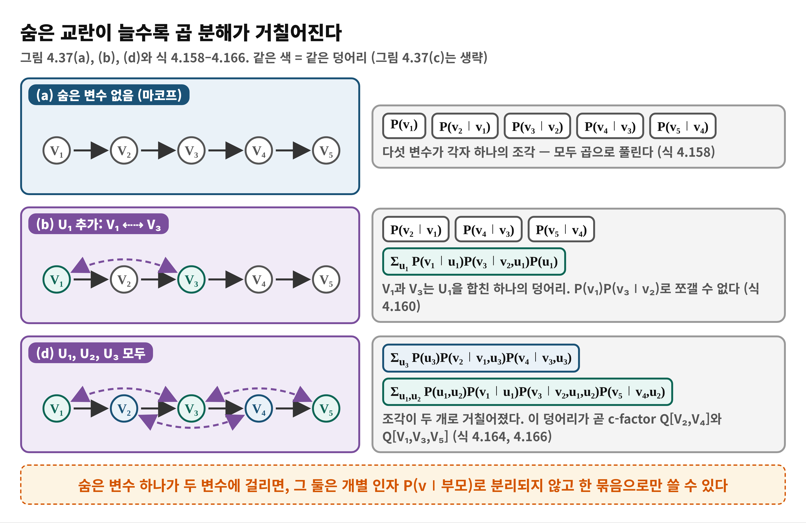
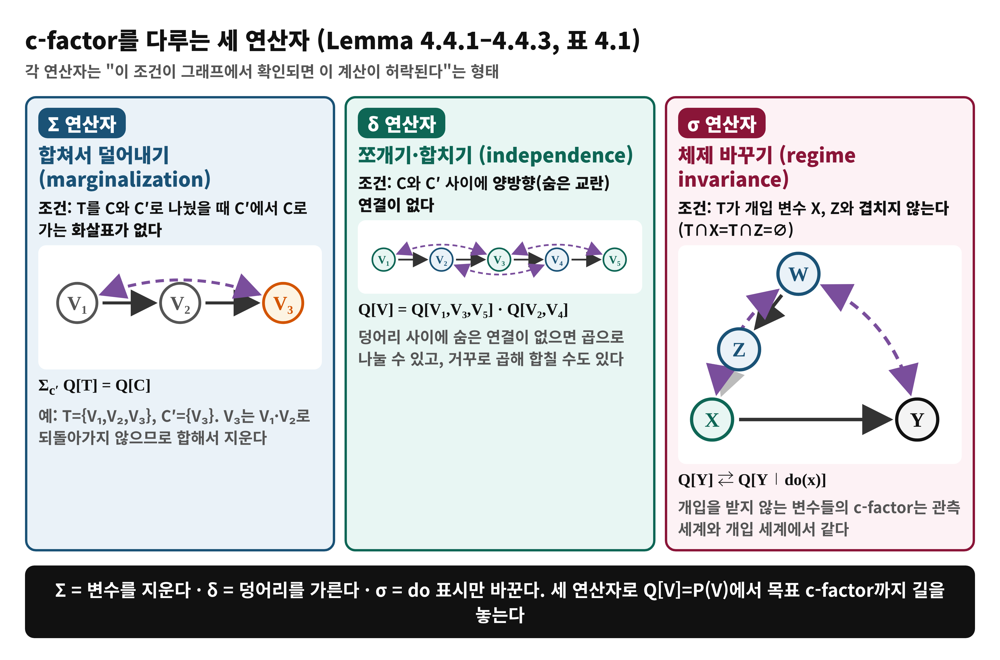
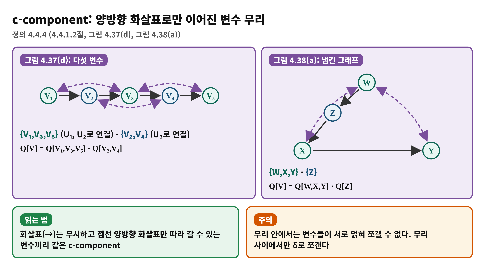
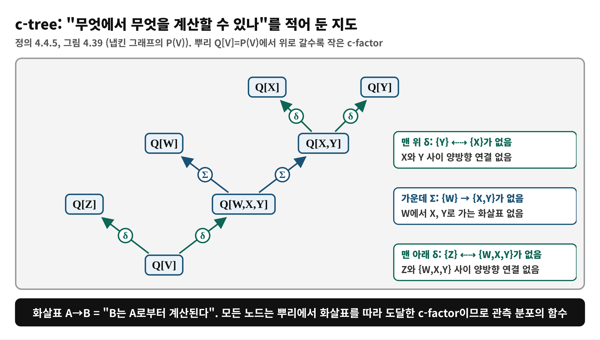
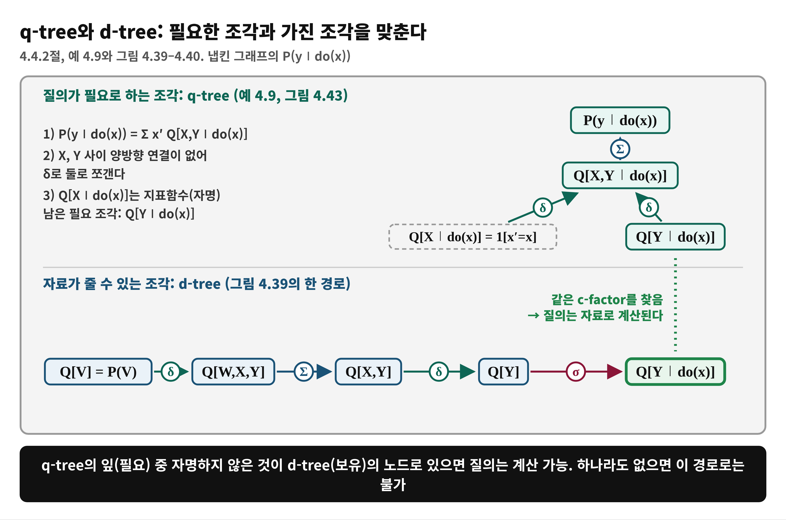

<!--
  book-explainer · Day 11 (PDF 179–192쪽) · Causal Artificial Intelligence
  빌드: python build_pptx.py day11.md
-->

# Day 11 — 식별 알고리즘 I: c-factor와 c-component

**책**: Causal Artificial Intelligence · **범위**: PDF 179–192쪽 (인쇄 167–180) · 4.4.1–4.4.2절 (4.4.3절 도입부 포함) · **수준**: 입문

---

# 한눈에 보기
<!-- _class: small -->

- **이 범위가 푸는 문제**
  - do-calculus의 규칙을 사람이 순서까지 골라야 하는 부담을, 기계가 따라 할 수 있는 절차로 바꿀 수 있는가?
- **결론 한 줄**
  - 숨은 교란이 있어도 **c-factor**라는 조각으로 확률을 쪼개고, **세 연산자(Σ, δ, σ)**와 **c-tree**로 "무엇에서 무엇을 계산할 수 있나"를 정리하면 식별 문제를 조각 맞추기로 바꿀 수 있다
- **읽고 나면**
  - 시그니처 ⟨Q, P, A⟩, c-factor, c-component를 설명하고, 냅킨 그래프에서 q-tree와 d-tree를 직접 그릴 수 있다

---

# Day 10에서 이어받은 것

- **do-calculus**: 세 규칙으로 do가 든 식을 do 없는 식으로 바꾼다. 식별 가능하면 규칙의 연쇄가 반드시 존재 (Thm 4.3.2)
- **한계**: 규칙을 **어떤 순서로** 쓸지, 막혔을 때 정말 불가능한지는 사람이 매번 판단해야 한다
- **냅킨 그래프**: 백도어·프론트도어 모두 안 되지만 규칙으로 식별됨 (식 4.130). 오늘도 다시 쓴다
- 오늘의 질문: **교란 구조를 c-component로 쪼개면 식별 문제가 어떻게 단순해지는가?**

---

# 왜 필요한가 — 기계가 따라 할 수 있는 절차로
<!-- _class: small -->

- **규칙의 문제**
  - 규칙과 확률 공리를 어느 순서로 쓸지 정해 주지 않아, 최악에는 가능한 수를 모두 시도하는 탐색이 된다
- **오늘의 아이디어**
  - 질의와 자료를 **같은 종류의 조각(c-factor)**으로 쪼갠 뒤, 질의에 필요한 조각이 자료에서 만들어지는지 **맞춰 본다**
  - 숨은 교란이 있으면 확률이 P(v∣부모)의 곱으로 안 쪼개지므로, 쪼개지는 **가장 작은 덩어리**부터 알아야 한다
- **오늘의 범위**
  - 도구 상자(시그니처, c-factor, 연산자, c-tree)까지. 이 도구로 답을 내는 알고리즘 본체는 Day 12

---

# 용어 준비
<!-- _class: small -->

| 용어 | 한 줄 뜻 | 예 |
|:---|:---|:---|
| 시그니처 ⟨Q,P,A⟩ | 질의·자료·가정 세 가지로 인과 추론 과제를 적은 것 | Def 4.4.1 |
| c-factor Q[C] | 숨은 변수를 합쳐 둔, C 변수들의 한 덩어리 인자 | Def 4.4.2 |
| c-operator | c-factor에서 다른 c-factor를 만드는 허락된 계산 | Σ, δ, σ |
| c-component | 양방향 화살표로만 이어진 변수 무리 | Def 4.4.4 |
| c-tree | "무엇에서 무엇을 계산하나"를 적은 나무 | Def 4.4.5 |
| q-tree / d-tree | 질의에 필요한 조각의 나무 / 자료가 주는 조각의 나무 | 4.4.2절 |

---

# 개념 1 — 인과 추론 과제의 시그니처
<!-- _class: small -->

Definition 4.4.1 (PDF 179, 식 4.155)

| 요소 | 뜻 | 지금까지 본 예 |
|:---|:---|:---|
| Q (질의) | 알아내고 싶은 양 | P(y∣do(x)) |
| P (자료) | 연구자가 가진 분포 모음 | 관측 P(V), 실험 P(V∣do(z)) |
| A (가정) | 기저 SCM에 대한 인과 가정, 보통 인과 그래프 | 냅킨 그래프 |

- 책은 이 세 가지의 짝이 **풀 수 있는지(식별 가능성)**를 결정한다고 본다
- 예: Day 10의 g-ID 문제 = ⟨P(y∣do(x)), {P(V), P(V∣do(z))}, 냅킨 그래프⟩

---

# 개념 2 — 숨은 교란은 곱 분해를 깬다
<!-- _class: small -->

예 4.6과 그림 4.37 (PDF 179–180, 식 4.156–4.166)

---

# 수식 풀이 1 — c-factor의 정의 (식 4.165)
<!-- _class: small -->

$$
Q[C](pa(C)) = \sum_{u(C)} \prod_{V_i \in C} P(v_i \mid pa_i, u_i)\, P(u(C))
$$

- **말로**: C에 속한 변수들의 "부모와 숨은 원인이 주어졌을 때의 확률"을 곱하고, 그 변수들에 걸린 **숨은 변수 U(C)만** 합산해 없앤 함수
- **U(C)**: C의 변수들에 걸린 모든 숨은 변수의 합집합. 이 덩어리에는 밖으로 새는 숨은 교란이 **없다**
- **C = V이면** Q[V] = P(v). 마코프 모델이면 각 c-factor가 평범한 P(vᵢ∣pa_i)로 줄어든다
- 예 (식 4.167–4.169, 프론트도어): Q[Y] = Σ P(y∣z,u_y)P(u_y), Q[X,Y] = Σ P(x∣u_x)P(y∣z,u_y)P(u_y,u_x)

---

# 개념 2 — 비유로 이해하기: 같은 숨은 도매상을 쓰는 가게들
<!-- _class: small -->

- **비유**
  - 동네 가게들이 각자 가격을 정하면 가게마다 따로 계산한다. 그런데 몇 가게가 **같은 숨은 도매상**에게서 물건을 받는다면 그 가게들의 가격은 따로 못 보고 한 묶음으로 봐야 한다
- **개념 대응**
  - 가게 = 변수 · 숨은 도매상 = 잠재 변수 U · 묶음 = c-factor · 묶음의 크기 = c-component
- **핵심**
  - 묶음 안쪽은 합산해 둔 한 덩어리, 묶음 **사이**는 숨은 연결이 없어 곱으로 나눌 수 있다
- **비유의 한계**
  - 도매상을 공유하지 않아도 가게끼리는 **화살표**(직접 영향)로 이어질 수 있다. c-component는 숨은 교란만 따질 뿐 인과 영향의 유무가 아니다

---

# 개념 3 — c-factor를 다루는 세 연산자
<!-- _class: small -->

Lemma 4.4.1–4.4.3, 표 4.1 (PDF 182–185)

---

# 수식 풀이 2 — Σ 연산자가 왜 성립하나 (식 4.171–4.174)
<!-- _class: small -->

$$
\sum_{v_3} Q[V_1,V_2,V_3] = \sum_{u_1} P(v_1 \mid u_1)\, P(v_2 \mid v_1)\, P(u_1) = Q[V_1,V_2]
$$

- **출발**: Q[V₁,V₂,V₃] = Σᵤ₁ P(v₁∣u₁)P(v₂∣v₁)P(v₃∣v₂,u₁)P(u₁) (V₁⇠⇢V₃의 숨은 U₁)
- **V₃만 합산**: V₃가 들어 있는 인자는 P(v₃∣v₂,u₁) 하나뿐이고 v₃에 대한 합은 1
- **결과**: 남은 식이 곧 Q[V₁,V₂]의 정의. 조건("V₃에서 V₁, V₂로 가는 화살표 없음")은 **V₃가 다른 인자의 조건에 끼어들지 않는다**는 보장
- 반대로 C = {V₂,V₃}, C′ = {V₁}이면 V₁→V₂ 때문에 불가

---

# 수식 풀이 3 — δ 연산자와 σ 연산자
<!-- _class: small -->

$$
Q[V_1,\dots,V_5] = Q[V_1,V_3,V_5]\; Q[V_2,V_4]
$$

- **δ**: 숨은 U₁, U₂는 {V₁,V₃,V₅}에만, U₃는 {V₂,V₄}에만 걸려 있어 합산을 두 덩어리로 갈라 쓸 수 있다 (식 4.175–4.177). 역방향(곱으로 합치기)은 곱셈, 꺼내기는 합과 비 (식 4.178–4.184, 공식은 Day 12)
- **σ**: T가 개입 변수와 겹치지 않으면 Q[T∣do(x)] ⇄ Q[T∣do(z)]. 예 4.7(d): Q[Y] → Q[Y∣do(x)] (Y ∉ {X})
- **관측 → 개입**으로 넘어가는 유일한 다리가 σ

---

# 개념 4 — c-component: 숨은 연결로 이어진 무리
<!-- _class: small -->

Definition 4.4.4 (PDF 184). 양방향 화살표 경로로 이어지는 변수끼리 한 무리. 무리 사이에는 숨은 연결이 없으므로 δ로 곱을 나눌 수 있어 **식별을 무리 단위의 작은 문제로 쪼갠다**.

---

# 개념 5 — c-tree: 계산 가능성의 지도
<!-- _class: small -->

Definition 4.4.5, 그림 4.39 (PDF 185)

---

# 개념 6 — q-tree와 d-tree
<!-- _class: small -->

4.4.2절 (PDF 185–187), 예 4.9, 그림 4.40

---

# 수식 풀이 4 — 질의를 c-factor로 쓰기 (식 4.190–4.192)
<!-- _class: small -->

$$
P(y \mid do(x)) = \sum_{d \setminus y} Q[D \mid do(x)], \qquad D = An(Y)_{G_{\overline{X}}}
$$

- **알고리즘 3 (GenQueryTree)**: 뿌리에 P(y∣do(x)) → Σ로 Q[D∣do(x)] → δ로 양방향 연결이 없는 **최소 덩어리**들로 쪼갬
- **왜 D = An(Y)인가**: Y의 조상이 아닌 변수는 Y로 가는 화살표가 없으니 Σ 연산자 조건이 충족되어 합산해 버린다
- **개입 변수의 잎**: Q[X∣do(x)] = 1[x′=x] (식 4.189)로 자명. 나머지 잎이 자료에서 와야 한다 (예 4.8, 4.9)

---

# 개념 7 — d-tree를 효율적으로 키우기
<!-- _class: small -->

4.4.2.3절, 알고리즘 4 (PDF 190–191)

- **d-tree는 하나로 정해지지 않는다**: 같은 P(V)도 연산자 적용 순서에 따라 전혀 다른 크기의 나무 (그림 4.39 대 4.45). 크기가 변수 수에 지수적일 수도 있다
- **우선순위**: ① σ (범위가 목표와 같고 개입만 다를 때) → ② Σ (목표 변수의 조상만 남김) → ③ δ (목표와 양방향으로 이어진 변수만 남김)
- **냅킨 추적 (책의 예가 아님, 직접 구성)**: Q[V] →δ→ Q[W,X,Y] →Σ→ Q[X,Y] →δ→ Q[Y] →σ→ Q[Y∣do(x)]
- 이 전략이 완전성과 효율을 모두 갖는다는 것은 정리 4.4.4 부근 (Day 12)

---

# 흔한 오해

> ❌ "c-factor는 P(v∣pa) 같은 보통 조건부 확률이다"

- ✅ 숨은 변수를 합산해 둔 덩어리 인자. 마코프이면 그렇게 줄어들지만 일반적으로는 아니다
- ❌ "c-component가 같으면 서로 인과적으로 영향을 준다" → ✅ 숨은 교란으로 이어진 무리일 뿐
- ❌ "c-tree는 하나뿐이다" → ✅ 연산자 적용 순서에 따라 여러 모양, 크기도 크게 다르다 (예 4.11)
- ❌ "Σ 연산자는 아무 변수나 합산해 지운다" → ✅ 지울 쪽에서 남길 쪽으로 가는 화살표가 없어야 한다

---

# 정리

- **시그니처 ⟨Q,P,A⟩**로 인과 추론 과제를 쓴다
- **c-factor**: 숨은 변수를 합친 덩어리. **c-component**: 양방향 연결 무리. 무리 사이는 δ로 곱 분해
- **Σ, δ, σ**로 c-factor 사이를 오가고, **c-tree**가 그 경로를 기록한다
- **q-tree**(필요) 잎을 **d-tree**(보유)에서 찾는 것이 식별의 뼈대
- 다음 날(Day 12): 이 둘을 맞추는 **C-INFER 알고리즘**, 그리고 '식별 불가'의 근거

---

# 이해 점검 퀴즈 Q1

**(개념 확인)** c-factor Q[C]에 대한 설명으로 맞는 것은?

- A) C의 변수들에 걸린 숨은 변수를 합산해 둔 한 덩어리 인자
- B) C 변수 각각의 P(v∣pa)를 그냥 곱한 값
- C) 언제나 P(c)와 같은 주변 분포
- D) 개입 분포에서만 정의된다

---

# Q1 정답 및 해설

- **정답: A**
- 왜 맞나: 식 4.165는 C에 걸린 숨은 변수 U(C)를 합산한 곱이다
- B가 틀린 이유: 숨은 변수가 있으면 P(v∣pa)의 곱으로 분해되지 않는다 (식 4.160)
- C가 틀린 이유: C = V일 때만 P(v)와 같다
- D가 틀린 이유: 관측에서도 정의되고 Q[V]=P(V)

---

# 이해 점검 퀴즈 Q2

**(적용)** 그림 4.37(d)의 V₁⇠⇢V₃, V₃⇠⇢V₅, V₂⇠⇢V₄에서 Q[V]에 δ 연산자를 쓸 수 있는 분할은?

- A) C={V₁,V₂}, C′={V₃,V₄,V₅}
- B) C={V₁,V₃,V₅}, C′={V₂,V₄}
- C) C={V₁,V₃}, C′={V₂,V₄,V₅}
- D) C={V₁}, C′={V₂,V₃,V₄,V₅}

---

# Q2 정답 및 해설

- **정답: B**
- 왜 맞나: 두 무리 사이에 양방향 화살표가 없어 Q[V]=Q[V₁,V₃,V₅]Q[V₂,V₄] (식 4.177)
- A가 틀린 이유: V₂⇠⇢V₄가 C와 C′에 걸친다
- C가 틀린 이유: V₃⇠⇢V₅가 걸친다
- D가 틀린 이유: V₁⇠⇢V₃가 걸친다

---

# 이해 점검 퀴즈 Q3

**(오개념 교정)** c-tree에 대한 설명 중 **틀린** 것은?

- A) 화살표 A→B는 B가 A로부터 계산 가능함을 뜻한다
- B) q-tree는 질의에 필요한 조각, d-tree는 자료가 주는 조각을 담는다
- C) 주어진 P(V)와 그래프에 대한 d-tree는 항상 유일하다
- D) 크기가 변수 수에 지수적으로 커질 수 있다

---

# Q3 정답 및 해설

- **정답: C** (틀린 설명)
- 왜 틀렸나: 연산자를 어떤 순서·방식으로 쓰느냐에 따라 달라진다. 같은 냅킨 그래프에도 그림 4.39와 4.45의 서로 다른 d-tree가 있다 (예 4.11)
- A, B: 맞다 (정의 4.4.5, 4.4.2절)
- D: 맞다. 그래서 질의가 필요로 하는 조각을 향해 확장하는 전략이 중요하다 (4.4.2.3절)
