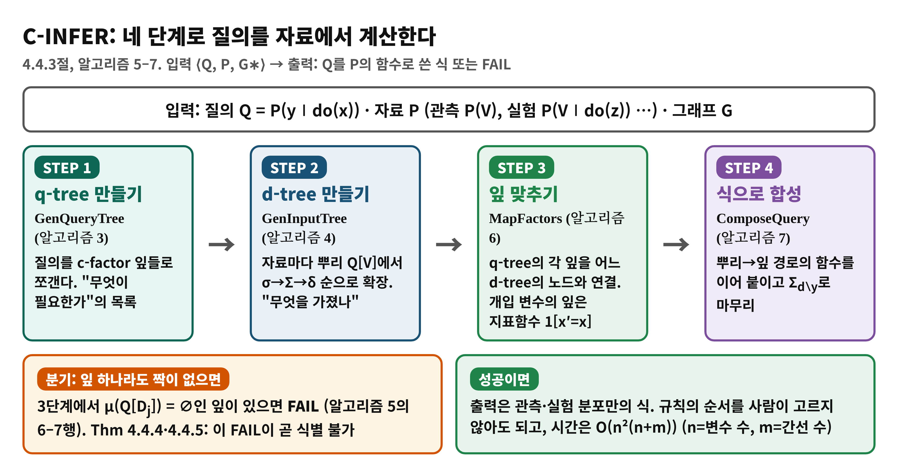
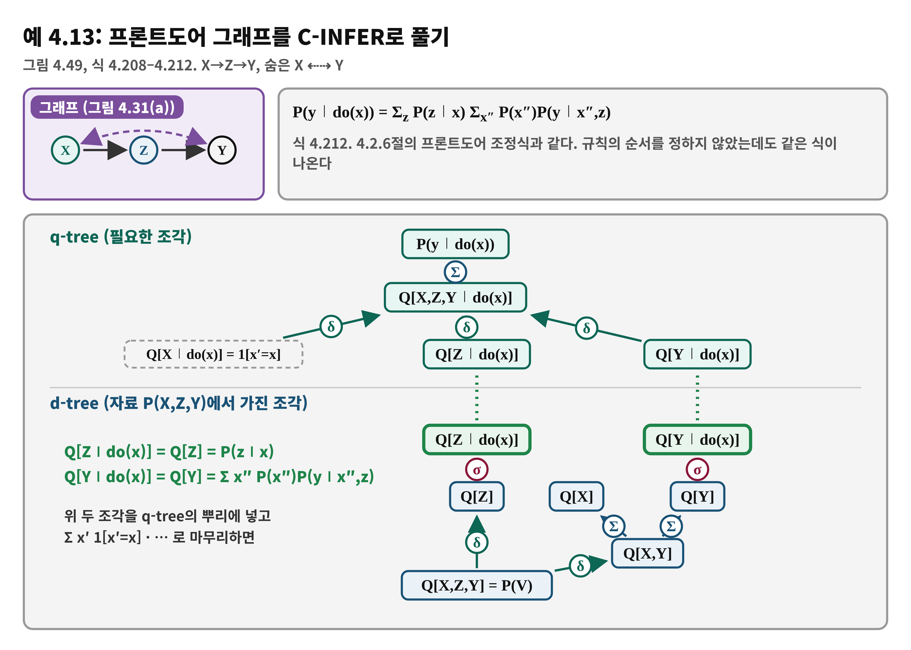
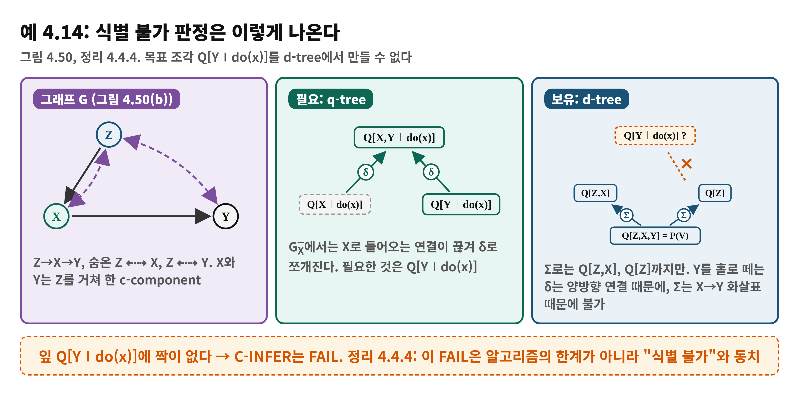
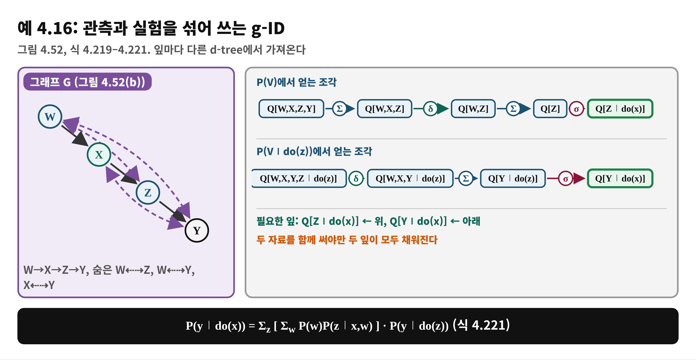
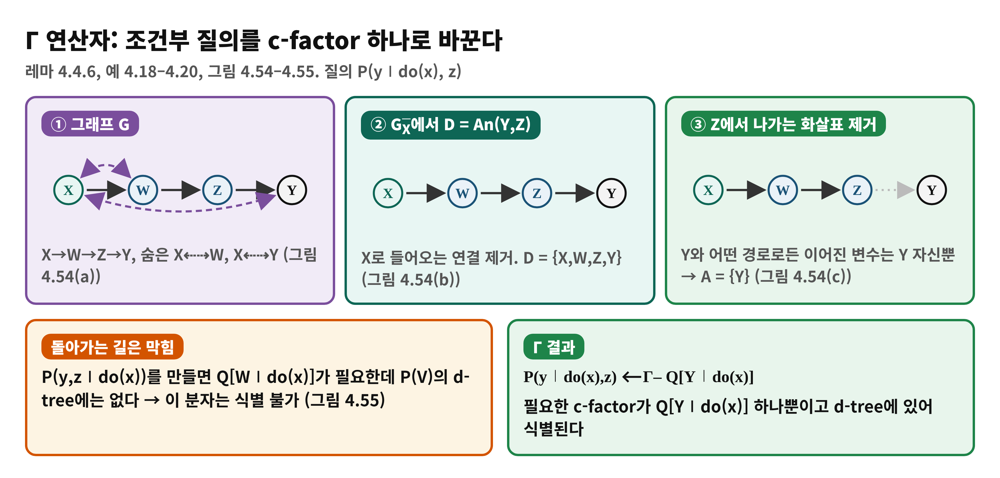

<!--
  book-explainer · Day 12 (PDF 193–204쪽) · Causal Artificial Intelligence
  빌드: python build_pptx.py day12.md
-->

# Day 12 — 식별 알고리즘 II: 알고리즘 완성

**책**: Causal Artificial Intelligence · **범위**: PDF 193–204쪽 (인쇄 181–192) · 4.4.3절 후반–4.4.6절 · **수준**: 입문

---

# 한눈에 보기
<!-- _class: small -->

- **이 범위가 푸는 문제**
  - 어제 만든 도구(c-factor, 세 연산자, q-tree·d-tree)로 식별 가능 여부를 **기계적으로 판정하고 식까지 뽑을** 수 있는가?
- **결론 한 줄**
  - **C-INFER**가 q-tree의 잎을 d-tree에서 찾아 맞추고, 하나라도 못 찾으면 FAIL. 이 FAIL은 **식별 불가와 동치**(Thm 4.4.4, 4.4.5)이고 시간은 다항식이다
- **읽고 나면**
  - 프론트도어, 식별 불가 예, 관측+실험 혼합 예를 트리로 풀고, 조건부 질의를 Γ 연산자로 바꿔 풀 수 있다

---

# Day 11에서 이어받은 것

- **c-factor Q[C]**: 숨은 변수를 합친 덩어리. **c-component**로 쪼개 δ로 곱 분해
- **세 연산자**: Σ(지우기), δ(쪼개기), σ(do 표시 바꾸기). **c-tree**는 그 계산 경로
- **q-tree**(질의가 필요로 하는 조각)와 **d-tree**(자료가 주는 조각), d-tree 확장 우선순위 σ→Σ→δ
- 오늘의 질문: **알고리즘이 '식별 불가능'이라고 답할 때 그 근거는 무엇인가?**

---

# 왜 필요한가 — 규칙 탐색에서 계산으로
<!-- _class: small -->

- **do-calculus만으로는**
  - 규칙의 순서를 사람이 찾아야 하고, 최악에는 지수 시간의 탐색
- **C-INFER가 주는 것**
  - 네 단계를 따라가면 식이 나오거나 FAIL이 나온다
  - 식별 가능성의 **판정**과 **식 도출**이 한 번에 이루어진다
- **한 가지 더**
  - 관측만 있을 때(obs-ID)뿐 아니라 여러 실험 분포를 섞어도(g-ID), 질의가 조건부일 때도(Γ 연산자) 같은 틀로 푼다

---

# 용어 준비
<!-- _class: small -->

| 용어 | 한 줄 뜻 | 예 |
|:---|:---|:---|
| C-INFER | q-tree와 d-tree를 만들어 맞추고 식을 합성하는 알고리즘 | 알고리즘 5 |
| MapFactors / ComposeQuery | 잎을 맞추는 / 맞춘 경로로 식을 쓰는 단계 | 알고리즘 6, 7 |
| obs-ID / g-ID | 관측만으로 / 관측과 실험을 섞어 식별 | 4.4.4, 4.4.5절 |
| FAIL | 필요한 c-factor가 어떤 d-tree에도 없음 | Thm 4.4.4 |
| 조건부 질의 | P(y∣do(x), z)처럼 부분 집단의 효과 | 4.4.6절 |
| Γ 연산자 | 조건부 질의를 c-factor 하나로 바꾸는 연산자 | Lemma 4.4.6 |

---

# 개념 1 — C-INFER 네 단계
<!-- _class: small -->

4.4.3절, 알고리즘 5–7 (PDF 192–194)

---

# 개념 1 — 비유로 이해하기: 조립 설명서와 부품 창고
<!-- _class: small -->

- **비유**
  - 가구 조립 설명서에 필요한 부품 목록이 있고, 창고에는 가진 부품이 있다. 목록의 모든 부품이 창고에 있으면 조립법대로 만들고, 하나라도 없으면 그 가구는 못 만든다
- **개념 대응**
  - 부품 목록 = q-tree의 잎 · 창고 = d-tree · 조립 = ComposeQuery · 부품 없음 = FAIL
- **핵심**
  - 창고가 **하나**(관측)여도 **여러 개**(관측+실험)여도 같은 방식. 잎마다 다른 창고에서 가져와도 된다
- **비유의 한계**
  - 부품은 있는데 **조립 순서를 모르는** 일은 없다. 경로가 곧 조립법이고, 못 만든다는 결론이 완전성 덕분에 "어떤 방법으로도 불가능"으로 확정된다

---

# 개념 2 — 합성: 연산자마다 함수가 정해져 있다
<!-- _class: small -->

4.4.3.1절 (PDF 193–194, 식 4.194–4.197)

| 연산자 | 경로가 뜻하는 계산 |
|:---|:---|
| Σ | Q[C] = Σ_{c′} Q[T] (C′ 변수를 합산) |
| δ (쪼개기) | 위상 순서의 변수마다 "남은 변수 합 ÷ 자기 포함 합"을 곱한다 |
| δ (합치기) | Q[T] = Q[C₁]···Q[C_k] (그냥 곱) |
| σ | Q[C∣do(x)] = Q[C∣do(z)] (식은 그대로) |

- 잎에서 뿌리로 이 함수들을 이어 붙이면 질의 식이 완성되고, 마지막에 Σ_{d∖y}를 씌운다 (알고리즘 7)

---

# 수식 풀이 1 — δ 연산자의 비율식 (식 4.195)
<!-- _class: small -->

$$
Q[C] = \prod_{T_i \in C} \frac{\sum_{t_{i+1},\dots,t_k} Q[T]}{\sum_{t_i,\dots,t_k} Q[T]}
$$

- **읽는 법**: 변수를 위상 순서 T₁<…<T_k로 놓고, C에 속한 각 변수 Tᵢ마다 "뒤쪽을 합산한 것 ÷ 자기부터 합산한 것"을 곱한다. 결국 P(자기∣앞쪽)을 하나씩 뽑아내는 것
- **냅킨 그래프 (식 4.198–4.200)**: C={W,X,Y}, 순서 W<Z<X<Y이면 Q[W,X,Y] = P(w)P(x∣z,w)P(y∣x,z,w)
- 이어서 Q[Y] = Q[X,Y]/Σ_y Q[X,Y] = Σ_w P(w)P(x∣z,w)P(y∣x,z,w) ÷ Σ_w P(w)P(x∣z,w) (식 4.205)
- **Day 10의 식 4.130과 같은 식**: 규칙으로 찾던 냅킨의 식별식이 알고리즘으로 저절로 나온다

---

# 개념 3 — obs-ID 예: 프론트도어 그래프
<!-- _class: small -->

4.4.4절, 예 4.13 (PDF 195–196, 식 4.207–4.212)

---

# 개념 4 — 식별 불가가 나오는 모습
<!-- _class: small -->

예 4.14 (PDF 197, 그림 4.50)

---

# 개념 4 — 식별 불가의 근거: Thm 4.4.4
<!-- _class: small -->

Theorem 4.4.4 (PDF 197, 식 4.213)

- **정리**: P(y∣do(x))가 P(V)와 G에서 식별 가능 ⇔ C-INFER가 Σ, σ, δ로 매핑을 찾는다. 판정 시간은 O(n²(n+m)) (n=변수 수, m=간선 수)
- **오늘의 질문의 답**: FAIL은 "내 도구가 부족해서"가 아니라 **필요한 c-factor가 자료에서 만들어질 수 없다**는 뜻이고, 완전성 덕분에 다른 어떤 방법으로도 불가능하다
- **do-calculus와의 관계**: 둘 다 건전하고 완전(Thm 4.3.2, 4.4.4). 차이는 **순서를 정해 주는가**. 규칙은 지수 탐색이 될 수 있고 C-INFER는 다항 시간
- **그래도 남는 일**: 식별 불가일 때 무엇을 할지는 Day 13 이후

---

# 개념 5 — g-ID: 관측과 실험을 섞기
<!-- _class: small -->

4.4.5절, 예 4.15–4.16 (PDF 198–199, 그림 4.52)

---

# 개념 5 — 혼합해도 안 되는 경우, 그리고 Thm 4.4.5
<!-- _class: small -->

- **예 4.15**: 실험 P(V∣do(Z))가 추가되면 Q[Z,X,Y∣do(z)] →δ→ Q[Y∣do(z)] →σ→ Q[Y∣do(x)] 경로가 생겨 P(y∣do(x)) = P(y∣x, do(z)) (식 4.217)
- **예 4.17 (g-ID 아님)**: 필요한 Q[Z,Y∣do(x)]가 두 d-tree 어디에도 없다 (그림 4.53)
- **Thm 4.4.5**: 실험 모음이 임의여도 식별 가능 ⇔ C-INFER가 Σ, σ, δ로 매핑을 찾는다. 시간 O(n²(n+m)p), p = 분포 수
- **읽는 법**: 자료가 늘면 d-tree가 늘고 창고가 커진다. 그래도 FAIL이면 그 자료 모음으로는 불가

---

# 개념 6 — 조건부 질의: 왜 새 연산자가 필요한가
<!-- _class: small -->

4.4.6절, 예 4.18–4.19 (PDF 202–203, 식 4.223–4.235)

- **조건부 질의**: P(y∣do(x), z). 예: 60세 이상에게 운동(do)이 건강에 미치는 효과
- **순진한 길**: 정의대로 P(y,z∣do(x)) ÷ P(z∣do(x))로 쓴 뒤 분자를 식별 (식 4.223–4.224)
- **문제 (예 4.18)**: 그래프 X→W→Z→Y (숨은 X⇠⇢W, X⇠⇢Y)에서 분자의 Q[W∣do(x)]는 자료로 못 만든다. 그런데 P(y∣do(x),z)는 **식별된다**: do-calculus로 Σ_w P(y∣z,w)P(w) (식 4.227–4.229)
- **교훈 (예 4.19)**: 분자와 분모에서 **필요 없는 c-factor가 약분**되어 Q[Y∣do(x)] 하나만 남는다. 이를 체계화한 것이 Γ

---

# 개념 6 — Γ 연산자: 필요한 c-factor만 남긴다
<!-- _class: small -->

Lemma 4.4.6 (PDF 204), 예 4.20

---

# 수식 풀이 2 — Γ 연산자의 변환식 (식 4.236)
<!-- _class: small -->

$$
P(y \mid do(x), w) = \frac{\sum_{a \setminus (x \cup y)} Q[A]}{\sum_{a \setminus x} Q[A]}
$$

- **A**: D = An(Y,W)_{G_X̄}에서, W로 나가는 화살표를 끊은 그래프에 대해 Y와 **방향에 상관없이 이어진 변수들**
- **분자**: A에서 X와 Y를 제외하고 합산. **분모**: X만 남기고 모두 합산(Y 포함) → Y에 대해 합이 1이 되게 하는 정규화
- **예 4.20**: A = {Y}이므로 P(y∣do(x),z) = Q[Y∣do(x)] / Σ_y Q[Y∣do(x)] = Q[Y∣do(x)] (Q[Y∣do(x)]가 이미 Y에 대한 분포)
- **예 4.21**: A = {Y,X}이면 P(y∣do(x),w) = Q[X,Y∣do(x)] / Σ_y Q[X,Y∣do(x)] (식 4.237). 이 예는 PDF 204쪽에서 시작하고 다음 쪽으로 이어진다

---

# 흔한 오해

> ❌ "C-INFER가 FAIL이면 더 영리한 알고리즘을 쓰면 풀린다"

- ✅ Thm 4.4.4, 4.4.5: FAIL은 식별 불가와 동치. 같은 자료와 그래프로는 어떤 방법으로도 불가
- ❌ "조건부 질의는 분자 P(y,z∣do(x))가 식별 불가이면 식별 불가다" → ✅ 예 4.18처럼 약분되어 식별될 수 있다 (Γ 연산자)
- ❌ "관측과 실험을 섞으면 항상 식별된다" → ✅ 예 4.17처럼 필요한 c-factor가 둘 다에 없으면 g-ID가 아니다
- ❌ "FAIL이면 효과가 0이다" → ✅ 모른다는 뜻이지 0이 아니다

---

# 정리

- **C-INFER**: q-tree 만들기 → d-tree 만들기 → 잎 맞추기 → 식 합성. 짝 없는 잎이 있으면 FAIL
- **FAIL ⇔ 식별 불가** (Thm 4.4.4, 4.4.5). 시간 O(n²(n+m)) (g-ID는 ×p)
- **g-ID**: 잎마다 다른 분포의 d-tree에서 가져와도 된다
- **Γ 연산자**: 조건부 질의를 필요한 c-factor 하나로
- 다음 날(Day 13): 알고리즘이 FAIL일 때 **같은 관측을 내면서 효과가 다른 두 모델**을 보이는 방법

---

# 이해 점검 퀴즈 Q1

**(개념 확인)** C-INFER가 FAIL을 반환하는 조건은?

- A) q-tree의 잎 중 어느 d-tree에서도 찾을 수 없는 c-factor가 있을 때
- B) 자료가 관측 분포뿐일 때
- C) 그래프에 양방향 화살표가 하나라도 있을 때
- D) d-tree가 너무 커서 시간이 오래 걸릴 때

---

# Q1 정답 및 해설

- **정답: A**
- 왜 맞나: MapFactors에서 μ(Q[D_j]) = ∅인 잎이 있으면 알고리즘 5의 6–7행이 FAIL을 낸다
- B가 틀린 이유: 관측만으로 성공하는 경우가 많다 (프론트도어, 예 4.13)
- C가 틀린 이유: 양방향 화살표가 있어도 프론트도어처럼 식별될 수 있다
- D가 틀린 이유: 판정은 O(n²(n+m)) 다항 시간이다

---

# 이해 점검 퀴즈 Q2

**(적용)** 예 4.16(그림 4.52)에서 P(y∣do(x))를 계산할 때 각 잎은 어디서 오는가?

- A) Q[Z∣do(x)]는 관측 P(V), Q[Y∣do(x)]는 실험 P(V∣do(z))
- B) 둘 다 관측 P(V)
- C) 둘 다 실험 P(V∣do(z))
- D) Q[Z∣do(x)]는 실험, Q[Y∣do(x)]는 관측

---

# Q2 정답 및 해설

- **정답: A**
- 왜 맞나: Q[Z∣do(x)] = Σ_w P(w)P(z∣x,w)는 P(V)의 d-tree, Q[Y∣do(x)] = P(y∣do(z))는 P(V∣do(z))의 d-tree에서 나온다 (식 4.219–4.221)
- B가 틀린 이유: 관측만으로는 Q[Y∣do(x)]를 못 만든다
- C가 틀린 이유: P(V∣do(z))에서는 Z 자신이 개입을 받으므로 Q[Z∣do(x)]를 만들 수 없다 (알고리즘 4의 3행)
- D가 틀린 이유: 방향이 반대

---

# 이해 점검 퀴즈 Q3

**(오개념 교정)** 설명 중 **틀린** 것은?

- A) FAIL은 정리 4.4.4에 따라 식별 불가와 동치이다
- B) g-ID에서는 잎마다 다른 분포의 d-tree를 쓸 수 있다
- C) 조건부 질의는 분자 P(y,z∣do(x))가 식별 불가이면 항상 식별 불가이다
- D) Γ 연산자는 조건부 질의를 필요한 c-factor로 바꿔 준다

---

# Q3 정답 및 해설

- **정답: C** (틀린 설명)
- 왜 틀렸나: 예 4.18에서 분자는 식별 불가(Q[W∣do(x)] 없음)이지만 분모와 약분되어 질의 P(y∣do(x),z)는 식별된다
- A: 맞다 (Thm 4.4.4)
- B: 맞다 (예 4.16)
- D: 맞다 (Lemma 4.4.6)
