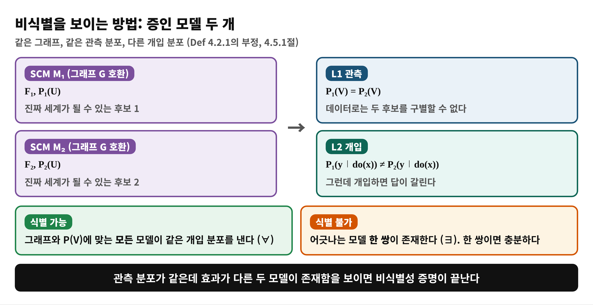
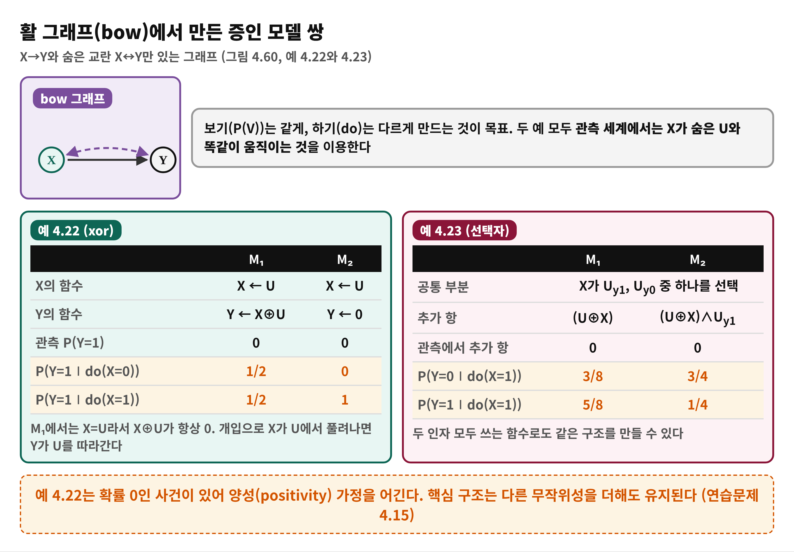
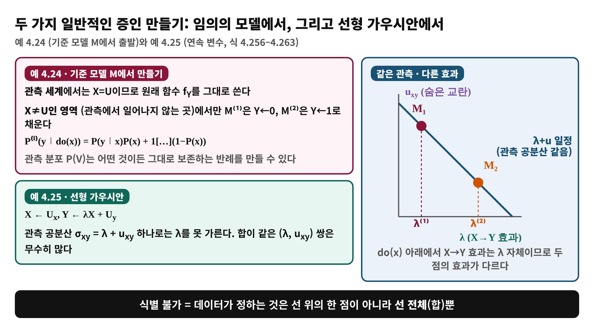
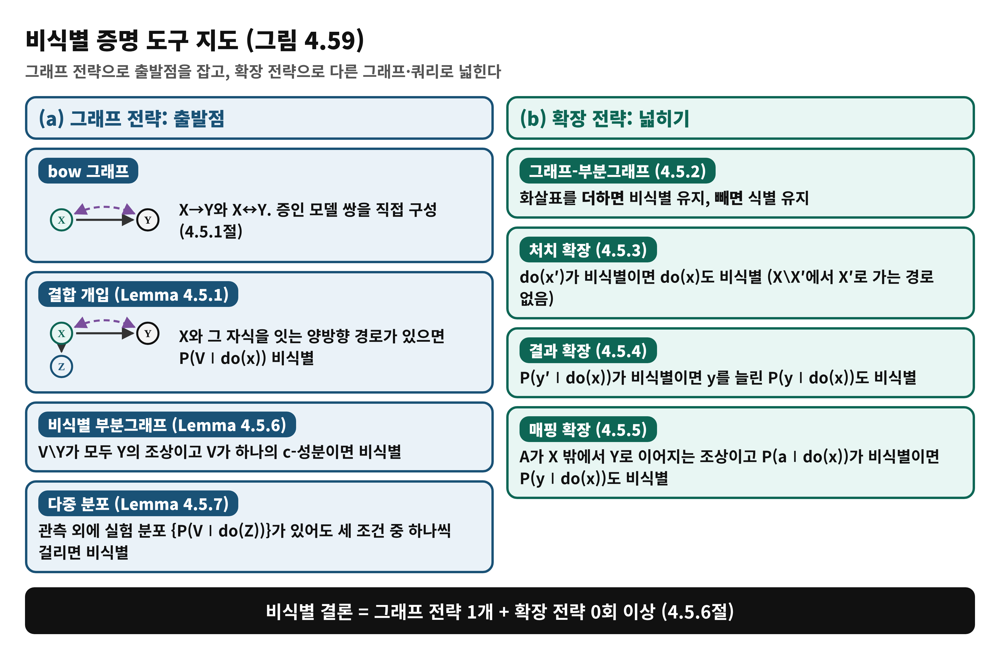
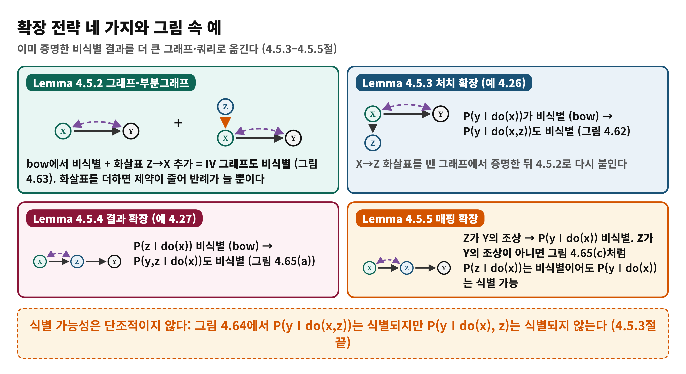

<!--
  book-explainer · Day 13 (PDF 205–216쪽) · Causal Artificial Intelligence
  빌드: python build_pptx.py day13.md
-->

# Day 13 — 식별 불가능성: 언제 답할 수 없는가

**책**: Causal Artificial Intelligence · **범위**: PDF 205–216쪽 (인쇄 193–204) · 4.5절 Non-Identification · **수준**: 입문

---

# 한눈에 보기
<!-- _class: small -->

- **이 범위가 푸는 문제**
  - 식별 알고리즘이 "식별 불가"라고 답했을 때, 그것이 정말 불가능하다는 것을 어떻게 **증명**하는가?
- **결론 한 줄**
  - 같은 그래프와 같은 관측 분포 P(V)를 내면서 P(y∣do(x))가 서로 다른 **SCM 두 개**를 보이면 된다. 그래프 전략(bow 등)으로 출발하고 확장 전략으로 더 큰 그래프로 넓힌다
- **읽고 나면**
  - bow 그래프의 증인 모델 쌍을 직접 만들고, 확장 네 가지(그래프-부분그래프·처치·결과·매핑)를 언제 쓰는지 말할 수 있다

---

# Day 12에서 이어받은 것
<!-- _class: small -->

- **Day 12의 알고리즘**: 식별을 입력·출력 규칙으로 계산하며, 막히면 **"식별 불가"**를 돌려준다 (4.4절)
- **남는 질문**: 그 "불가"는 알고리즘이 못 찾았다는 뜻인가, 정말 불가능하다는 뜻인가?
- **Day 10의 건전성·완전성(Thm 4.3.2)**: 규칙이 막히면 식별 불가라는 선언은 있었지만, 그것을 **모델로 직접 보인 적은 없다**
- **오늘의 질문**: **관측 분포가 같은데 효과가 다른 두 모델이 존재함을 어떻게 보이는가?**

---

# 왜 필요한가 — "못 찾았다"와 "없다"의 차이
<!-- _class: small -->

- **문제 상황**
  - 규칙을 아무리 적용해도 do가 안 지워지면, 사람은 더 시도해 봐야 하는지 멈춰야 하는지 알 수 없다
- **비식별성 증명이 주는 것**
  - "이 데이터와 이 그래프로는 **원리적으로** 답이 정해지지 않는다"는 확정 판정 (책의 말로는 SCM 쌍 증인)
  - 데이터를 더 모아도 소용없다는 것을 알려 주어, 가정을 더하거나 실험을 설계하는 쪽으로 방향을 돌린다
- **오늘의 접근**
  - 그래프 하나(bow)에서 직접 증명 → 확장 규칙으로 다른 그래프에 옮기기

---

# 용어 준비
<!-- _class: small -->

| 용어 | 한 줄 뜻 | 예 |
|:---|:---|:---|
| 비식별성 | 그래프와 P(V)가 효과를 하나로 정하지 못함 | Def 4.2.1의 부정 |
| 증인 모델 | P(V)는 같고 do 분포는 다른 SCM 쌍 M₁, M₂ | 예 4.22–4.25 |
| bow 그래프 | X→Y와 숨은 교란 X↔Y만 있는 그래프 | 그림 4.60 |
| 결합 개입 분포 | do(x) 아래 여러 변수의 결합 분포 P(V∖X∣do(x)) | Lemma 4.5.1 |
| c-성분 | 숨은 교란(점선)으로 이어진 변수 묶음 | Lemma 4.5.6 (Day 11) |
| IV 그래프 | bow에 Z→X를 더한 그래프 | 그림 4.63 |

---

# 개념 1 — 비식별을 보이는 구조: 증인 모델 쌍
<!-- _class: small -->

4.5.1절 (PDF 206–207쪽), Def 4.2.1의 부정

---

# 개념 1 — 비유로 이해하기: 같은 그림자를 만드는 두 물체
<!-- _class: small -->

- **비유**
  - 벽에 비친 그림자만 보고 물체의 모양을 맞히라고 한다. 그런데 모양이 다른 두 물체가 정확히 같은 그림자를 만든다면, 그림자만으로는 답할 수 없다
- **개념 대응**
  - 그림자 = 관측 분포 P(V) · 물체 = SCM · 물체를 직접 만져 보기 = do 개입 · 같은 그림자의 두 물체 = 증인 모델 쌍
- **핵심**
  - 두 물체를 **하나만 보여 주면** 충분하다. 모든 물체를 검사할 필요는 없다
- **비유의 한계**
  - 그림자는 항상 정보를 잃는 투영이지만, 여기서는 **그래프 가정이 후보 물체를 이미 줄여 놓는다**. 또 그림자를 더 얻으면(실험 분포 추가) 풀릴 수도 있다 (Day 20 이후)

---

# 개념 2 — bow 그래프에서 증인 만들기
<!-- _class: small -->

예 4.22 (xor)와 예 4.23 (선택자), 식 4.238–4.243

---

# 수식 풀이 — 예 4.22: 같은 P(V), 다른 do 분포
<!-- _class: small -->

$$
P_1(Y=1 \mid do(X=0)) = P(U_{xy}=1) = \frac{1}{2} \neq 0 = P_2(Y=1 \mid do(X=0))
$$

- **모델**: M₁은 X←U, Y←X⊕U. M₂는 X←U, Y←0 (U는 공정한 동전)
- **관측 세계**: X가 U와 같아서 M₁의 Y=U⊕U=0. 두 모델 모두 Y는 항상 0이므로 P₁(V)=P₂(V)
- **do(X=0) 세계**: X가 U와 끊어지면 M₁의 Y=0⊕U=U. 확률 1/2로 1이 된다. M₂는 Y가 항상 0
- **의미**: 진짜 세계가 M₁이면 X=0과 X=1이 똑같지만, M₂이면 X=0이 훨씬 낫다. 데이터로는 구별 불가 (표 4.3)

---

# 개념 3 — 일반 전략과 연속 변수 (선형 가우시안)
<!-- _class: small -->

예 4.24 (식 4.244–4.255)와 예 4.25 (식 4.256–4.263)

---

# 수식 풀이 — 예 4.25: 공분산은 합만 알려 준다
<!-- _class: small -->

$$
\sigma_{xy} = E[XY] = \lambda\, E[XX] + E[U_x U_y] = \lambda + u_{xy}
$$

- **λ**: X→Y의 구조 계수. do(x) 아래의 효과는 λ 그 자체다
- **u_xy**: 숨은 교란 U_x와 U_y의 공분산 (관측되지 않음)
- **관측으로 알 수 있는 것**: σ_xy (정규화하면 분산은 1) = λ + u_xy
- **자유도**: 네 개 {λ, u_xy, u_xx, u_yy}가 있는데 관측은 합만 준다. 합이 같고 λ가 다른 두 쌍을 고르면 증인이 된다

---

# 개념 4 — 도구 지도: 그래프 전략과 확장 전략
<!-- _class: small -->

그림 4.59 (4.5절 도입, PDF 205–206쪽)

---

# 개념 4 — 결합 개입 분포의 그래프 기준 (Lemma 4.5.1)
<!-- _class: small -->

- **Lemma 4.5.1 (Joint non-ID)**: X와 그 자식 사이에 **양방향 경로**가 있으면 결합 개입 분포 P(V∖X∣do(x))는 P(V)와 G로부터 식별되지 않는다
- **bow에 적용**: V={X,Y}이면 P(y∣do(x))가 곧 결합 분포이므로 비식별
- **주의 (그림 4.62)**: X→Y, X↔Y에 X→Z가 있으면 P(y,z∣do(x))는 비식별이지만 **P(z∣do(x))는 식별**된다. 주변 분포의 판정은 더 분석해야 한다
- **PDF 211–212쪽 (인쇄 199–200)**

---

# 개념 5 — 확장 전략: 이미 아는 비식별을 넓히기
<!-- _class: small -->

Lemma 4.5.2–4.5.5 (PDF 212–214쪽)

---

# 개념 6 — bow 없이도 비식별: non-ID 부분그래프와 다중 분포
<!-- _class: small -->

- **Lemma 4.5.6** (PDF 214쪽): V∖Y의 모든 변수가 Y의 조상이고, V가 **하나의 c-성분**이면 P(y∣do(x))는 비식별. bow가 없는 그림 4.67도 포함
- **그림 4.66**: P(w,y∣do(x))를 이 Lemma로 비식별 판정 → 매핑 확장으로 P(y∣do(x))의 비식별까지
- **Lemma 4.5.7** (PDF 215–216쪽): P(V)에 실험 분포 {P(V∣do(Z))}까지 있어도 모든 Z에서 다음 중 하나가 걸리면 비식별
  - (i) 줄인 그래프에서도 여전히 비식별 · (ii) 반대 방향 P(y∣do(z))가 비식별 · (iii) Z가 Y와 겹침
- **예 4.28·4.29**: 그림 4.67(c), (d)에서 P(V)와 P(V∣do(Z))가 있어도 P(y∣do(x))는 비식별

---

# 흔한 오해
<!-- _class: small -->

> ❌ "식별 불가는 효과가 없다는 뜻이다"

- ✅ 효과는 있을 수 있다. 현재 그래프와 데이터로 **하나의 값으로 정해지지 않는다**는 뜻이다
- ❌ "bow 그래프만 비식별이다" → ✅ bow가 없어도 비식별이다 (Lemma 4.5.6, 그림 4.67)
- ❌ "식별 가능성은 변수를 더하면 쉬워진다" → ✅ 단조적이지 않다. 그림 4.64에서 P(y∣do(x,z))는 식별되고 P(y∣do(x),z)는 아니다
- ❌ "Z가 X의 자식이고 P(z∣do(x))가 비식별이면 P(y∣do(x))도 비식별" → ✅ Z가 Y의 조상일 때만 (Lemma 4.5.5, 그림 4.65(c))

---

# 정리

- **비식별성** = 관측 분포가 같고 효과가 다른 SCM 쌍의 존재. 한 쌍이면 충분 (∀ 대 ∃)
- **그래프 전략**: bow, 결합 개입 기준, non-ID 부분그래프, 다중 분포 기준
- **확장 전략**: 화살표 더하기, 처치·결과 늘리기, 조상으로 매핑
- 다음: 식별되지 않을 때 어떻게 할 것인가는 **Day 20–22 (부분 식별)**. 바로 다음 Day 14는 고정 개입을 넘는 **정책 개입**

---

# 이해 점검 퀴즈 Q1

**(개념 확인)** 어떤 그래프에서 P(y∣do(x))가 식별되지 않음을 보이려면 무엇이 필요한가?

- A) 같은 그래프와 같은 P(V)를 내지만 P(y∣do(x))가 다른 SCM 두 개
- B) 규칙을 한 번 적용해 보고 실패한 기록
- C) 표본 수가 충분히 큰 데이터
- D) P(V)가 서로 다른 두 SCM

---

# Q1 정답 및 해설

- **정답: A**
- 왜 맞나: 식별 가능성은 Def 4.2.1에서 모든 모델이 같은 효과를 낸다는 조건이므로, 부정은 어긋나는 모델 한 쌍의 존재다
- B가 틀린 이유: 실패 기록은 못 찾았다는 것일 뿐이다. 완전성(Thm 4.3.2) 덕분에 모든 규칙이 막히면 비식별이지만, 직접 보이려면 증인이 필요하다
- C가 틀린 이유: 비식별은 표본 수가 아니라 가정의 부족 문제이다
- D가 틀린 이유: 관측 분포가 달라지면 같은 데이터에서 나온 모델이 아니다

---

# 이해 점검 퀴즈 Q2

**(적용)** IV 그래프 (Z→X, X→Y, 숨은 교란 X↔Y)에서 P(y∣do(x))는 비모수 설정에서 식별되는가?

- A) 식별 가능. Z가 X를 움직이므로
- B) 식별 불가. bow에 화살표 Z→X만 더한 그래프이기 때문
- C) 식별 가능. Z가 Y의 조상이므로
- D) 판정할 수 없다

---

# Q2 정답 및 해설

- **정답: B**
- 왜 맞나: bow에서 비식별이고, Lemma 4.5.2에 따라 화살표를 **더해도** 비식별이 유지된다 (그림 4.63)
- A가 틀린 이유: Z가 있다는 것만으로는 도움이 되지 않는다. 그래프-부분그래프 논리로 확정된다
- C가 틀린 이유: Z는 X를 통해서만 Y로 이어지고, 조상 관계는 식별과 무관하다
- D가 틀린 이유: Lemma 4.5.2로 판정할 수 있다

---

# 이해 점검 퀴즈 Q3

**(오개념 교정)** 다음 설명 중 **틀린** 것은?

- A) 비식별은 효과가 존재하지 않는다는 뜻이 아니다
- B) 증인 모델은 한 쌍이면 충분하다
- C) P(z∣do(x))가 비식별이어도 P(y∣do(x))가 식별될 수 있다 (그림 4.65(c))
- D) 어떤 그래프에서 비식별이면, 거기서 화살표를 **빼도** 항상 비식별이다

---

# Q3 정답 및 해설

- **정답: D** (틀린 설명)
- 왜 틀렸나: Lemma 4.5.2는 화살표를 **더할 때** 비식별이 유지된다고 말한다. 빼면 제약이 늘어 식별될 수도 있다 (반대로 식별은 화살표를 빼도 유지)
- A: 맞다. 값이 하나로 정해지지 않을 뿐이다
- B: 맞다. 식별은 ∀, 비식별은 ∃이다
- C: 맞다. Z가 Y의 조상이 아니면 매핑 확장을 못 쓴다 (Lemma 4.5.5)
