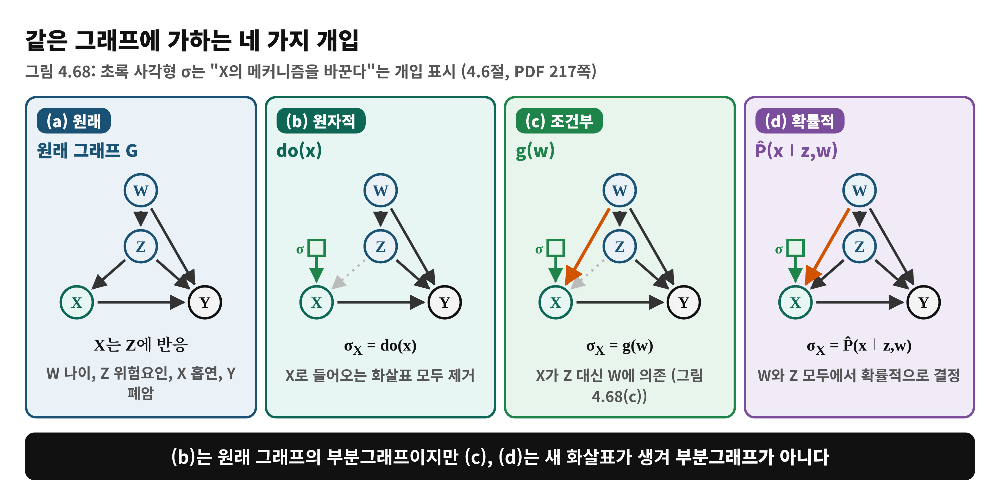
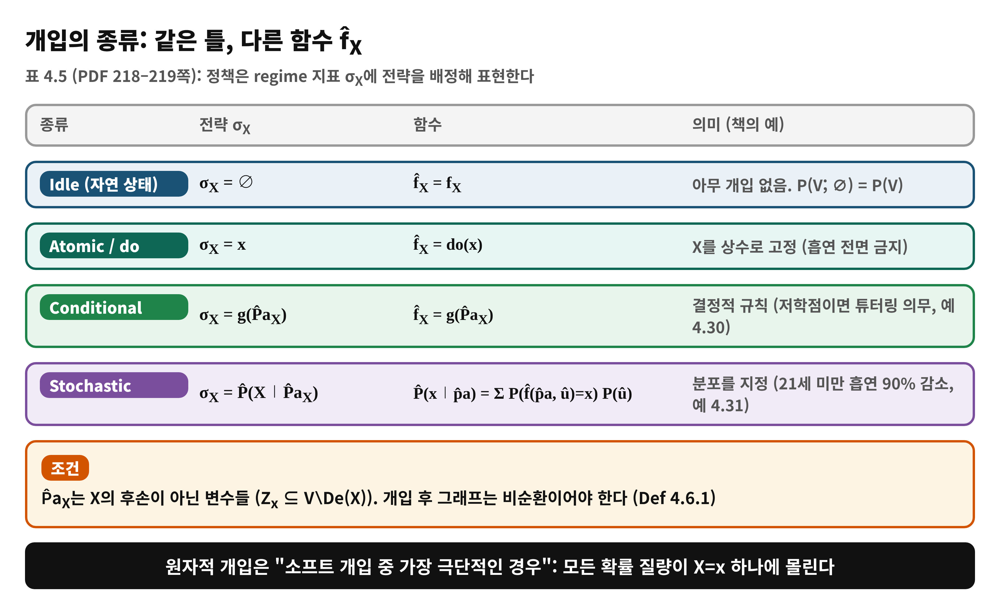
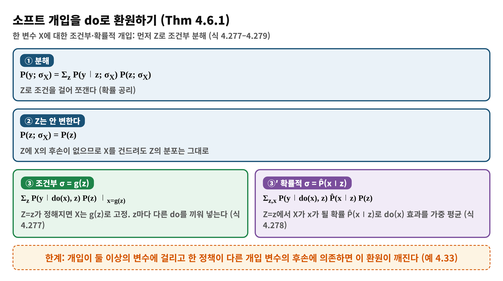
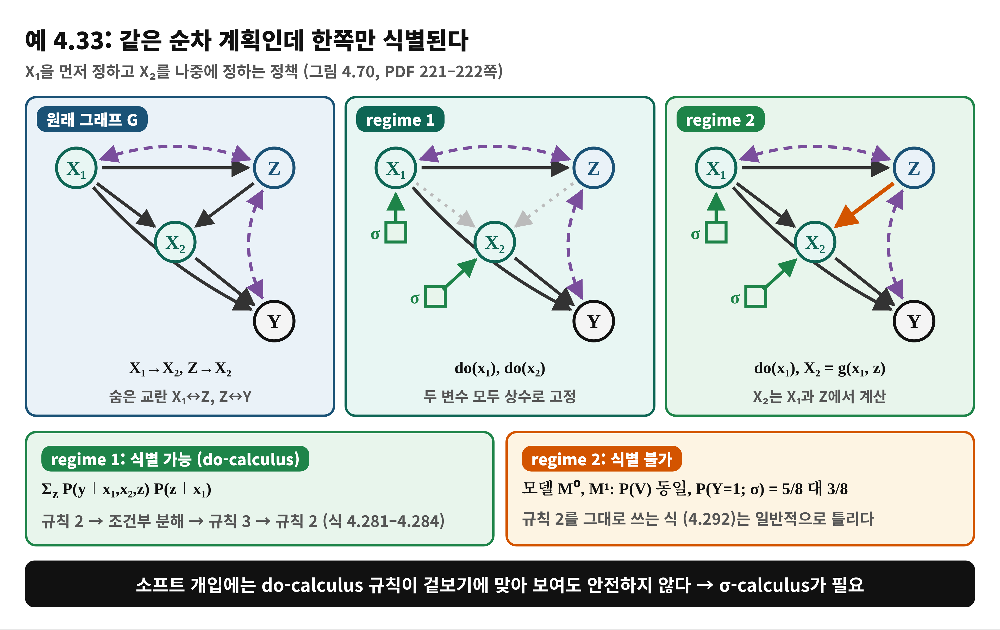
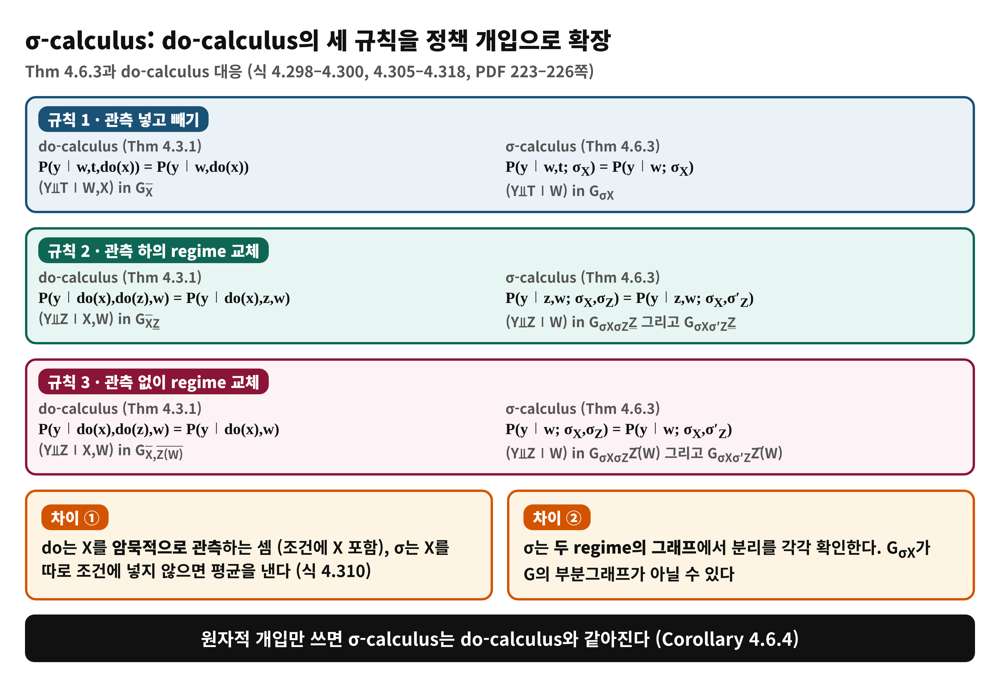

# Day 14 — 정책 개입: 고정 개입을 넘어 (학습 노트)

> 근거: Causal Artificial Intelligence, PDF 217–228쪽 (인쇄 205–216) · 4.6절 Topics in Interventional Reasoning: Policy Interventions · 독자 수준: 입문
> 쪽 번호는 PDF 기준이며 인쇄 번호 = PDF − 12. 표기: σ_X = 개입 전략(regime 지표), P̂ = 정책이 지정하는 분포, G_X̄ = X로 들어오는 화살표를 지운 그래프, G_X̲ = X에서 나가는 화살표를 지운 그래프.

## 한눈에 보기
- **이 범위가 푸는 문제**: do(x)처럼 X를 고정하는 것이 아니라, 조건에 따라 달라지는 **정책**의 효과도 관측 자료로 계산할 수 있는가?
- **결론 한 줄**: 정책은 regime 지표 σ_X로 쓰며(Def 4.6.1), 한 변수 정책은 do 효과의 가중 평균으로 환원된다(Thm 4.6.1). 여러 변수 정책에서는 do-calculus가 틀릴 수 있어 **σ-calculus**(Thm 4.6.3)를 쓴다.
- **읽고 나면**: 원자적·조건부·확률적 개입을 구분하고, 정책 효과를 do 효과로 바꿔 쓰며, 예 4.33이 왜 식별 불가인지 설명할 수 있다.

## Day 8–13에서 이어받은 것
Day 8–12는 P(y∣do(x))를 관측 자료에서 계산하는 법(백도어, 프론트도어, do-calculus, 식별 알고리즘)이었고, Day 13은 계산이 불가능한 경우를 증인 모델로 보이는 법이었다. 모두 개입이 do(x), 즉 한 값에 고정하는 원자적 개입이라는 전제 위에 있었다. 오늘은 그 전제를 푼다.

## 왜 필요한가
책은 do(흡연=0)이 흡연이 사라진 세계를 정밀하게 기술하지만 현실에서는 담배를 완전히 없애는 정책이 드물다고 말한다. 현실 정책은 "21세 미만 흡연을 90% 줄인다"처럼 X의 메커니즘을 **더 부드러운 규칙으로 교체**한다. 책은 다만 이는 정의의 문제와 구현 가능성의 문제를 섞은 것일 수 있다고 하며, do 연산자는 이상화되었더라도 더 복잡한 개입을 분석하는 수학적 도구로 남는다고 한다 (PDF 217쪽).

## 용어 준비
| 용어 | 한 줄 뜻 | 예 |
|---|---|---|
| 원자적(hard) 개입 | X를 상수로 고정 | do(x) |
| 소프트(soft) 개입 | X를 조건부·확률적 규칙으로 교체 | 4.6절 |
| 개입 모델 M_X̂ | f_X를 새 함수 f̂_X로 교체한 SCM | Def 4.6.1 |
| regime 지표 σ_X | 어떤 전략이 쓰였는지 표시. 그래프에서는 σ_X→X 노드 | 그림 4.68 |
| P(V; σ_X) | σ_X 아래의 분포 (do 표기의 일반화) | 각주 17 |
| σ-calculus | 소프트 개입용 규칙 세 개 | Thm 4.6.3 |

## 개념 1. 개입 모델 (4.6.1절, PDF 217–218)
**Def 4.6.1 (Interventional Model)**: M=⟨V,U,F,P(U)⟩, X⊆V, 그리고 f̂_X : Val(Z_x)×Val(Û_x)→Val(X) (Z_x ⊆ V∖De(X), Û_x는 새 외생 변수)에 대해
M_X̂ = ⟨U∪Û, V, F_X̂, P(U,Û)⟩, F_X̂ = {f_i : V_i∉X} ∪ f̂_X, P(U,Û)=P(U)P(Û) (식 4.264–4.267).
- 원자적 submodel(Def 2.2.2)과 달리 개입 변수가 상수일 필요가 없다. 상수, 결정적, 확률적 모두 가능하다. 단 개입 후 그래프는 **비순환**이어야 한다.
- 새 외생 Û는 원래 U와 독립이다. 정책이 숨은 요인에 의존하지 않는다는 가정이다.
- G_σX는 각 개입 변수마다 노드 σ와 화살표 σ→X를 더한 그래프이다. 정책이 새로운 관측 변수를 읽을 수 있어 **G의 부분그래프가 아닐 수 있다** (그림 4.68(c),(d)).

## 개념 2. 개입의 종류 (4.6.2절, 표 4.5, PDF 218–219)
| 종류 | 전략 | 함수 |
|---|---|---|
| Idle | σ_X=∅ | f̂_X = f_X (관측 분포 P(V)) |
| Atomic/do | σ_X=x | f̂_X = do(x) |
| Conditional | σ_X=g(P̂a_X) | f̂_X = g(P̂a_X) |
| Stochastic | σ_X=P̂(X∣P̂a_X) | P̂(x∣p̂a)=Σ_û P(f̂(p̂a,û)=x)P(û) |

- **예 4.30 (튜터링)**: W 지난 학기 GPA, Z 동기, X 튜터링, Y 학기말 GPA. 현재는 동기가 높은 학생이 자발적으로 신청(Z→X). 학교가 GPA가 낮은 학생에게 의무화하고 그들에게만 제공하면 σ_X=g(w), g(w)=1(저GPA)이며 그림 4.68(c)에서 X는 W에 의존하고 Z에는 의존하지 않는다.
- **예 4.31 (흡연)**: 21세 미만 흡연을 90% 줄이는 정책: P̂(X=1∣W<21,z) = 0.1×P(X=1∣z) (식 4.270–4.271). 그림 4.68(d).

**비유**: 에어컨 설정. 원자적 = 리모컨으로 26℃ 고정, 조건부 = 센서가 "28℃ 이상이면 켠다"는 자동 규칙, 확률적 = "더울수록 켜질 확률이 높다".

| 비유 | 개념 |
|---|---|
| 26℃ 고정 | do(x) |
| 센서값에 따른 on/off | g(w) |
| 켜질 확률 규칙 | P̂(x∣w,z) |
| 센서 값 | 정책이 읽는 변수 (X의 후손 아님) |

> **비유의 한계**: 실제 에어컨은 실내 온도가 에어컨에 되먹임되는 순환이다. 책은 개입 모델을 비순환으로 한정한다.

## 개념 3. do와 소프트 개입의 차이 (4.6.3절, PDF 219–220)
- **do(x) 아래에서 X는 암묵적으로 관측된다**: P(y; do(x)) = Σ_x′ P(y∣x′; do(x))P(x′; do(x)) = P(y∣x; do(x)) (식 4.272–4.274). do가 모든 확률 질량을 X=x로 옮기기 때문이다 (각주 18: 효과성(effectiveness) 성질, Def 2.2.5).
- **소프트에서는 일반적으로 P(y; σ_X) ≠ P(y∣x; σ_X)**. 책의 예는 X→Y에 P̂(X=1)=1/2인 확률적 개입 (식 4.275–4.276). 아래 "주의" 참고.
- 원자적 개입은 항상 부분그래프로 축소되지만, 소프트 정책은 원래 없던 변수를 읽어 구조가 달라질 수 있다.

## 개념 4. 한 변수 소프트 개입의 환원 (Thm 4.6.1, PDF 220)
**Thm 4.6.1**: σ¹_X=g(Z)(조건부), σ²_X=P̂(X∣Z)(확률적), Z가 X의 후손을 포함하지 않으면
- P(y; σ¹_X) = Σ_z P(y∣do(x),z)P(z) ∣_{x=g(z)} (식 4.277)
- P(y; σ²_X) = Σ_{z,x} P(y∣do(x),z)P̂(x∣z)P(z) (식 4.278)

증명의 핵심: Z로 조건부 분해(식 4.279)하고, Z에 X의 후손이 없으므로 P(z;σ_X)=P(z)이며, Z가 정해지면 X는 g(z) 또는 P̂(x∣z)를 따른다. **예 4.32**: 그림 4.69에서 σ_X=P̂(X∣W)이면 P(y;σ_X)=Σ_w P(y∣do(x),w)P̂(x∣w)P(w) (식 4.280). 책은 이 환원이 직관적이고 건전하지만 do-calculus로는 유도할 수 없다고 덧붙인다.

### 수식 풀이 (식 4.278)
- P(z): 정책이 Z의 분포를 바꾸지 않는다 (Z는 X의 후손이 아님).
- P̂(x∣z): 정책이 정하는 값. Z=z인 대상에게 X=x를 줄 확률.
- P(y∣do(x),z): 그 대상에게 X=x를 강제했을 때의 효과. 이것이 식별 가능해야 전체가 계산된다.
- **숫자 예 (책의 예가 아님, 직접 계산)**: P(W=1)=0.3, P(Y=1∣do(x),w)가 w=1에서 x=1이면 0.6, x=0이면 0.3, w=0에서 x=1이면 0.8, x=0이면 0.7이라 하자(P(y∣do(x),w)가 식별 가능하다고 가정). 조건부 정책 "w=1이면 X=1, w=0이면 X=0": 0.3×0.6 + 0.7×0.7 = **0.67**. 모두 do(1)이면 0.3×0.6+0.7×0.8=0.74, 모두 do(0)이면 0.3×0.3+0.7×0.7=0.58. 확률적 정책 "w=1이면 X=1을 확률 0.5로, w=0이면 X=0": 0.3×(0.5×0.6+0.5×0.3)+0.7×0.7 = 0.625.

## 개념 5. 예 4.33: 두 변수에서는 환원이 깨진다 (PDF 221–222)
그림 4.70: X₁→Z, X₁→X₂, X₁→Y, Z→X₂, X₂→Y, 숨은 교란 X₁↔Z, Z↔Y. 순차 계획: X₁을 먼저 정하고 X₂를 나중에 정한다.
- **regime 1** (둘 다 do): 규칙 2, 조건부 분해, 규칙 3, 규칙 2로 Σ_z P(y∣x₁,x₂,z)P(z∣x₁) (식 4.281–4.284). 식별 가능.
- **regime 2** (do(x₁), X₂=g(x₁,z)): 규칙 2의 첫 단계 (식 4.285)는 따라 할 수 있지만 Z→X₂ 때문에 X₁과 Y가 X₂ 조건에서 종속일 수 있어 이어갈 수 없다. 사실 **식별 자체가 불가능**하다. 책은 이진 SCM 두 개 M⁰, M¹ (식 4.286–4.289)로 P(V)가 같은데 P(Y=1; σ)가 5/8 대 3/8임을 보인다. 검산: g=X₁⊕Z이고 Y=X₁⊕X₂⊕U_y이므로 Y=Z⊕U_y. X₁=U_{x₁z}이면(확률 1/2) Z=X₁⊕U_z는 공정한 동전, 아니면 M⁰은 Z=0, M¹은 Z=1이다. P(U_y=1)=3/4이므로 M⁰: 1/2×1/2+1/2×3/4=5/8, M¹: 1/4+1/2×1/4=3/8.
- 교훈: "규칙 2에 의하면 P(y∣do(x₁),do(X₂=g))=P(y∣x₁,do(X₂=g))"(식 4.292)는 일반적으로 틀린 추론이다.

### Thm 4.6.2 (일반 환원, PDF 222–223)
σ*_X가 원자적·조건부·확률적 개입일 때 P(y; σ_X=σ*_X) = Σ_{d∖y} P(d∖x∣do(x)) Π_{X∈X∩D} P(x∣pa_x; σ*_X), D=An(Y) in G_σX (식 4.293). 이 효과가 식별 가능한 것과 P(d∖x; do(x))가 식별 가능한 것은 동치이다. 예 4.34는 그림 4.69에서 식 4.294–4.297로 Thm 4.6.1(식 4.280)과 일치함을 확인한다. 다만 식 4.294의 첫 단계는 do-calculus 안에서 설명되지 않아 새 규칙이 필요하다고 책은 말한다.

## 개념 6. σ-calculus (4.6.4절, PDF 223–228)
**Thm 4.6.3**: G_σXσZ, G_σXσ′Z가 비순환일 때 임의의 정책에 대해
- **규칙 1** (관측 넣기/빼기): (T⫫Y∣W) in G_σX이면 P(y∣w,t;σ_X)=P(y∣w;σ_X) (식 4.298).
- **규칙 2** (관측 하의 regime 교체): (Z⫫Y∣W)가 G_σXσZ에서 Z의 나가는 화살표를 지운 그래프와 G_σXσ′Z에서 같은 방식으로 지운 그래프 둘 다에서 성립하면 P(y∣z,w;σ_X,σ_Z)=P(y∣z,w;σ_X,σ′_Z) (식 4.299). 여기서 Z̲ = Z에서 나가는 화살표를 지운 그래프이다.
- **규칙 3** (관측 없이 regime 교체): (Z⫫Y∣W)가 G_σXσZ와 G_σXσ′Z에서 Z(W)로 들어오는 화살표를 지운 그래프 둘 다에서 성립하면 P(y∣w;σ_X,σ_Z)=P(y∣w;σ_X,σ′_Z) (식 4.300). Z(W)는 Z 중 W의 조상이 아닌 원소.
- **Corollary 4.6.4**: 원자적 개입만 쓰면 σ-calculus = do-calculus.
- **Corollary 4.6.5**: 개입이 X의 부모를 늘리지 않으면 조건을 G_σXZ̲, G_σXZ̄(W) 한 그래프에서만 확인하면 된다 (식 4.348–4.349 이하).

**do-calculus와의 차이** (PDF 225–227, 식 4.305–4.328): (1) do는 조건에 X가 암묵적으로 들어가 있지만 σ는 X를 따로 조건에 넣어야 한다. 조건에 안 넣으면 Σ_x P(y∣x;σ)P(x;σ)로 평균을 낸다 (식 4.310). (2) do-calculus는 항상 G_X̄ 하나이지만 σ-calculus는 양변 regime의 그래프 둘에서 분리를 확인한다. 예: 그림 4.72(a)에서 σ_X=do(g(w))이면 P(y∣x,w;σ_X)=P(y∣x,w) (식 4.313)이지만 P(y∣w;σ_X)=P(y∣x,w) (식 4.314)는 일반적으로 성립하지 않는다. 또 σ_T=P̂(T∣Y)이면 규칙 3으로 P(y; σ_T)=P(y)는 얻어도 P(y∣t; σ_T)=P(y)는 성립하지 않는다 (식 4.321–4.323).

### 수식 풀이 (예 4.35, 식 4.301–4.304)
σ_X=P̂(x∣z,w)일 때 P(y;σ_X)=Σ_{x,z,w} P(y∣x,z,w;σ_X)P(x∣z,w;σ_X)P(z,w;σ_X)로 분해한다. 규칙 2로 P(y∣x,z,w;σ_X)=P(y∣x,z,w) (G_X와 G_σX_X에서 Y⫫X∣Z,W), 규칙 3으로 P(z,w;σ_X)=P(z,w), 가운데는 정의로 P̂(x∣z,w)이다. 결과 Σ P(y∣x,z,w)P̂(x∣z,w)P(z,w)는 모두 P(V)와 정책의 함수이므로 식별된다 (식 4.304). **예 4.36**은 더 복잡한 그림 4.73에서 규칙 1–3을 여러 번 써서 식 4.347을 얻는다.

## 이 PDF를 읽을 때 주의
- **식 4.276 (PDF 220, 인쇄 208)**: "P(y;σ_X)=P(y)"는 X→Y에서 확률적 개입 P̂(X=1)=1/2일 때 P(y;σ_X)=Σ_x P(y∣x)P̂(x)가 되어, 관측의 P(X=1)이 1/2일 때만 P(y)와 같다. "almost any structural model"이라는 말과 맞지 않아 보인다. 의도는 P(y∣x;σ_X)=P(y∣x)와 P(y;σ_X)가 다르다는 점이라고 읽었다.
- **예 4.35 (PDF 224)**: "Tutoring program continued"라고 하면서 예 4.31(흡연, σ_X=P̂(x∣w,z))을 가리킨다. 튜터링은 예 4.30이다. 예시 이름이 섞였다.
- **그림 4.69 캡션 (PDF 220)**: "...related ." 로 문장이 끝나 있다 (초안).
- **식 4.285 (PDF 222)**: regime 2의 질의를 쓰는 줄이지만 좌변이 P(y∣do(x₁),do(x₂))로 되어 있다. 문맥상 do(X₂=g(x₁,z))를 의미한다.
- **예 4.33의 확률 (PDF 222)**: "P(U_y=1)=3/4,"가 쉼표로 끝난다. 다른 U는 공정한 동전이라는 문장이 뒤에 이어지는 구조로, 5/8과 3/8은 이 값으로 검산된다. 그림 4.70(a)에는 Z↔Y 점선이 있으나 이 SCM에는 U_y가 Y에만 있어 실제로는 그 숨은 교란이 없다 (그래프는 SCM보다 약한 가정이므로 모순은 아니다).
- **Thm 4.6.2 (PDF 222)**: "P(d∖x; σ_X=x)"는 P(d∖x∣do(x))를 뜻하는 표기로 보이며 형식이 일정하지 않다.
- **식 4.320 (PDF 227)**: "P(y∣t, σ_T=t)"는 σ_T=do(t)를 뜻하는 것으로 읽었다.
- **그림 4.68, 4.69, 4.70은 추출 텍스트에서 화살표를 알 수 없어 PDF 이미지(217, 220, 221쪽)로 확인했다.** 그림 4.72, 4.73의 상세 구조는 확인하지 않고 본문 서술만 따랐다.

## 흔한 오해
- ❌ "정책 효과도 do(x)와 똑같이 계산하면 된다" → ✅ 한 변수라면 do 효과의 가중 평균(Thm 4.6.1), 여러 변수에서는 환원이 깨질 수 있다.
- ❌ "소프트 개입에도 do-calculus 규칙 2를 그대로 쓰면 된다" → ✅ 예 4.33 regime 2는 식별 불가인데 규칙 2를 쓴 식 4.292는 틀리다.
- ❌ "do(x)는 구현이 어려워서 쓸모없다" → ✅ 소프트 개입 분석의 수학적 재료이다.
- ❌ "정책이 읽는 변수는 아무거나 된다" → ✅ X의 후손은 안 된다 (Def 4.6.1, Thm 4.6.1).
- ❌ "정책 효과는 P(y∣x)로 구할 수 있다" → ✅ P(y; σ_X)와 P(y∣x; σ_X)는 일반적으로 다르다 (식 4.275–4.276).

## 정리
1. 정책 개입은 f_X를 f̂_X로 교체한 개입 모델이며 원자적, 조건부, 확률적 세 종류이다 (Def 4.6.1, 표 4.5).
2. 한 변수 정책은 do 효과의 가중 평균 (Thm 4.6.1), 일반 환원은 Thm 4.6.2.
3. 여러 변수 정책은 do-calculus가 안전하지 않고(예 4.33), σ-calculus가 규칙을 제공하며 원자적이면 do-calculus와 같다 (Cor 4.6.4).
4. 어떤 개입을 할지 고르는 정책 개념은 Part III 의사결정의 씨앗이다 (Day 31 이후).

## 이해 점검 퀴즈
**Q1. (개념 확인)** 조건부 개입 σ_X=g(W)가 원자적 do(x)와 다른 점은?
- A) X가 상수가 아니라 W의 함수로 정해지고, 그래프에서 X의 부모가 바뀔 수 있다
- B) X를 측정하지 않는다
- C) 항상 확률적이다
- D) 항상 식별 불가능하다

정답 및 해설

정답: **A**. f̂_X=g(W)로 교체되고 그림 4.68(c)처럼 X의 부모가 Z에서 W로 바뀐다. B는 정의와 무관, C는 조건부가 결정적이고 확률적이 별도 종류(표 4.5), D는 예 4.30, 4.35처럼 식별되는 경우가 많다.

**Q2. (적용, 책의 예가 아님)** P(W=1)=0.3. P(Y=1∣do(x),w): w=1에서 x=1이면 0.6, x=0이면 0.3 / w=0에서 x=1이면 0.8, x=0이면 0.7. 정책 "W=1이면 X=1, W=0이면 X=0"의 P(Y=1; σ)는?
- A) 0.67  B) 0.74  C) 0.58  D) 0.65

정답 및 해설

정답: **A**. 식 4.277: 0.3×0.6+0.7×0.7=0.67. B는 do(1) 전체, C는 do(0) 전체, D는 P(W)로 가중하지 않은 (0.6+0.7)/2이다.

**Q3. (오개념 교정)** 틀린 설명은?
- A) 한 변수에 대한 조건부·확률적 정책은 do 효과의 가중 평균으로 환원된다
- B) 소프트 개입에서도 do-calculus 규칙을 그대로 쓰면 항상 올바른 식을 얻는다
- C) 예 4.33의 regime 2는 P(V)로 식별되지 않는다
- D) 원자적 개입만 쓰면 σ-calculus는 do-calculus와 같아진다

정답 및 해설

정답: **B**. 식 4.292는 일반적으로 틀리고 효과가 식별조차 되지 않는다. A는 Thm 4.6.1, C는 M⁰, M¹의 5/8 대 3/8, D는 Corollary 4.6.4.

**Q4. (설명하기)** 에어컨 비유로 "do(x)"와 "조건부 정책"의 차이를 한 문장으로 설명해 보라.

모범 답안

do(x)는 리모컨으로 온도를 26℃로 못 박는 것이고, 조건부 정책은 센서가 읽는 값(정책이 읽는 변수)에 따라 켜고 끄는 자동 규칙이며, 정책이 읽는 변수는 에어컨이 만든 결과(X의 후손)가 아니어야 한다.

## 다음 날로 이어지는 고리
'어떤 개입을 할지 고르는' 정책 개념은 Part III 의사결정(Day 31 이후)의 씨앗이다. 다음 Day 15는 L3의 반사실 추론으로 넘어간다 (PDF 251–265쪽).
