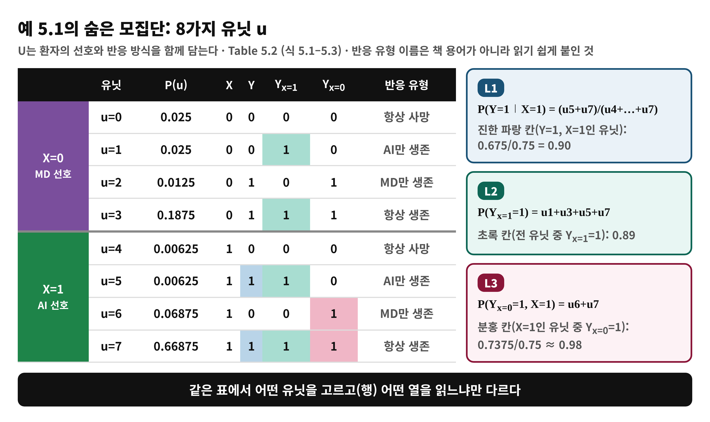
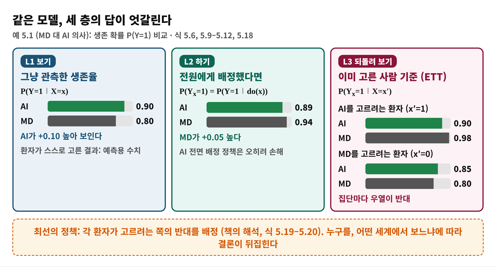
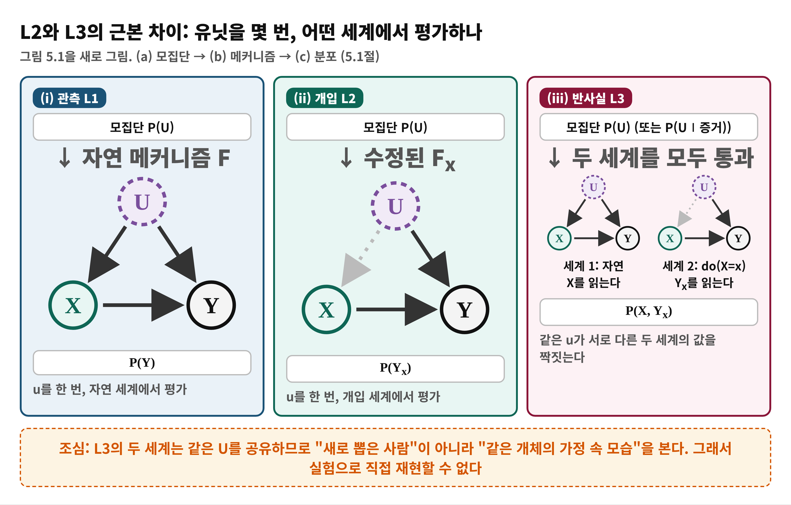
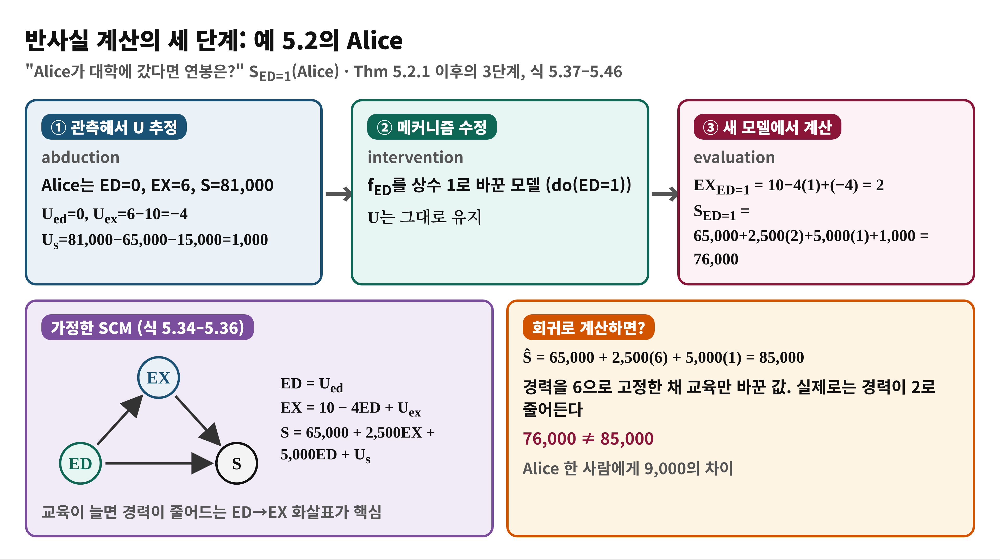
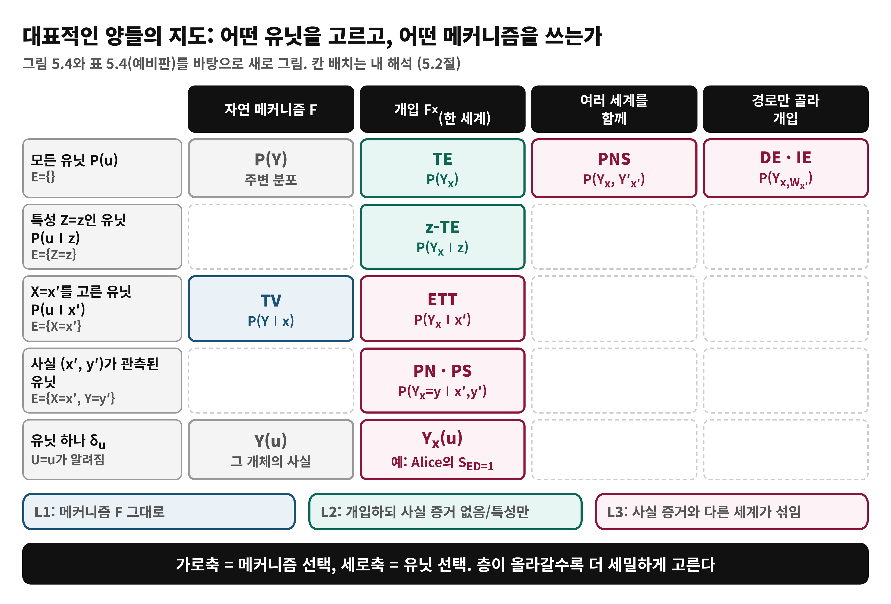

<!--
  book-explainer · Day 15 (PDF 251–265쪽) · Causal Artificial Intelligence
  빌드: python build_pptx.py day15.md
-->

# Day 15 — 반사실 추론 I: 동기와 반사실 양

**책**: Causal Artificial Intelligence · **범위**: PDF 251–265쪽 (인쇄 239–253) · 5.1절 Motivation & Recap, 5.2절 Counterfactual Quantities (5.2.1 ETT 시작부) · **수준**: 입문

---

# 한눈에 보기
<!-- _class: small -->

- **이 범위가 푸는 문제**
  - 같은 개체를 서로 다른 개입 아래에서 비교하는 질문(L3)이 평균 효과(L2)와 근본적으로 다른 이유는?
- **결론 한 줄**
  - 반사실 양은 모두 **"어떤 유닛 u를 고르고(사실 증거 E), 어떤 메커니즘으로 평가하나(조건 C)"** 의 조합 P[Y_C ∣ E]이다. 같은 SCM에서도 층마다 답이 뒤집힐 수 있다
- **읽고 나면**
  - 예 5.1의 세 층 답을 표에서 직접 계산하고, 구조적 기저 전개(Thm 5.2.1)와 3단계 절차로 반사실을 풀 수 있다

---

# Day 3·7·14에서 이어받은 것

- **Day 3**: 인과 사다리의 3층(L3 반사실)은 개체 수준의 "만약 ~했다면"
- **Day 7**: 사실(factual)과 반사실(counterfactual)을 대비하는 SCM의 평가 규칙
- **Day 14**: 고정된 do(x)를 넘어 조건에 따라 달라지는 정책 개입도 L2 안에서 다룸
- 오늘의 질문: **같은 개체를 서로 다른 개입 아래 비교하는 질문이 L2와 근본적으로 다른 이유는?**

---

# 왜 필요한가 — 평균으로는 답할 수 없는 질문
<!-- _class: small -->

- **책의 질문들 (5.1절)**
  - "백신을 2주 일찍 시작했다면 사망률은?", "택시 대신 지하철을 탔다면 제시간에 도착했을까?"
- **L2의 한계**
  - 무작위 실험은 **평균** 효과 P(Y_x)를 준다. 이미 일어난 사실과 모순되는 가정, 책임·기여도, 개인별 결정에는 부족하다
- **L3가 주는 것**
  - 사실 증거(E)를 유지한 채 다른 조건(C)을 가정한 결과. 평균이 맞아도 **개인·집단별 결론은 정반대**일 수 있다
- **다루는 순서**
  - 예 5.1~5.3(동기) → 5.2절의 통일된 형식 P[Y_C∣E] → ETT

---

# 용어 준비
<!-- _class: small -->

| 용어 | 한 줄 뜻 | 예 |
|:---|:---|:---|
| 유닛 u | 숨은 요인 U의 한 값. 한 개체(또는 개체 유형) | 예 5.1의 u=0…7 |
| 잠재 반응 Y_x(u) | 유닛 u가 do(X=x)를 받았을 때의 Y | Table 5.2 |
| 사실 증거 E · 반사실 조건 C | 실제로 관측된 사건 / 가정하는 개입 | C(E,C,Y)=P[Y_C∣E] |
| TV · TE · z-TE | 관측 차이 / 전체 효과 / 특성 z별 효과 | 표 5.4 |
| ETT | 원래 X=x′를 고른 사람들에게 do(X=x)였다면 | 식 5.54 |
| 반사실 3단계 | 관측해 U 추정 → 메커니즘 수정 → 계산 | 식 5.50 |

---

# 개념 1 — 예 5.1: 숨은 모집단은 8가지 유닛
<!-- _class: small -->

MD 대 AI 의사 (Hinton의 역설), 식 5.1–5.3과 Table 5.2

---

# 개념 1 — 세 층의 답이 엇갈린다
<!-- _class: small -->

같은 SCM에서 계산한 L1 · L2 · L3 값 (식 5.6, 5.9–5.12, 5.18)

---

# 개념 1 — 이 역설이 말하는 것
<!-- _class: small -->

- **Remark 1 (L1 대 L2)**: P(Y∣X)로 학습한 분류기는 **수동적 예측**에만 맞다. 숨은 교란이 섞여 있어 정책 근거로 쓰면 해롭다 (AI 전면 배정 0.89 < MD 0.94)
- **Remark 2 (L2 대 L3)**: 무작위 실험(L2)도 평균일 뿐. 환자가 **고르려던 쪽의 반대**를 주면 더 낫다 (식 5.19–5.20)
- **Remark 3 (L3 내부)**: PN 같은 개체 수준 양도 ETT와 다른 이야기를 한다. L3 양은 **모두 같지 않고** 서로 관계를 따져야 한다
- **교훈**: 사람의 (틀릴 수 있는) 직관과 기계 능력을 합치면 더 나은 결정이 나온다
- 반사실 양은 **물리 실험으로 얻을 수 없다**. 죽은 사람을 다른 치료로 되돌릴 수 없기 때문

---

# 개념 2 — L2 질문과 L3 질문의 차이
<!-- _class: small -->

그림 5.1 (5.1절): 유닛을 몇 번, 어떤 세계에서 평가하나

---

# 개념 2 — 비유로 이해하기: 게임 세이브 파일
<!-- _class: small -->

- **비유**
  - 세이브 파일을 불러와 **한 가지 선택만 바꿔** 다시 플레이한다. L2는 새 캐릭터를 무작위로 뽑아 다른 설정으로 플레이시키는 것
- **개념 대응**
  - 세이브 파일 = 유닛 u · 게임 규칙 = 메커니즘 F · 바꾼 선택 = do(X=x) · 처음 플레이 기록 = 사실 증거 E
- **핵심**
  - L3는 같은 u를 **두 세계**에 통과시켜 (X, Y_x)를 짝짓는다
- **비유의 한계**
  - 현실에서는 세이브 파일(U)이 **보이지 않고**, 관측 E로 추정해야 한다. 또 책은 개입 전에 정해진 변수 Z는 Z(u)=Z_x(u)로 변하지 않는다고 본다 (그림 5.1과 각주 2)

---

# 개념 3 — 모든 양을 한 형식으로: C(E, C, Y) = P[Y_C ∣ E]
<!-- _class: small -->

- **두 단계 생성 과정** (그림 5.3): ① 유닛 u를 P(U) (또는 P(U∣E))에서 **뽑는다** ② 메커니즘 F_exec를 인과 순서로 **평가**한다
- **E**: 사실 증거(어떤 유닛을 고르나) · **C**: 반사실 조건(어떤 메커니즘으로 평가하나)
- **양 극단**
  - C = {} 이면 **사실적(L1)**: 예 P(Y∣X=x)
  - E = {} 이면 **주변, do 형태(L2)**: 예 P(Y_x)
- 그 사이의 조합이 L3. E와 C의 변수가 **서로 어긋날 때** (E에서 X=1, C에서 x=0) 가장 흥미로운 질문이 된다

---

# 수식 풀이 — 구조적 기저 전개 (Thm 5.2.1, 식 5.49)
<!-- _class: small -->

$$
\mathcal{C}(E, C, Y) = \sum_{u} \mathbf{1}[Y_C(u) = y]\, P(u \mid E = e)
$$

- **P(u∣E=e)**: 사실 증거에 맞는 유닛만 가중해서 **뽑는 단계** (책의 파란 인자)
- **1[Y_C(u)=y]**: 그 유닛에 개입 C를 적용해 **평가하는 단계**. 결과가 y이면 1 (책의 빨간 인자)
- **읽는 법**: "증거와 맞는 유닛들 중, 개입 C 아래 Y=y가 되는 유닛의 비율"
- 확인: E={} 이면 Σ 1[Y_x(u)=y]P(u) = TE (식 5.52), C={}이면 TV (식 5.51)
- 책은 이 식이 의미 이해용이며 SCM을 모르므로 **직접 계산에는 못 쓴다**고 밝힌다

---

# 개념 4 — 반사실 3단계: 예 5.2의 Alice
<!-- _class: small -->

식 5.34–5.46: 교육이 경력에 영향을 주는 SCM

---

# 개념 5 — 대표적인 양들의 지도 (표 5.4, 그림 5.4)
<!-- _class: small -->

---

# 개념 6 — ETT: 이미 고른 사람에게는? (5.2.1절, 식 5.54–5.57)
<!-- _class: small -->

$$
\mathrm{ETT}_{x,x'}(Y) = P(Y_{X=x} \mid X = x') = \frac{P(Y_{X=x},\, X = x')}{P(X = x')}
$$

- **분자**: Y는 do(X=x) 세계, X는 자연 세계에 산다. **두 세계의 변수**가 한 식에 있는 것이 L3의 본질
- **TE와 비교**: 메커니즘(F_x)은 같고 **유닛 선택**만 다르다. TE는 P(U), ETT는 P(U∣X=x′)
- **대비형**: ETT_{x1−x0,x′} = ETT_{x1,x′} − ETT_{x0,x′} (식 5.57)
- **일관성(consistency)**: x=x′이면 X=x → Y_x=Y (식 5.65). 위 예 5.1의 0.90이 L1과 같은 이유

---

# 개념 6 — 예 5.3 일자리 재교육: 평균 효과와 자원자의 효과
<!-- _class: small -->

식 5.58–5.65. 아래 수치는 책의 모델에서 **직접 계산** (책 범위 밖 결론 포함)

| 양 | 값 | 의미 |
|:---|:---|:---|
| P(Y_{x=1}=1) − P(Y_{x=0}=1) | 25/40 − 23/40 = +0.05 | 파일럿 실험: 효과 있음 (식 5.62) |
| P(Y=1∣X=1) | 2/3 ≈ 0.67 | 자원자의 취업률은 더 높음 (식 5.63) |
| P(Y_{x=1}=1∣X=1) − P(Y_{x=0}=1∣X=1) | 2/3 − 2/3 = 0 | 자원자에 대한 ETT 대비 (식 5.64) |

- 책은 "자원자에게 정말 도움이 되나?"라는 비판을 ETT로 형식화하고 PDF 265쪽에서 끊긴다. 위 ETT=0은 **내가 모델로 계산**한 값
- 즉 평균 효과가 양수여도 자원자에게는 효과가 없을 수 있다

---

# 흔한 오해

> ❌ "P(Y∣X=1)가 더 높은 치료가 더 좋은 치료다"

- ✅ 그것은 환자가 스스로 고른 결과(L1)일 뿐. 예 5.1에서는 AI가 0.90 대 0.80으로 높아 보여도 do 아래서는 0.89 대 0.94
- ❌ "무작위 실험(L2)의 평균 효과를 알면 개인·집단별 효과도 안다" → ✅ ETT는 TE와 유닛 선택이 달라 부호까지 다를 수 있다
- ❌ "회귀식에서 교육을 바꾸면 연봉이 계산된다" → ✅ 교육이 경력도 바꾼다. Alice: 85,000이 아니라 76,000
- ❌ "반사실은 실험으로 측정할 수 있다" → ✅ 같은 개체를 두 번 처리할 수 없다 (책 5.1절)
- ❌ "반사실은 아무 상상이나 해도 된다" → ✅ 사실 증거 E로 U를 좁히고 같은 u를 유지한다

---

# 정리

- **형식**: 모든 양은 C(E,C,Y)=P[Y_C∣E] = 유닛 선택(E) + 메커니즘 선택(C)
- **구조적 기저 전개(Thm 5.2.1)**: 사실에 맞는 u를 뽑고, 개입 아래에서 평가. 3단계(관측→수정→계산)로도 읽을 수 있다
- **L2와 L3의 차이**: 한 세계에서 평균 평가 대 같은 u를 여러 세계에서 평가해 짝짓기
- **ETT**: TE와 같은 메커니즘, 다른 유닛. 예 5.1·5.3에서 결론이 갈린다
- 다음 날(Day 16): 반사실 질의를 **그래프 위의 객체**로 번역 — 반사실 변수의 조상(Def 5.2.1)

---

# 이해 점검 퀴즈 Q1

**(개념 확인)** TE = P(Y_x)와 ETT = P(Y_x∣X=x′)의 차이는?

- A) 서로 다른 메커니즘(F 대 F_x)을 쓴다
- B) 같은 메커니즘 F_x를 쓰되 평가할 유닛 선택이 P(U) 대 P(U∣X=x′)로 다르다
- C) ETT는 관측 데이터로만 정의되는 L1 양이다
- D) 둘은 항상 같은 값이다

---

# Q1 정답 및 해설

- **정답: B**
- 왜 맞나: 책의 구조적 기저 전개에서 두 양은 빨간 인자(메커니즘)가 같고 파란 인자(유닛 선택)만 다르다 (5.2.1절)
- A가 틀린 이유: 둘 다 do(X=x)의 F_x를 쓴다
- C가 틀린 이유: ETT에는 do 세계의 변수 Y_x가 들어 있어 L1이 아니다
- D가 틀린 이유: 예 5.1에서 TE 차이는 −0.05, X=1 집단의 ETT 차이는 −0.08, X=0 집단은 +0.05로 서로 다르다

---

# 이해 점검 퀴즈 Q2

**(적용)** 예 5.2 모델에서 Alice는 ED=0, EX=6, S=81,000이다 (U_ex=−4, U_s=1,000). Alice가 대학(ED=1)에 갔다면 연봉 S_{ED=1}은?

- A) 85,000
- B) 76,000
- C) 86,000
- D) 70,000

---

# Q2 정답 및 해설

- **정답: B (76,000)**
- 왜 맞나: ED=1이면 EX = 10−4(1)+(−4) = 2. S = 65,000 + 2,500(2) + 5,000(1) + 1,000 = 76,000 (식 5.46)
- A가 틀린 이유: 회귀식에 EX=6을 그대로 넣은 값(식 5.33). 교육이 경력을 줄이는 경로를 무시했다
- C가 틀린 이유: 경력 6 그대로, 교육 효과 5,000만 더한 것 (U_s까지 더한 계산)
- D가 틀린 이유: 근거 없는 값. U_s=1,000을 빼먹으면 75,000이 된다

---

# 이해 점검 퀴즈 Q3

**(오개념 교정)** 다음 중 **틀린** 설명은?

- A) E={}이면 C(E,C,Y)는 L2의 do형 양이다
- B) C={}이면 C(E,C,Y)는 L1의 사실적 양이다
- C) 무작위 실험으로 TE>0을 확인하면, 스스로 선택한 집단의 ETT도 양수임이 보장된다
- D) 반사실 양에서는 한 식 안의 변수들이 서로 다른 세계에 있을 수 있다

---

# Q3 정답 및 해설

- **정답: C** (틀린 설명)
- 왜 틀렸나: TE와 ETT는 유닛 선택이 다르다. 예 5.3 모델을 직접 계산하면 TE=+0.05인데 자원자의 ETT 대비는 0이다
- A, B: 맞다 (5.2절의 양 극단)
- D: 맞다. 분자 P(Y_{X=0}, X=1)에서 Y는 do 세계, X는 자연 세계에 산다
